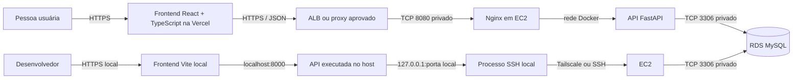

# Arquitetura e conexão com a RDS

**Status:** frontend e API já implementam autenticação, controle de acesso, catálogos e rascunhos de Entregas. O backend será hospedado em uma EC2 da AWS; detalhes da instância, endpoint HTTPS, rede e segredos ainda dependem de Infra. O catálogo `vilarejo_bi_logistica_staging` é o destino de staging confirmado, seguindo o procedimento do VilarejoBI. Para validar sem RDS, use o MySQL local isolado descrito em [rodar-localmente.md](./rodar-localmente.md).

## Componentes

O portal usa frontend e backend separados dentro do mesmo repositório. O backend é um monólito modular: uma API e um deploy, com módulos organizados por domínio. Essa estrutura deixa a interface e a API independentes sem introduzir serviços distribuídos antes de haver necessidade.



Em produção, somente a API na AWS acessa o endpoint privado da RDS. A RDS não deve ser aberta à internet nem acessada pelo navegador. O frontend Vercel conhece apenas a URL HTTPS da API.

## Desenvolvimento local isolado

O `compose.yaml` do portal sobe um MySQL separado chamado `op_logistica_dev`, a API e o frontend. O comando local de bootstrap cria o schema do modelo ORM atual, perfis de teste, catálogos fictícios e a primeira conta `DEV`. Ele recusa qualquer banco que não seja local e não configura acesso ao RDS.

Esse modo serve para validar login e rascunhos. Para integração com dados empresariais, a conexão à RDS continua dependendo de endpoint, credenciais, rota e aprovações de Infra descritas abaixo.

## Conexão ao banco compartilhado no desenvolvimento

Para desenvolvimento contra staging, a API executada diretamente no host pode gerenciar o túnel SSH local até a RDS. Com `USE_DB_TUNNEL=true`, o backend inicia o cliente OpenSSH; com `USE_TAILSCALE=true`, usa `TAILSCALE_EC2_IP` como destino SSH da EC2. A URL da aplicação é redirecionada para `127.0.0.1` na porta local encaminhada. Ao encerrar a API, o processo SSH também é encerrado.

O Tailscale precisa estar instalado e conectado no computador do desenvolvedor e na EC2. A política da tailnet e o SSH da EC2 devem permitir essa conexão; a Security Group da RDS permite MySQL a partir da EC2. A chave indicada por `SSH_KEY_PATH` fica no computador, com permissão `0600`, e seu conteúdo não é copiado para o repositório ou para a imagem.

O Compose local normal continua isolado no MySQL `op_logistica_dev` e não carrega esse `.env`. A API em staging/produção na EC2 mantém `USE_DB_TUNNEL=false` e acessa a RDS pela VPC, sem depender do Tailscale.

## Conexão em staging e produção

O backend implantado na AWS deve conectar diretamente ao endpoint privado da RDS na porta 3306. Isso requer:

1. executar a API na EC2 escolhida, dentro da VPC/sub-redes autorizadas;
2. permitir TCP 3306 no Security Group da RDS com origem no Security Group da API (ou outra regra interna aprovada);
3. fornecer credencial de runtime por mecanismo de segredos aprovado, com privilégios mínimos sobre as tabelas operacionais;
4. manter uma credencial separada para migrations, liberada somente na etapa controlada de release;
5. separar endpoints, credenciais e catálogos de staging e produção.

O backend do Portal será executado na EC2 e acessará a RDS diretamente pela rede privada; não abrirá túnel SSH por requisição. O túnel SSH via EC2/Tailscale continua sendo somente uma opção para desenvolvimento local. A configuração em [`deploy/ec2/`](../deploy/ec2/README.md) segue o deploy EC2 do VilarejoBI: Docker Compose, Nginx na porta 8080 do host e FastAPI somente na rede Docker. O desenho-base termina TLS no ALB/proxy aprovado pela Infra. DNS, certificado, encaminhamento para a EC2 e regras dos Security Groups ainda precisam ser aplicados.

## Variáveis de ambiente

O `compose.yaml` fornece configurações seguras para o MySQL local isolado. Nos ambientes compartilhados, configure as variáveis da API no serviço de execução e armazene os segredos no mecanismo aprovado pela Infra; não coloque credenciais no frontend, em `VITE_*` ou no repositório.

| Variável | Uso |
|---|---|
| `APP_ENV` | Seleciona o ambiente da API (`local`, `staging` ou `production`). |
| `API_PREFIX` | Prefixo versionado das rotas HTTP. |
| `SESSION_SECRET` | Segredo aleatório com pelo menos 32 bytes; obrigatório em staging e produção e armazenado no gerenciador de segredos. Em desenvolvimento local, se omitido, uma chave efêmera é gerada para o processo. |
| `SESSION_TTL_MINUTES` | Duração absoluta da sessão em minutos; padrão de 720 (12 horas), sem renovação automática. |
| `SESSION_COOKIE_NAME` | Nome do cookie de sessão; padrão `op_logistica_session`. |
| `SESSION_COOKIE_SECURE` | Controla o atributo `Secure`; ativado por padrão fora dos ambientes locais. `SameSite=None` exige `Secure`. |
| `SESSION_COOKIE_SAMESITE` | `lax`, `strict` ou `none`; escolher conforme os domínios finais do frontend e da API. |
| `LOGIN_RATE_LIMIT_ATTEMPTS`, `LOGIN_RATE_LIMIT_WINDOW_SECONDS` | Limite local de tentativas; o controle em memória serve a um processo. Antes de produção, mover o limite para um gateway ou serviço compartilhado. |
| `CORS_ALLOWED_ORIGINS` | Origens web autorizadas a chamar a API. Configurar Vercel Preview e domínio oficial conforme política. |
| `OP_LOGISTICA_DATABASE_URL` | Conexão de runtime com o catálogo operacional; nunca é variável do frontend. |
| `OP_LOGISTICA_MIGRATION_DATABASE_URL` | Conexão privilegiada para etapa controlada de migrations; não deve ser disponibilizada à API em produção. |
| `USE_DB_TUNNEL`, `USE_TAILSCALE`, `TAILSCALE_EC2_IP`, `EC2_HOST`, `RDS_ENDPOINT`, `SSH_KEY_PATH` | Configuração opcional do túnel SSH da API local executada no host. Na EC2, mantenha `USE_DB_TUNNEL=false` e conecte diretamente à RDS. |
| `VITE_API_BASE_URL` | URL pública da API embutida no frontend no build; não colocar segredo nesse valor. |

O catálogo operacional de staging confirmado é `vilarejo_bi_logistica_staging`, conforme o script de provisionamento seguro do Portal e o procedimento do VilarejoBI. Endpoint RDS, credenciais e regras de rede devem ser obtidos com BI/Infra; não deduzir esses valores do nome do catálogo. O catálogo e as credenciais de produção continuam separados e fora deste deploy base.

O `.env` já existente em `backend/` é local, não rastreado, modo `0600` e configurado para staging via túnel Tailscale. O modelo sem segredos está em [`backend/.env.example`](../backend/.env.example); ele usa os nomes esperados pelo código do Portal, diferentes de `ENVIRONMENT`, `DATABASE_URL` ou `LOGISTICA_DATABASE_URL` dos outros repositórios. O arquivo local não é enviado à EC2. Os exemplos de runtime da EC2 estão em [`deploy/ec2/api.env.example`](../deploy/ec2/api.env.example); na instância, os valores reais ficam em `/etc/lancamento-logistica/api.env`, com proprietário `root` e modo `0600`. O arquivo da chave SSH nunca deve entrar no repositório ou na imagem.

## Pastas e responsabilidades

```text
LancamentoLogistica/
  backend/
    app/
      api/v1/                 # Composição das rotas e dependências HTTP
      core/                   # Configuração, banco, segurança, logs e erros
      modules/
        auth/                 # Login e sessão
        access_control/       # Perfis, permissões e escopos
        catalogs/             # Setor, localidade, pessoas e motivos
        deliveries/           # Lançamentos diários de Entregas
        workflow/             # Transições legadas; correções e cancelamentos auditáveis
        feedback/             # Consulta, lançamento e exportação de elogios/reclamações
        audit/                # Trilha de ações
    migrations/               # Ambiente Alembic e revisões incrementais
  frontend/
    src/app/                  # Composição, navegação e layout
    src/shared/               # Cliente HTTP e componentes comuns
    src/features/             # Funcionalidades agrupadas por domínio
    src/styles/               # Estilos globais e tokens visuais
  docs/                       # Especificação, plano, DBML e arquitetura
```

Os mapeamentos ORM das tabelas operacionais do DBML estão registrados em
backend/app/model_registry.py. O bootstrap usa esses modelos somente para criar a base local de
teste. Bancos compartilhados continuam dependendo da cadeia Alembic responsável e de uma etapa
controlada de migration.

## Publicação do frontend

Na configuração do projeto Vercel, usar `frontend/` como **Root Directory**, `npm run build` como comando de build e `dist` como diretório de saída. Definir `VITE_API_BASE_URL` por ambiente. Como esse valor é enviado ao navegador, ele deve conter somente a URL pública HTTPS da API.

Para coletar feedback visual antes de publicar API ou banco, pode-se usar uma Preview isolada: em uma branch não produtiva, configurar `VITE_DEMO_MODE=true` apenas no ambiente **Preview**. Esse modo força os adaptadores de demonstração, ignora a URL de API configurada e mantém alterações no armazenamento local de cada navegador; não chama API nem acessa banco. Deixar `VITE_DEMO_MODE=false` em **Production** e não promover essa Preview. Compartilhar somente a URL da branch Preview; deploys Preview são públicos por padrão, salvo se a proteção de deploy estiver ativada.

Configurar CORS no backend para as origens oficiais e de preview que forem aceitas. A API precisa de endpoint HTTPS público protegido por autenticação e controles de rede; a conexão da API à RDS permanece privada dentro da AWS.

## O que continua pendente

- **Integração funcional:** os clientes do frontend já chamam as rotas correspondentes da API, e o `compose.yaml` define frontend, API e MySQL local. Falta executar e registrar a validação integrada antes de usar staging.
- **Vercel:** criar/vincular o projeto com `frontend/` como Root Directory e configurar `VITE_API_BASE_URL` para a API HTTPS em cada ambiente. Essa variável é pública no bundle; não pode conter credenciais.
- **AWS:** aplicar a configuração em `deploy/ec2/` à EC2 aprovada. O workflow manual para publicar no GHCR e atualizar a EC2 está preparado; ainda faltam região/instância, domínios DNS, confirmação do ALB/proxy e target group, Security Groups, secrets do ambiente `staging` no GitHub, acesso SSH aprovado e URL/credencial operacional da RDS.
- **Sessão web:** escolher domínios frontend/API no mesmo domínio registrável, configurar `CORS_ALLOWED_ORIGINS`, `SESSION_SECRET`, `SESSION_COOKIE_SECURE=true` e `SESSION_COOKIE_SAMESITE=lax`; depois validar login/logout publicado. Previews `vercel.app` com API em domínio separado são cross-site e podem depender de cookies de terceiros.
- **Banco e migrations:** comparar os modelos atuais com o schema de staging e coordenar qualquer revisão necessária na cadeia Alembic `logistica`, mantida no repositório VilarejoBI. Este repositório contém instruções, mas não as revisões Alembic aplicadas.
- **Dados e regras:** carregar catálogos oficiais e concluir a retenção de nome/relato antes de um piloto com feedback real. As regras de ranking misto e acesso aos perfis já foram definidas. Meta/faixas do OTIF ficam para depois do primeiro piloto; a fórmula é não realizadas ÷ total registrado, no geral e por motorista/equipe/loja.
- **Operação:** executar a suíte e o build, validar os fluxos com perfis diferentes, definir logs/monitoramento, backups e teste de restauração, além do procedimento de release/rollback.
