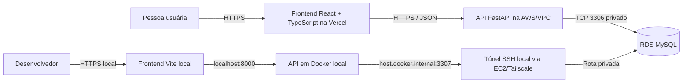

# Arquitetura e conexão com a RDS

**Status:** arquitetura inicial do scaffold. A localização exata do backend na AWS e os catálogos de staging/produção ainda dependem de confirmação de Infra.

## Componentes

O portal usa frontend e backend separados dentro do mesmo repositório. O backend é um monólito modular: uma API e um deploy, com módulos organizados por domínio. Essa estrutura deixa a interface e a API independentes sem introduzir serviços distribuídos antes de haver necessidade.



Em produção, somente a API na AWS acessa o endpoint privado da RDS. A RDS não deve ser aberta à internet nem acessada pelo navegador. O frontend Vercel conhece apenas a URL HTTPS da API.

## Conexão no desenvolvimento

Para desenvolvimento local, pode-se repetir o padrão operacional usado pelo VilarejoBI: abrir um túnel SSH do computador de desenvolvimento, via EC2/Tailscale autorizada, para o endpoint RDS. O container da API alcança a porta local encaminhada pelo endereço `host.docker.internal`.

Depois de receber endpoint, usuário SSH, chave e porta aprovados, o comando tem este formato:

```bash
ssh -i "$SSH_KEY_PATH" -N \
  -L "${RDS_LOCAL_PORT}:${RDS_ENDPOINT}:3306" \
  "$EC2_SSH_TARGET"
```

Deixe o túnel em execução em um terminal. Na configuração local, `OP_LOGISTICA_DATABASE_URL` aponta para `host.docker.internal:3307`. A aplicação não abre nem administra o túnel. A chave privada fica na máquina do desenvolvedor e não é copiada para a imagem ou montada no container.

Se a API for executada diretamente no host, a URL usará `127.0.0.1:3307`; se estiver em Docker Compose, usará `host.docker.internal:3307`. O acesso depende de rota SSH/Tailscale, autorização de chave e regras de rede já aprovadas para o ambiente.

## Conexão em staging e produção

O backend implantado na AWS deve conectar diretamente ao endpoint privado da RDS na porta 3306. Isso requer:

1. executar a API em EC2 ou em serviço de containers na VPC/sub-redes autorizadas;
2. permitir TCP 3306 no Security Group da RDS com origem no Security Group da API (ou outra regra interna aprovada);
3. fornecer credencial de runtime por mecanismo de segredos aprovado, com privilégios mínimos sobre as tabelas operacionais;
4. manter uma credencial separada para migrations, liberada somente na etapa controlada de release;
5. separar endpoints, credenciais e catálogos de staging e produção.

O uso da EC2 como salto SSH é uma opção para o acesso local de desenvolvimento. O processo do backend em produção não deve abrir túnel SSH para cada operação; estando corretamente posicionado na VPC, ele usa a rota privada de rede até a RDS. Infra ainda precisa confirmar se o alvo será EC2, ECS/Fargate ou outro serviço e liberar os respectivos Security Groups.

## Variáveis de ambiente

O arquivo raiz `.env.example` documenta as variáveis locais. Copie-o para `.env` e substitua os placeholders com dados fornecidos pela equipe. O `.env` está ignorado pelo Git.

| Variável | Uso |
|---|---|
| `APP_ENV` | Seleciona o ambiente da API (`local`, `staging` ou `production`). |
| `API_PREFIX` | Prefixo versionado das rotas HTTP. |
| `SESSION_SECRET` | Segredo de sessão do backend; gere um valor local aleatório e use Secrets Manager em produção. |
| `CORS_ALLOWED_ORIGINS` | Origens web autorizadas a chamar a API. Configurar Vercel Preview e domínio oficial conforme política. |
| `OP_LOGISTICA_DATABASE_URL` | Conexão de runtime com o catálogo operacional; nunca é variável do frontend. |
| `OP_LOGISTICA_MIGRATION_DATABASE_URL` | Conexão privilegiada para etapa controlada de migrations; não deve ser disponibilizada à API em produção. |
| `RDS_ENDPOINT`, `EC2_SSH_TARGET`, `SSH_KEY_PATH`, `RDS_LOCAL_PORT` | Dados locais necessários para o comando de túnel, sem chave privada dentro do repositório. |
| `VITE_API_BASE_URL` | URL pública da API embutida no frontend no build; não colocar segredo nesse valor. |

O nome real do catálogo operacional ainda precisa ser confirmado. O placeholder `NOME_BANCO_OPERACIONAL_STAGING` no `.env.example` não é um nome de banco criado ou aprovado.

## Pastas e responsabilidades

```text
LancamentoLogistica/
  backend/
    app/
      api/v1/                 # Composição das rotas e dependências HTTP
      core/                   # Configuração, banco, segurança, logs e erros
      modules/
        auth/                 # Login e sessão
        access_control/       # Perfis, permissões e escopos
        catalogs/             # Setor, localidade, pessoas e motivos
        deliveries/           # Lançamentos diários de Entregas
        workflow/             # Envio, devolução, aprovação e correção
        feedback/             # Reclamações/elogios, após aprovar política de dados
        publication/          # Publicação analítica, após definir contrato com BI/ETL
        audit/                # Trilha de ações
    migrations/               # Ambiente Alembic e revisões incrementais
  frontend/
    src/app/                  # Composição, navegação e layout
    src/shared/               # Cliente HTTP e componentes comuns
    src/features/             # Funcionalidades agrupadas por domínio
    src/styles/               # Estilos globais e tokens visuais
  docs/                       # Especificação, plano, DBML e arquitetura
```

O scaffold de API e frontend continua sem fluxos funcionais. Os mapeamentos ORM das tabelas
operacionais do DBML já foram implementados no backend e estão registrados em
backend/app/model_registry.py. Eles não criam as tabelas: a migration física ainda depende da
escolha do catálogo e da cadeia Alembic responsável.

## Publicação do frontend

Na configuração do projeto Vercel, usar `frontend/` como **Root Directory**, `npm run build` como comando de build e `dist` como diretório de saída. Definir `VITE_API_BASE_URL` por ambiente. Como esse valor é enviado ao navegador, ele deve conter somente a URL pública HTTPS da API.

Configurar CORS no backend para as origens oficiais e de preview que forem aceitas. A API precisa de endpoint HTTPS público protegido por autenticação e controles de rede; a conexão da API à RDS permanece privada dentro da AWS.

## O que continua pendente

- serviço AWS escolhido para executar o backend e endpoint HTTPS público da API;
- confirmação de catálogos de operação e de staging/produção;
- Security Groups, Secrets Manager, DNS/TLS, observabilidade e estratégia de release;
- decisão sobre origem de localidades/pessoas e contrato de publicação analítica;
- implementação funcional do app FastAPI e do frontend;
- revisão final dos modelos ORM contra o DBML e implementação do ambiente Alembic conforme o
  catálogo escolhido.
