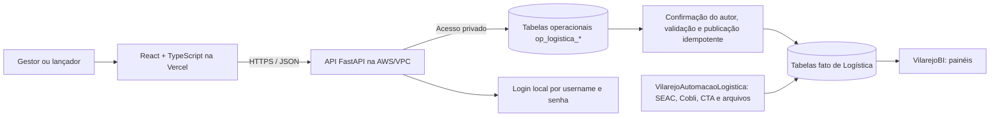

# Portal de lançamento de dados de Logística

**Atualizado em:** 15/10/2026  
**Status:** especificação inicial para validação com o gestor; ainda não é autorização para aplicar migrations ou publicar em produção.  
**Protótipo de referência:** [Painel de Entregas Vilarejo — Adapta](https://skip-artifacts-snapshots.application.production.adapta.tools/user_3I06ziDncMpG4iCubDFbOkPrTAz/fn575irlp4ibn56ddn5vixzsmq/revisions/a6b1778b-3b65-424d-8a21-2c4c2a51f134/index.html)

## 1. Resumo da mudança de escopo

O gestor pediu que o lançamento de dados de Logística seja feito em um site próprio, separado da interface do VilarejoBI. A primeira experiência deve se basear no protótipo que ele construiu na ADAPTA. Depois, o site deve ganhar uma área por setor e por conjunto de dados/formulários logísticos. Os lançamentos precisam ficar persistidos em banco de dados, com controle de acesso por pessoa, função, setor e localidade. A publicação do site deve usar a Vercel.

O site e o BI serão aplicações diferentes. O portal terá contas locais próprias, sem copiar credenciais do BI. Eles podem compartilhar o banco após as decisões de arquitetura, mas os dados que uma pessoa está preenchendo precisam ficar em tabelas operacionais próprias. Não gravar rascunhos ou linhas de formulário diretamente nas tabelas fato mensais do BI.

O protótipo analisado chama-se **Painel de Entregas Vilarejo** e contém lançamento diário de entregas, reclamações/elogios, cadastros, painel gerencial e ranking de pessoas. A especificação abaixo registra o que existe na página e propõe como reconstruir isso como aplicação com backend, autorização e persistência reais.

## 2. O que existe na página da ADAPTA

### 2.1 Navegação e funções visíveis

O protótipo apresenta estas abas:

1. **Lançamento de Entregas:** registro diário por loja/filial e equipe.
2. **Reclamações e Elogios:** registro do relato do cliente e das pessoas envolvidas.
3. **Cadastros:** lojas/filiais, motoristas/entregadores e motivos de não realização.
4. **Painel Gerencial (OTIF):** indicadores e filtros por período, loja, motivo, pessoa e equipe.
5. **Ranking de Pessoas:** comparação de motoristas e ajudantes por entrega e feedback.

Também existem impressão/PDF, importação/exportação de CSV, dados de demonstração e uma configuração manual de Firebase Realtime Database.

### 2.2 Campos do lançamento diário de entregas

O formulário atual solicita:

- data da entrega;
- loja/filial;
- motorista obrigatório;
- até dois ajudantes opcionais;
- quantidade de entregas realizadas;
- quantidade de entregas não realizadas;
- um ou mais motivos com quantidade para as entregas não realizadas;
- observações.

O protótipo valida que a soma de realizadas e não realizadas seja maior que zero. Se houver entregas não realizadas, exige um motivo por linha e valida que a soma das quantidades dos motivos seja igual ao total não realizado. Esses controles devem ser repetidos no backend, não somente no navegador.

O grão aparente é um resumo diário de loja/filial e equipe, com quantidades agregadas; não é um registro de cada pedido/entrega. A chave de negócio desse lançamento ainda precisa de confirmação. Não adotar automaticamente `data + loja + motorista` como chave única: pode haver mais de uma equipe/rota no mesmo dia e na mesma loja.

### 2.3 Campos de reclamação/elogio

O formulário solicita:

- data;
- tipo: reclamação ou elogio;
- nome do cliente;
- loja;
- motorista obrigatório;
- até dois ajudantes opcionais;
- descrição do ocorrido.

O protótipo atribui `+1` por elogio e `-1` por reclamação a cada pessoa informada. Nome do cliente e descrição podem conter dados pessoais; sua coleta, visibilidade, exportação e prazo de retenção precisam ser definidos antes do piloto.

### 2.4 Cadastros e filtros

Os cadastros editáveis da tela são lojas/filiais, entregadores e motivos de não entrega. O protótipo já traz como exemplos Macaé, Cabo Frio, Campos e motivos como cliente ausente, endereço incorreto, avaria e veículo quebrado. Esses valores são dados demonstrativos do site; confirmar códigos e nomes oficiais antes de carregá-los no banco.

O painel permite filtrar por mês ou período, loja, motivo, pessoa e equipe. A equipe aparece como a combinação exata de motorista e ajudantes do lançamento; ainda não há confirmação de que exista um cadastro empresarial de equipes fixas.

### 2.5 Indicadores exibidos e decisões de negócio necessárias

O código do protótipo calcula a taxa rotulada **OTIF** como:

```text
entregas realizadas / (entregas realizadas + entregas não realizadas)
```

O painel também apresenta meta de 95%, faixas abaixo de 90% e entre 90% e 95%, totais por loja/equipe/pessoa e um ranking que ordena primeiro pela taxa, depois pelo score de atendimento e depois pelo volume realizado.

Os campos do formulário não informam horário prometido, prazo combinado ou atendimento completo do pedido. Portanto, a fórmula implementada na página mede a proporção de entregas realizadas dentro do total registrado; sozinha, ela não demonstra pontualidade e não permite validar OTIF. Antes de publicar o indicador, o gestor deve confirmar a definição e a meta ou autorizar a troca do rótulo para algo como **taxa de entregas realizadas**.

O ranking individual também precisa de aceite explícito. O formulário registra contagens por equipe, não por pedido e pessoa. Atribuir a mesma quantidade realizada/não realizada a cada integrante pode duplicar volumes ou produzir uma avaliação individual que os dados não sustentam. Definir se o ranking é por equipe, se há uma regra de atribuição por integrante ou se a tela deve mostrar apenas resultados agregados.

### 2.6 Limite técnico do protótipo

O HTML consultado salva dados no `localStorage` do navegador e oferece uma configuração opcional de Firebase Realtime Database. Há exemplos de dados carregados quando a base está vazia. Isso é útil como referência de interface e fluxo, mas não constitui a persistência central, o login ou a autorização exigidos para uso corporativo multiusuário. A aplicação nova deve remover o acesso/configuração de Firebase feita pelo usuário, o modo de demonstração em produção e qualquer dependência de dados apenas locais.

## 3. Decisões propostas para o produto

### 3.1 Primeira entrega do portal

Proposta para a versão 1:

- reproduzir a identidade visual e a navegação geral do protótipo;
- implementar o módulo **Entregas**, começando pelo formulário de lançamento diário;
- oferecer histórico e edição somente enquanto o lançamento estiver em rascunho;
- incluir motivos de não realização e validações;
- incluir feedbacks, cadastros, painel e ranking apenas após validar os campos, permissões e regras dessas telas;
- deixar pronta a navegação modular para adicionar **Gestão de Frota** e **Operações no CD**.

O gestor deve confirmar se “a primeira página” significa toda a experiência do protótipo (cinco abas) ou se a primeira entrega deve conter apenas o lançamento de entregas e seu histórico. Isso afeta o tamanho e o modelo da primeira migration.

### 3.2 Módulos posteriores

O plano é acrescentar uma área de trabalho por setor, com formulários tipados e campos definidos a partir das planilhas e das regras já levantadas:

- **Gestão de Frota:** registros mensais por veículo e demais campos manuais que não venham de Cobli/CTA/SEAC.
- **Operações no CD:** formulários/lançamentos definidos a partir dos dados de estoque, entregas, custos, ocorrências, devoluções e backlog.
- **Outros setores logísticos:** somente quando gestor, origem, campos e regras forem mapeados.

Não criar um formulário genérico de qualquer coluna nem uma tabela EAV de `campo/valor`. Cada formulário deve ter tabelas relacionais tipadas. Isso preserva tipos, validações, filtros, histórico e consultas.

## 4. Arquitetura recomendada

### 4.1 Componentes



O navegador nunca acessa MySQL diretamente. O frontend React valida e envia dados pela API HTTPS; o backend valida sessão, autorização e regras de negócio em cada leitura e escrita, grava as tabelas operacionais e controla a publicação. A pessoa que preenche confere e confirma o próprio lançamento; a confirmação o registra imediatamente. A página de lançamento é independente do BI, ainda que ambos consumam dados analíticos publicados.

### 4.2 Aplicação Python

**Proposta adotada:** organizar o `LancamentoLogistica` como monorepo com `frontend/` e `backend/`. O frontend será React + TypeScript + Vite e cuidará das páginas, formulários, navegação e acessibilidade. O backend será uma API FastAPI em monólito modular, responsável por autenticação, autorização, validação, regras de negócio, persistência e acesso aos repositórios/banco. O contrato entre eles será HTTPS/JSON.

Manter a API do portal separada da API de painéis do VilarejoBI. O frontend é publicado como site estático na Vercel; a API roda na AWS/VPC junto da RDS. Operações de leitura e gravação passam por rotas FastAPI, que autenticam, autorizam e validam cada ação no servidor. A estrutura permanece monolítica no backend, com módulos separados por domínio, e não exige serviços independentes para cada módulo.

O login do portal será próprio, por username e senha. A conta, o hash Argon2id e o estado da credencial ficam em op_logistica_usuario; os três campos de senha ficam todos nulos até a credencial ser provisionada. Não reutilizar nem copiar credenciais do BI. Username é normalizado e único. CPF não será coletado no MVP; se uma necessidade for aprovada futuramente, sua coleta deverá ser feita em tabela própria e com leitura restrita. Os perfis, permissões e escopos continuam nas tabelas existentes: op_logistica_usuario_escopo associa uma conta a um perfil e escopo, e op_logistica_perfil_permissao define as ações daquele perfil.

### 4.3 Vercel e acesso ao RDS

Na Vercel será implantado somente o frontend. A API FastAPI deve executar na AWS/VPC e conectar diretamente ao endpoint privado da RDS pela porta 3306, com regra de Security Group autorizando a origem da API. O navegador chama a API por HTTPS; não há conexão do frontend nem do usuário final ao MySQL.

No desenvolvimento local, é possível usar o túnel SSH via EC2/Tailscale adotado no fluxo do VilarejoBI. O túnel fica no computador do desenvolvedor, e o container local alcança a porta encaminhada pelo host. Essa rota é para desenvolvimento; a API em produção usa rede privada da AWS e não abre túnel SSH para cada acesso. A [arquitetura e guia de conexão](./arquitetura_implantacao.md) registra o desenho e as configurações.

O deploy da API poderá usar EC2 ou serviço de containers, conforme a infraestrutura já disponível e a decisão de Infra. Não configurar VPC peering entre Vercel e AWS para esse desenho: a interface é pública e só precisa alcançar um endpoint HTTPS da API.

## 5. Banco de dados: o que adicionar

### 5.1 Separar lançamento operacional de fato analítica

O banco analítico atual possui 15 dimensões/fatos mensais. Ele não guarda rascunhos, versões, participantes, motivo por linha ou histórico operacional. Além disso, `fato_entregas_mensais` é mensal por localidade e tipo de transporte; não possui data diária, equipe/pessoa nem contagem separada de não realizadas. `fato_retornos_ocorrencias` também é mensal e não é o lugar para guardar nome do cliente e descrição do feedback.

Por isso, o site grava primeiro em tabelas operacionais e não diretamente nas tabelas fato mensais. Uma rotina controlada transforma somente revisões confirmadas em medidas analíticas, depois de definir como elas se reconciliam com SEAC, Cobli, CTA e com o ETL das planilhas. Não escrever formulário diretamente em `fato_entregas_mensais` ou `fato_retornos_ocorrencias`.

### Convenção de nomes por camada

Padronizar todos os nomes físicos em `snake_case` e usar prefixos que identifiquem a função dos dados:

| Prefixo | Camada | Exemplo |
|---|---|---|
| `stg_<fonte>_<entidade>` | Respostas originais/temporárias recebidas de uma fonte ou ETL. | `stg_cobli_veiculo` |
| `dim_<entidade>` | Dimensão descritiva compartilhada pelo modelo analítico. | `dim_localidade`, já existente. |
| `fato_<processo>_<grao>` | Medidas publicadas para análise, com granularidade definida. | `fato_entregas_mensais`, já existente. |
| `bridge_<relacao>` | Relação analítica multivalorada sem duplicar medidas da fato. | `bridge_entrega_pessoa`. |
| `etl_<dominio>_<entidade>` | Controle técnico de execução e linhagem de cargas. | `etl_logistica_execucao`. |
| `op_logistica_<entidade>` | Dados operacionais gravados pelo site, incluindo rascunhos, confirmações e cadastros. | `op_logistica_entrega_diaria`. |

Assim, `op_logistica_` identifica a camada de operação; não o nome do site. A camada operacional mantém o preenchimento, a confirmação e o histórico de versões. Dimensões/fatos representam dados conformados para análise; pontes representam relações multivaloradas. O [DBML analítico](../../docs/modelos/VilarejoBI/Banco_Logistica_Revisado.dbml) preserva as 15 tabelas da baseline e acrescenta as dimensões/fatos propostos para os novos indicadores. O [DBML operacional do portal](./modelo_operacional_lancamento_logistica.dbml) detalha formulários, versões, autorização e auditoria. As extensões propostas ainda exigem revisão de negócio e migrations próprias; a migration inicial do BI continua limitada às 15 tabelas.

### 5.2 Decisão sobre catálogo/banco

**Proposta inicial:** manter a mesma instância RDS e decidir com Infra se o portal terá catálogo lógico separado. O modelo operacional evita FKs físicas para o banco analítico; localidades, pessoas, motivos e tipos são integrados por códigos estáveis e pela carga. Usar uma sequência de migration coordenada para cada catálogo, sem reescrever a baseline analítica de 15 tabelas.

**Alternativa com mais isolamento:** criar catálogos operacionais na mesma instância RDS (por exemplo, `vilarejo_logistica_operacional_staging` e `vilarejo_logistica_operacional`). Isso separa permissões, retenção e dados de feedback, mas exige sincronizar localidades e publicar informações entre catálogos; em MySQL, planejar essa integração explicitamente em vez de presumir FKs entre eles.

A decisão deve considerar que o protótipo guarda nome de cliente e relatos sobre empregados. Se as credenciais do BI têm leitura ampla do catálogo, a primeira alternativa só é aceitável com grants restritos por tabela/serviço. As tabelas `op_logistica_*` não devem ficar legíveis automaticamente para consumidores de BI.

### 5.3 Tabelas operacionais propostas para a primeira versão

Os nomes e relacionamentos completos estão no [DBML operacional do portal](./modelo_operacional_lancamento_logistica.dbml). A tabela resume o propósito das entidades; revisar campos sensíveis, retenção e fluxos com o gestor antes de gerar migrations.

| Tabela | Grão e finalidade | Campos principais sugeridos |
|---|---|---|
| `op_logistica_setor` | Um cadastro por setor que lança dados. | `id_setor`, `codigo` (`ENTREGAS`, `FROTA`, `OPERACOES_CD`), `nome`, `ativo`, timestamps. |
| `op_logistica_localidade` | Cópia controlada das localidades permitidas no portal. | `codigo_localidade` canônico, nome, tipo, ativo e horário da sincronização. |
| `op_logistica_perfil` | Um registro por perfil funcional da aplicação. | `id_perfil`, `codigo`, `nome`, `ativo`. Exemplos: `ADMIN_PORTAL`, `DONO_VILAREJO`, `DIRETOR_LOGISTICA`, `GESTOR_SETOR`, `LANCADOR`, `LEITOR`. |
| `op_logistica_recurso` | Catálogo das áreas/páginas funcionais do portal, como Entregas, Frota e Painel Gerencial. | Cada recurso pode pertencer a um setor. Recursos transversais não concedem acesso global aos dados; a consulta continua limitada pelos escopos do usuário. |
| `op_logistica_permissao` e `op_logistica_perfil_permissao` | Ações por recurso e associação dessas ações aos perfis. | Exemplos: `ENTREGAS_DIARIAS:ACESSAR`, `ENTREGAS_DIARIAS:VER`, `ENTREGAS_DIARIAS:CRIAR`, `FEEDBACK_CLIENTES:VER`, `PAINEL_GERENCIAL:EXPORTAR`. A navegação exige `ACESSAR`; cada operação da API exige a ação específica e um escopo compatível. |
| `op_logistica_usuario` | Uma conta local e sua credencial opcional. | Username normalizado, nome, estado, hash Argon2id e campos de alteração/troca de senha; os campos de credencial ficam todos nulos antes da definição da senha. |
| `op_logistica_escopo` e `op_logistica_usuario_escopo` | Cadastro do alvo de acesso e concessões de perfil por período. | Escopo explícito `GLOBAL`, setor, localidade ou combinação; uma pessoa pode ter várias concessões. |
| `op_logistica_formulario_versao` | Uma versão publicada de um formulário vinculada a um setor. | `id_setor`, `codigo_formulario`, `versao`, data de vigência, estado, referência ao contrato e autor da alteração. A API confere se o setor da versão corresponde ao setor do lançamento. O detalhe permanece em tabelas tipadas; não guardar toda a linha em JSON genérico. |
| `op_logistica_lancamento` | Cabeçalho estável de um processo de lançamento. | UUID público estável, setor, autor e chave de idempotência. |
| `op_logistica_lancamento_revisao` | Uma versão editável ou confirmada do cabeçalho e respectivos detalhes. | Formulário/versão, número, UUID estável para linhagem analítica, estado e autor/horário de confirmação. Campos de aprovação/devolução permanecem apenas para dados legados; novas confirmações não aguardam outro usuário. |
| `op_logistica_lancamento_evento` | Uma transição ou ação auditável de uma revisão. | Estado anterior/novo, ator, horário UTC, comentário e nomes dos campos alterados sem copiar valores sensíveis. Append-only. |
| `op_logistica_pessoa` | Cadastro canônico versionado de motoristas/ajudantes que aparecem no formulário. | `id_pessoa` identifica uma versão; `codigo_pessoa` permanece estável entre versões. Nome/função e vigência ficam na versão apontada pelo participante. Usar código estável se disponível; não depender apenas de comparar nomes digitados. |
| `op_logistica_motivo_nao_entrega` | Catálogo controlado e versionado de motivos. | `id_motivo` identifica a versão; `codigo_motivo` permanece estável entre versões. Desativar/encerrar motivos usados historicamente em vez de apagá-los ou reutilizar seu código com outro significado. |
| `op_logistica_tipo_feedback` | Categorias controladas de feedback. | Código e descrição; começar com categorias confirmadas pelo gestor. |
| `op_logistica_entrega_diaria` | Uma linha de resumo diário por localidade/equipe em uma revisão. | Data, código estável da linha, localidade, quantidades e observação. Não fixar unicidade por data/localidade. |
| `op_logistica_entrega_participante` | Uma pessoa e um papel por registro de entrega. | `id_entrega`, `id_pessoa`, papel (`MOTORISTA`/`AJUDANTE`), ordem; restringir um motorista e a quantidade de ajudantes aprovada. |
| `op_logistica_entrega_motivo` | Quantidade não realizada por motivo em um registro. | `id_entrega`, `id_motivo`, `quantidade`; chave única por entrega e motivo, se o formulário só permitir uma linha consolidada por motivo. |
| `op_logistica_feedback` | Um elogio/reclamação em uma revisão, opcionalmente ligado a uma entrega. | Código estável da linha, data, tipo, localidade, cliente/texto quando aprovados e retenção definida. |
| `op_logistica_feedback_participante` | Uma pessoa associada a um feedback. | `id_feedback`, `id_pessoa`, papel; evitar campos duplicados `motorista`, `ajudante1`, `ajudante2` na tabela de feedback. |
| `op_logistica_publicacao` | Uma execução idempotente que envia dados confirmados à camada analítica. | UUID correlacionável com `etl_logistica_execucao`, alvo, estado, contagens, horários e erro resumido. |
| `op_logistica_publicacao_lancamento` | Linhagem das revisões consideradas por uma execução. | Publicação, revisão, hash e resultado. |

### Regras de integridade que devem virar constraints e validações

- Chaves primárias numéricas ou UUIDs geradas no servidor; username normalizado é único, e a credencial de senha tem relação um-para-um com a conta. A autorização não depende de username, nome ou CPF enviados pelo navegador.
- FKs obrigatórias entre conta/credencial, conta/identificação opcional, recurso/setor, permissão/recurso, perfil/permissão, concessões/conta/perfil/escopo, cabeçalho/revisão/evento, revisão/formulário, entrega/revisão/localidade, participante/pessoa, motivo/catálogo e feedback/revisão/tipo. Os dois modelos DBML ficam sem FKs cruzadas entre o banco operacional e o analítico.
- Unicidade de username normalizado, CPF quando informado, código de setor/localidade/recurso/motivo/tipo, `(id_recurso, acao)`, `(id_lancamento, numero_revisao)` e chaves de idempotência.
- Quantidades de entregas e motivos não podem ser negativas; motivo informado precisa ter quantidade positiva. Aplicar `CHECK` nas colunas suportadas pelo MySQL e repetir as regras no serviço da API.
- A soma das quantidades de motivos precisa ser igual à quantidade não realizada. Como depende de várias linhas, validar todas as linhas dentro da transação da API antes de enviar o formulário; repetir a validação na publicação.
- Uma entrega tem no máximo um motorista, até dois ajudantes e não pode repetir a mesma pessoa como participante, salvo regra de negócio aprovada. Validar no serviço e, quando possível, reforçar com chaves/índices.
- Para cada tabela de histórico, definir índices começando pelos filtros mais comuns: status/data, setor/localidade/data, autor/data e lançamento/revisão. Confirmar o plano de consultas antes de criar índices redundantes.
- Usar `ativo` e vigência para retirar cadastros de uso corrente sem apagar dados históricos. Exclusão física fica restrita a correção administrativa auditada e aprovada.

Essas regras protegem a base contra requests inválidos mesmo quando o formulário é chamado fora da interface. Regras entre várias tabelas (por exemplo, a soma dos motivos) devem validar e gravar em uma única transação.

### 5.4 Cadastros reutilizáveis e tabelas opcionais

- **Localidades:** o portal usa `op_logistica_localidade` como referência sincronizada e somente leitura. A sincronização lê `dim_localidade` com uma credencial de leitura, preserva a chave canônica e desativa no portal itens ausentes/inativos na origem. O ETL resolve `codigo_localidade` para `dim_localidade` ou para `dim_localidade_codigo_origem` por correspondência exata; não há FK entre catálogos.
- **Competência:** usar `dim_competencia` quando a linha for mensal; para os lançamentos do protótipo, armazenar a data do evento e derivar a competência a partir dela no servidor.
- **Equipe fixa:** o protótipo monta equipe a partir das pessoas no lançamento. Só criar `op_logistica_equipe` e `op_logistica_equipe_membro` se o negócio confirmar grupos permanentes e precisar administrá-los.
- **Anexos:** não são requeridos pelo protótipo. Adicionar tabela/armazenamento separado só se gestores aprovarem evidências anexadas.
- **Auditoria de catálogos:** os campos `criado_por`, `criado_em` e `atualizado_em` são preenchidos pelo servidor e registram a manutenção dos catálogos. A interface não deve aceitar essas datas como entrada. Se houver edição administrativa com impacto histórico, adicionar eventos específicos antes de habilitar a alteração pela interface.

## 6. Integração com o modelo analítico e com a automação

### 6.1 Fluxo dos dados do portal

1. A pessoa salva um lançamento como rascunho.
2. A pessoa confere os dados e confirma o lançamento; a API valida sessão, setor, localidade, datas, pessoas, campos obrigatórios e regras aritméticas.
3. A confirmação registra o lançamento imediatamente, torna a versão imutável e cria um evento de auditoria. Não há aprovação obrigatória por outra pessoa.
4. Uma correção posterior deve criar nova versão vinculada à anterior e preservar o histórico.
5. Uma rotina de publicação lê revisões confirmadas e publica fatos idempotentemente por lançamento, UUID da revisão e UUID de cada item. A versão anterior permanece rastreável.
6. A publicação registra um UUID de execução correlacionável com `etl_logistica_execucao`, revisões consideradas, contagens e resultado.
7. Os painéis consomem dados publicados nas tabelas fato; o portal pode mostrar seus lançamentos/indicadores autorizados pelas tabelas operacionais.

Para novos registros, `RASCUNHO` é editável e `ENVIADA` representa confirmação final. `CANCELADA` depende de política e justificativa. `EM_REVISAO`, `DEVOLVIDA` e `APROVADA` são estados legados mantidos para compatibilidade histórica; não fazem parte do fluxo novo nem devem ser atribuídos a novos lançamentos.

### 6.2 Fatos analíticos propostos para os lançamentos

O DBML do VilarejoBI mantém as 15 tabelas analíticas de baseline e adiciona uma extensão proposta para esse portal:

- `dim_data` permite analisar registros por dia e navegar para competência.
- `dim_pessoa_logistica` preserva versões históricas de função usando chave pseudonimizada; `dim_pessoa_logistica_identidade` guarda o nome em tabela separada com leitura restrita. Pontes e indicadores individuais continuam sujeitos a autorização.
- `dim_localidade_codigo_origem` associa códigos exatos de cada sistema à localidade canônica em períodos de vigência. A carga valida sobreposições temporalmente, sem usar nome/cidade como chave.
- `dim_motivo_nao_entrega` e `dim_tipo_feedback` normalizam categorias usadas nos formulários.
- `fato_entregas_diarias` tem grão de uma linha de resumo diária/localidade/equipe por revisão publicada. A chave de idempotência é formada por sistema, UUID do lançamento, UUID da revisão e UUID estável do item. Reprocessar a mesma revisão não duplica linhas; uma nova revisão preserva a versão anterior e atualiza `eh_revisao_atual` na mesma transação de publicação.
- `fato_entregas_nao_realizadas_motivo` tem grão de uma linha de resumo por motivo e revisão, e guarda a quantidade não realizada daquele motivo. O ETL valida que a soma por linha coincide com o resumo diário.
- `fato_feedback` tem grão de um evento por revisão e guarda somente contagem, tipo, data e localidade. Nome de cliente, identificador e texto permanecem no banco operacional.
- `bridge_entrega_pessoa` e `bridge_feedback_pessoa` representam participantes sem atribuir a cada pessoa as medidas totais da equipe/evento. Ranking por entregas individuais exige uma regra de rateio aprovada.
- `etl_logistica_execucao` registra a execução técnica e as contagens da carga; seu UUID é o mesmo `codigo_execucao` da publicação operacional. Os catálogos podem ficar em databases separados, portanto essa correlação não depende de FK entre eles.

Os fatos novos mantêm versões analíticas de correções confirmadas em vez de apagar a versão anterior. Consultas de indicadores vigentes filtram `eh_revisao_atual = true`; a rotina de publicação garante que somente a última versão confirmada de cada lançamento permaneça marcada nas três fatos. Esse marcador deve ser atualizado transacionalmente para evitar uma janela com duas versões somadas ou nenhuma versão visível. O UUID `codigo_revisao` da camada operacional é gravado como `codigo_revisao_origem` no analítico.

Esses fatos não substituem automaticamente `fato_entregas_mensais`, cujo grão e medidas são diferentes. Também não modelam OTIF: o formulário atual não registra pedido, data prometida e data efetiva por pedido. Só criar esse indicador quando os campos e sua definição forem aprovados.

### 6.3 Evitar conflito com `VilarejoAutomacaoLogistica`

O portal e o projeto de automação podem avançar em paralelo, mas podem produzir dados sobre o mesmo indicador. O portal recebe lançamentos humanos; a automação lê SEAC, Cobli, CTA e arquivos. Antes de ambos escreverem na mesma fato, definir por indicador:

- qual origem é oficial;
- se o portal complementa, corrige ou apenas valida a origem automática;
- como identificar duplicatas e substituições;
- quem aprova divergências;
- qual processo é dono da publicação final.

No exemplo atual, o formulário da ADAPTA registra totais diários por equipe, enquanto `fato_entregas_mensais` recebe agregados mensais por localidade e tipo de transporte e pode receber dados do SEAC. Essas granularidades e semânticas não devem ser somadas automaticamente. Feedbacks também não devem ser convertidos em devoluções do SEAC sem uma regra aprovada.

Manter os projetos separados em código:

| Projeto | Responsabilidade |
|---|---|
| `LancamentoLogistica` (novo) | Interface de lançamento, login/permissões do portal, tabelas operacionais, confirmação e publicação dos dados manuais autorizados. |
| `VilarejoAutomacaoLogistica` | Extração, normalização, validação e consolidação mensal das fontes externas/planilhas. |
| `VilarejoBI` | Modelo analítico, migrations atuais, API/painéis de BI e consumo dos dados publicados nas tabelas fato. |

Os modelos ORM operacionais pertencem ao backend do portal, que é o serviço dono dos lançamentos, credenciais e regras. Se as tabelas forem criadas no mesmo catálogo MySQL do BI, a migration deve ser coordenada na cadeia Alembic `logistica` desse catálogo, sem uma segunda tabela `alembic_version` concorrente. A revisão operacional não deve alterar ou recriar as 15 tabelas analíticas existentes.

## 7. Autenticação e autorização

### 7.1 Identidade

O portal terá autenticação local por username e senha. op_logistica_usuario guarda os dados da conta e os campos opcionais da credencial local: hash Argon2id codificado, data de alteração e indicador de troca obrigatória. Os três campos devem estar todos nulos ou todos preenchidos; conta sem hash não autentica. O hash inclui salt aleatório e parâmetros do algoritmo, permitindo atualizar o custo quando necessário. Nunca armazenar senha em texto puro, criptografia reversível, SHA-256 simples ou outro hash rápido. A API nunca retorna o hash nem o registra em logs.

O username deve ser normalizado (remover espaços externos e converter para minúsculas) antes de salvar e comparar. CPF não faz parte do esquema nem da coleta no MVP. Se for aprovado futuramente, deve ser armazenado em tabela própria, validado no serviço e nunca usado como username, recuperação de conta ou autorização.

O nível de acesso não é um número único na conta. A autorização combina três partes: `op_logistica_perfil` identifica o papel; `op_logistica_perfil_permissao` concede ao papel ações em recursos/páginas cadastrados em `op_logistica_recurso`; `op_logistica_usuario_escopo` delimita onde a pessoa pode usar essas ações. A página aparece na navegação quando a pessoa tem `ACESSAR` no recurso e escopo compatível; a API volta a validar a ação e filtra os dados pelo escopo em toda operação.

`op_logistica_autorizacao_evento` mantém a trilha append-only de concessões e revogações de permissões de perfil e de escopos de usuários. A alteração do estado atual e o evento correspondente devem ser gravados na mesma transação. Revogar uma permissão de perfil remove sua associação vigente e grava quem fez a revogação, quando e o motivo; revogar um escopo desativa/encerra sua concessão sem apagar a linha e grava o mesmo evento. A tabela de eventos é apenas histórica: a API decide acesso consultando as concessões vigentes, nunca inferindo permissão a partir do log.

Assim, os gestores X e Y podem receber o mesmo perfil e escopo do setor que administram, vendo os lançamentos daquele setor. O diretor de Logística e o dono da Vilarejo podem receber permissões de leitura nos recursos necessários e escopo `GLOBAL` explícito. O sistema não infere acesso pela cadeia hierárquica: esses acessos superiores são concessões explícitas. Um gestor de outro setor não vê uma página/recurso sem permissão no perfil ou sem escopo compatível.

O cadastro administrativo cria a conta e sua primeira concessão de perfil/escopo na mesma transação. O servidor gera uma senha temporária, armazena somente o hash, exige troca no primeiro login e revela a senha uma vez para entrega por canal privado. Se for esquecida, a administração emite outra senha temporária e revoga as sessões existentes; não há consulta à senha anterior. Não confiar em perfil, setor, localidade ou usuário enviados pelo navegador.

Concentrar autorização numa camada de serviços/repositórios Python e validar operações sensíveis no servidor; esconder botões na interface é apenas conveniência visual. FastAPI fornece dependências de segurança e scopes que podem compor essa autorização ([OAuth2 scopes no FastAPI](https://fastapi.tiangolo.com/advanced/security/oauth2-scopes/)).

### 7.2 Papéis iniciais para discutir

| Perfil | Permissões candidatas | Escopo |
|---|---|---|
| `DIRETOR_LOGISTICA` | Ver recursos autorizados de todos os setores e acompanhar os lançamentos. | Global explícito. |
| `DONO_VILAREJO` | Ver os recursos executivos autorizados. | Global explícito; não recebe permissões administrativas automaticamente. |
| `GESTOR_SETOR` | Ver dados e formulários do(s) setor(es) atribuído(s); acompanhar lançamentos confirmados. | Setor(es) e localidades autorizados. |
| `LANCADOR` | Criar, editar o próprio rascunho, confirmar e ver lançamentos autorizados. | Setor/localidade atribuídos. |
| `LEITOR` | Somente consultar dados permitidos. | Setor/localidade atribuídos. |
| `ADMIN_PORTAL` | Administrar permissões, catálogos e versões de formulário. | Operacional; não recebe acesso amplo a feedback/PII automaticamente. |

Um perfil pode ser atribuído mais de uma vez com escopos diferentes. Usar uma concessão por pessoa/perfil/setor/localidade; para diretoria, registrar escopo global de forma explícita, não usar `localidade NULL` como convenção ambígua. Cargo é atributo organizacional, não autorização por si só.

O fluxo diário não exige cargo de gestão para confirmar um lançamento próprio. Se no futuro houver outra operação que exija perfil gerencial, a concessão ativa em `op_logistica_usuario_escopo` deve indicar as ações e os setores/localidades permitidos. Não aceitar cargo informado pelo navegador nem conceder acesso apenas por correspondência textual de título.

### 7.3 Regras obrigatórias no servidor

- Conferir identidade e estado ativo em cada chamada protegida.
- No login, comparar o username normalizado, verificar o hash com a biblioteca de senha escolhida e aplicar limitação progressiva de tentativas para evitar ataques de adivinhação. Não revelar se username existe; não registrar senha, hash, CPF ou payload sensível em logs.
- Como o desenho atual prevê senha sem MFA, exigir no mínimo 6 caracteres e permitir pelo menos 64. Aceitar espaços e caracteres imprimíveis; rejeitar senhas comuns ou conhecidas como comprometidas, permitir gerenciadores/autopreenchimento e não impor regras arbitrárias de composição nem troca periódica sem evidência de comprometimento. Se MFA for adotado, revisar o mínimo conforme a política escolhida.
- Criar sessões opacas no servidor depois da autenticação; usar HTTPS e cookies `HttpOnly`, `Secure` e `SameSite` adequado, com expiração e invalidação.
- Conferir ação, setor e localidade com as concessões ativas do usuário.
- Aplicar filtros de escopo no SQL/API antes de retornar dados.
- Validar que o ID enviado pertence ao escopo; não aceitar alteração de `id_localidade`, `id_setor`, perfil ou autor sem permissão.
- Exigir permissão de criação para confirmar e permissão própria para cancelar, corrigir ou administrar cadastros conforme política definida. Não exigir permissão de aprovador para registrar lançamentos diários.
- Registrar concessões e revogações de perfil/permissão e usuário/escopo em `op_logistica_autorizacao_evento`, na mesma transação da mudança efetiva; exigir motivo para revogações e restringir `UPDATE`/`DELETE` da trilha.
- Registrar ator, ação, data/hora e resultado nas transições relevantes.
- Restringir descrição/nome de cliente, exportação e dados do ranking a perfis autorizados.
- Proteger operações de escrita contra CSRF.
- Guardar segredos somente no servidor/gerenciador de segredos. Nenhum segredo de banco pode ir para código ou variável de ambiente enviada ao navegador.

Referências para implementar armazenamento e política de senha: [OWASP Password Storage Cheat Sheet](https://cheatsheetseries.owasp.org/cheatsheets/Password_Storage_Cheat_Sheet.html) recomenda hashing adaptativo como Argon2id, e [NIST SP 800-63B](https://pages.nist.gov/800-63-4/sp800-63b.html) cobre tamanho, blocklist, limitação de tentativas e sessões.

### 7.4 Contrato inicial dos endpoints

Este contrato é uma proposta de divisão por responsabilidade; nomes e formatos finais podem ser ajustados ao padrão adotado pela API.

| Método e rota | Uso | Regra de autorização essencial |
|---|---|---|
| `GET /api/v1/me` | Retorna identidade autenticada, módulos, ações e localidades disponíveis para montar a navegação. | O servidor calcula as capacidades a partir de concessões vigentes. |
| `POST /api/v1/auth/change-password` | Troca a senha temporária no primeiro acesso ou atualiza a senha da própria conta. | Exige sessão e CSRF; a senha atual é validada, as demais sessões são revogadas e a nova credencial usa Argon2id. |
| `GET/POST /api/v1/access/users`, `PATCH /api/v1/access/users/{id}` | Lista contas, cria conta interna junto com o perfil/escopo inicial ou ativa/desativa usuário. | Somente `CONTROLE_ACESSO:ADMINISTRAR` global. Não existe auto cadastro; a conta e a concessão inicial são gravadas juntas, sem data final preenchida pelo usuário. A senha temporária exige troca no primeiro login. Desativar revoga as sessões. |
| `GET /api/v1/access/scope-options` | Carrega setores e lojas para concessões de perfil/escopo. | Somente administração global de acesso; retorna somente opções ativas. |
| `GET/POST/PATCH /api/v1/cadastros/localidades` | Lista, cadastra e ativa/desativa lojas/unidades. | Exigir `CADASTROS:ADMINISTRAR` global; código estável e imutável, sem exclusão física. Confirmar códigos com a referência oficial. |
| `GET/POST/PATCH /api/v1/cadastros/pessoas` | Lista pessoas, cria motorista/ajudante ou nova versão e desativa a versão atual. | Exigir `CADASTROS:ADMINISTRAR` global; manter identidade estável e vigência para preservar lançamentos históricos. |
| `GET/POST/PATCH /api/v1/cadastros/motivos` | Lista motivos, cadastra nova versão ou desativa motivo. | Exigir `CADASTROS:ADMINISTRAR` global; código estável, sem exclusão ou reutilização com outro significado. |
| `GET /api/v1/localidades`, `/pessoas`, `/motivos` | Carrega opções válidas para o formulário. | Retornar somente localidades autorizadas e cadastros ativos que o usuário pode consultar. |
| `GET /api/v1/entregas` | Histórico paginado por data, localidade, equipe, situação e autor. | Aplicar o escopo no servidor antes de filtros/paginação. |
| `POST /api/v1/entregas` | Cria um rascunho com cabeçalho, participantes e motivos. | Exigir setor/localidade permitidos; aceitar `Idempotency-Key` para proteger retries. |
| `PATCH /api/v1/entregas/{id}` | Atualiza o próprio rascunho ou rascunho autorizado. | Revalidar escopo e estado; não aceitar autor, perfil ou localidade alterados pelo cliente sem permissão. |
| `POST /api/v1/deliveries/{codigo_lancamento}/confirm` | Valida e registra definitivamente o lançamento conferido pelo autor. | Exigir permissão de criação e escopo compatível; confirmação idempotente. |
| `POST /api/v1/feedbacks` e `GET /api/v1/feedbacks` | Registra ou consulta reclamações/elogios. | Aplicar permissão mais restrita para nome do cliente e texto. |
| `GET /api/v1/indicadores/entregas` | Painel gerencial com filtros. | Indicadores e exportações usam os mesmos escopos e filtros que a listagem. |
| `POST /api/v1/access/users` | Provisiona funcionários autorizados a entrar no portal com perfil e escopo iniciais. | Exigir `CONTROLE_ACESSO:ADMINISTRAR` global; criar conta e concessão na mesma transação, emitir senha temporária e exigir troca no primeiro acesso. |

As rotas devem usar respostas paginadas, validação de schema, códigos HTTP consistentes e mensagens que não revelem dados de outro escopo. A interface pode ocultar funções, mas a API é a autoridade final. Logs técnicos registram request ID, rota, ator e resultado sem gravar tokens ou textos integrais de feedback.

## 8. Estrutura sugerida do novo repositório

O repositório contém duas aplicações separadas e documentação compartilhada. O backend é um monólito modular: os módulos pertencem ao mesmo deploy/API e são agrupados por domínio.

```text
LancamentoLogistica/
  backend/
    app/
      main.py                             # criação da aplicação FastAPI
      api/v1/                             # composição de rotas e dependências HTTP
      core/                               # configuração, banco, segurança, logs e erros
      modules/
        auth/                             # login e sessão
        access_control/                   # perfis, permissões e escopos
        catalogs/                         # setor, localidade, pessoa e motivo
        deliveries/                       # lançamentos de Entregas
        workflow/                         # envio, revisão, aprovação e correção
        feedback/                          # reclamação/elogio, após política aprovada
        publication/                      # publicação analítica, após contrato aprovado
        audit/                             # trilha de ações
    migrations/                           # Alembic e revisões incrementais
    Dockerfile
    requirements.txt
  frontend/
    src/app/                              # composição, rotas e layout
    src/shared/                           # cliente HTTP e componentes compartilhados
    src/features/                         # telas e contratos por funcionalidade
    src/styles/                           # estilos globais e responsividade
    package.json
    vercel.json
  docker-compose.yml                      # API local em container
  .env.example                            # modelo local sem segredos reais
  docs/
```

Na Vercel, configurar `frontend/` como Root Directory, executar `npm run build` e publicar `dist`. O backend usa Docker e será implantado na AWS/VPC aprovada. Arquivos enviados ao navegador não devem conter dados protegidos nem credenciais; toda operação que depende de permissão passa por rotas verificadas no servidor.

## 9. Plano de implementação em ordem

### Etapa 0 — Confirmar decisões com o gestor e Infra

Antes de definir migration, registrar respostas para:

1. A versão inicial reproduz as cinco abas atuais ou começa apenas por lançamentos de entregas?
2. O grão é um resumo por data/loja/equipe, por rota ou por pedido? Uma equipe pode lançar duas vezes para a mesma loja/data?
3. O número chamado OTIF no protótipo deve manter esse nome? Qual é a fórmula e qual a meta oficial?
4. O ranking individual é aprovado? Como dividir o resultado de uma equipe por motorista/ajudante? Feedback pode ser usado em avaliação individual?
5. Quem pode criar, confirmar, cancelar e corrigir lançamentos? Como uma correção preserva a versão anterior?
6. Quais setores e localidades cada gestor pode acessar? O diretor tem escopo global em todos os formulários?
7. Como as contas serão provisionadas e como será feita a definição/reset de senha? É necessário MFA? Que equipe poderá ativar/desativar contas e conceder perfis/escopos?
8. Os dados `op_logistica_*` ficarão no catálogo de Logística ou em catálogo operacional separado na mesma instância?
9. Qual serviço AWS aprovado hospedará a API e fornecerá seu endpoint HTTPS? Quais Security Groups e segredos serão usados para acesso privado à RDS?
10. Nome do cliente é realmente necessário? Qual retenção, política de exportação e acesso ao histórico de reclamações?

### Etapa 1 — Criar repositório e preparar frontend e backend

1. Usar o projeto/repositório separado `LancamentoLogistica` e definir acesso Git privado, responsável, branches e revisão de PR.
2. Preparar o frontend React/TypeScript/Vite e a API FastAPI em monólito modular, com contratos HTTP versionados.
3. Definir lint, formatação, tipagem, configuração local, ambientes e guia de execução.
4. Implementar layout e navegação por módulos inspirados na página da ADAPTA sem trazer persistência de `localStorage` ou credenciais de Firebase.
5. Manter dados fictícios somente em desenvolvimento; produção deve iniciar vazia e buscar dados da API.

**Aceite:** login e shell da aplicação funcionam localmente; não há conexão direta do navegador ao banco; o repositório novo não altera `VilarejoBI` ou `VilarejoAutomacaoLogistica`.

### Etapa 2 — Revisar DBML e implementar a migration operacional

1. Atualizar um DBML de portal que mantenha separadas tabelas operacionais e tabelas fato analíticas.
2. Confirmar o formato/normalização dos usernames, política de CPF opcional, localidade, pessoa e motivo.
3. Revisar os models SQLAlchemy já mapeados no backend do portal, incluindo constraints, índices para data/localidade/status/usuário e FKs.
4. Criar migration incremental depois da revisão do DBML; não modificar a baseline `f4a7c9d2e1b6` das 15 fatos/dimensões.
5. Aplicar somente em banco de desenvolvimento/staging e verificar migrations, constraints, permissões e backup/restore.
6. Carregar catálogos iniciais de localidades, pessoas e motivos com valores aprovados.

**Aceite:** tabelas `op_logistica_*` existem em staging com chaves, status e escopos consistentes; fatos antigas permanecem iguais.

### Etapa 3 — Implementar autenticação e matriz de acesso antes de dados reais

1. Implementar login/logout local, verificação de hash, provisionamento de conta, troca/recuperação de senha e expiração/invalidação de sessão conforme política aprovada.
2. Criar lookup servidor de `op_logistica_usuario_escopo` e permissões por ação.
3. Implementar dependências FastAPI para autenticar e autorizar setor/localidade/ação.
4. Colocar filtros de escopo dentro dos repositórios/consultas, não só em filtros do frontend.
5. Implementar `GET /api/v1/me` para retornar capacidades permitidas para montar a navegação.
6. Criar cenários de validação para diretor global, gestor de setor, lançador restrito, usuário inativo e pessoa sem escopo.

**Aceite:** chamadas HTTP diretas não permitem ler ou alterar localidade/setor de terceiros; a aplicação não usa o papel enviado pelo navegador como autorização.

### Etapa 4 — Implementar o módulo Entregas

1. Criar endpoints de catálogos: localidades permitidas, pessoas ativas e motivos ativos.
2. Criar endpoint de rascunho e endpoint de confirmação final pelo próprio autor. A API recebe uma chave de idempotência para evitar duplicação em retry do navegador.
3. Validar campos obrigatórios, datas, pessoa ativa e escopo permitido.
4. Validar no servidor `realizadas + nao_realizadas > 0` e `soma(motivos.quantidade) == nao_realizadas` quando existirem não realizadas.
5. Salvar registro, participantes, motivos, autor e evento de auditoria numa transação.
6. Implementar histórico com paginação e filtros já autorizados no servidor.
7. Permitir edição de rascunho conforme permissão; depois da confirmação, manter o registro imutável. Correções futuras criam nova revisão/evento, sem sobrescrita silenciosa.

**Aceite:** registro não se perde ao trocar de computador/navegador, erros de regra são claros e nenhuma repetição por timeout cria duplicata.

### Etapa 5 — Implementar cadastros, feedback e correções auditáveis

1. Usar `dim_localidade` ou catálogo sincronizado para as lojas/filiais; impedir criação duplicada de texto livre.
2. Restringir criação, alteração e desativação de motoristas, ajudantes e motivos a quem possuir permissão de cadastro.
3. Desativar motivos/pessoas antigas sem apagar referências históricas.
4. Implementar feedback com controles de acesso mais restritos a cliente/descrição.
5. Implementar política de cancelamento e correção por nova revisão. Não criar etapa de aprovação por outra pessoa no fluxo diário.
6. Registrar cada transição com ator, hora, estado anterior/novo e comentário.

**Aceite:** o gestor acompanha os lançamentos confirmados no seu escopo; o autor consegue concluir o lançamento sem aguardar revisão; usuários comuns não conseguem apagar o histórico.

### Etapa 6 — Indicadores, filtros, CSV e impressão

1. Definir com o gestor fórmula do indicador; se não houver horário/status de prazo, apresentar a razão atual como taxa de conclusão, não como OTIF.
2. Implementar filtros de competência/período/localidade/motivo/pessoa/equipe com consultas paginadas e escopo de acesso.
3. Implementar dados por equipe/pessoa sem atribuir todo o volume de uma equipe a cada integrante até regra aprovada.
4. Implementar feedback score somente após aprovação da política de pontuação e visibilidade.
5. Confirmar se importação CSV permanece no MVP. Se sim, validar todas as linhas e apresentar prévia/erros antes de gravar.
6. Implementar exportação/impressão com os mesmos filtros e autorização do relatório visual.

**Aceite:** indicadores conferem com casos manuais conhecidos e exportações não ampliam o escopo de dados do usuário.

### Etapa 7 — Publicar dados confirmados e integrar com ETL/BI

1. Definir por métrica se a origem é formulário, SEAC, Cobli, CTA ou arquivo e a precedência em divergência.
2. Mapear campos do portal às fatos atuais; identificar novos campos/fatos se a granularidade atual não comportar equipe, pessoa ou dia.
3. Criar serviço de publicação idempotente com validação e registro de `codigo_execucao` UUID/linhagem, correlacionado com `etl_logistica_execucao`; a chave de negócio inclui os UUIDs de lançamento, revisão e item.
4. Só publicar submissões confirmadas; agregar nos grãos definidos pelo DBML e reconciliar quantidades/totais.
5. Coordenar a mesma revisão do DBML, models e Alembic com o projeto de automação quando ambos tocarem as mesmas tabelas fato.
6. Rodar em paralelo com planilha e ETL por um período acordado; obter aceite dos gestores antes de tornar o portal a fonte operacional oficial.

**Aceite:** reprocessar a publicação não duplica fatos, a origem é rastreável e não há soma dupla entre lançamento manual e extração automatizada.

### Etapa 8 — Adicionar setores e seus formulários

Para cada novo setor:

1. mapear Notion/planilha para campos, origem, tipo, unidade, grão, chave e regra;
2. definir formulário tipado e versão efetiva;
3. definir papéis, localidade, confirmação e política de correção;
4. criar tabelas operacionais/migration incremental somente para dados que não cabem em tabelas existentes;
5. implementar endpoint, validações, consulta, relatório e reconciliação;
6. pilotar com poucos gestores/uma competência e depois expandir.

## 10. Implantação na Vercel e do backend

### 10.1 Preparar o frontend na Vercel e a API na AWS

1. Conectar o repositório Git privado `LancamentoLogistica` ao projeto da equipe na Vercel.
2. Configurar `frontend/` como Root Directory, `npm run build` como build e `dist` como diretório de saída.
3. Usar PRs/branches para gerar previews da interface e manter `VITE_API_BASE_URL` apontando para a API de staging; Vercel documenta deploy por Git e previews ([Git deployments](https://vercel.com/docs/git)).
4. Implantar a imagem Docker do backend no serviço AWS aprovado, dentro da VPC e com endpoint HTTPS para o frontend.
5. Configurar o domínio oficial e TLS após liberação de DNS/Infra; confirmar health check, logs e região AWS próxima da RDS.

### 10.2 Configurar variáveis por ambiente

Criar configurações separadas para `Development`, `Preview/Staging` e `Production`:

- `VITE_API_BASE_URL` na Vercel, contendo somente a URL HTTPS pública da API correspondente ao ambiente; todas as variáveis `VITE_*` são públicas no bundle;
- `OP_LOGISTICA_DATABASE_URL`, segredo de sessão e configurações privadas somente no backend, por secret store aprovado;
- `CORS_ALLOWED_ORIGINS` no backend, limitado às URLs oficiais e de preview autorizadas;
- credenciais de runtime e de migration distintas, ambas separadas entre staging e produção.

Variáveis da Vercel passam a valer em novos deployments. Nenhuma credencial SQL ou segredo de sessão deve existir no projeto Vercel/frontend ([Vercel Environment Variables](https://vercel.com/docs/environment-variables)).

### 10.3 Backend na AWS/VPC e conexão com a RDS

1. Construir a imagem Docker do FastAPI com health check, logs sem PII desnecessária e conexão privada à RDS.
2. Implantar a API na infraestrutura AWS aprovada (EC2, serviço/container ou outra opção disponível), com endpoint HTTPS autenticado.
3. Configurar o Security Group da RDS para aceitar TCP 3306 a partir do Security Group da API, além de fornecer segredos de runtime e migrations por mecanismo aprovado.
4. Publicar o frontend estático na Vercel para chamar o endpoint HTTPS; aplicar autenticação, CORS e controles de tráfego no backend/gateway.
5. Manter a RDS inacessível ao navegador e à internet; somente a API dentro da VPC conecta diretamente ao banco.
6. Executar Alembic como etapa controlada de release no ambiente com conectividade à RDS; não executar migration no build Vercel ou no startup da API.

### 10.4 Túnel local de desenvolvimento

Para acesso local ao staging, pode-se abrir um túnel SSH via EC2/Tailscale autorizada, como no fluxo do VilarejoBI. A chave permanece no computador do desenvolvedor; o container local conecta ao host pela porta encaminhada. A aplicação em produção, executada na VPC, usa a rota privada até a RDS e não depende desse túnel. Ver [arquitetura e conexão com a RDS](./arquitetura_implantacao.md) para o formato do comando e as variáveis locais.

### 10.5 Segredos e releases

- manter `.env` e `frontend/.env.local` fora do Git e usar o dashboard/CLI da Vercel para a URL pública da API por ambiente;
- não colocar tokens reais em PR, HTML, JavaScript enviado ao browser ou variáveis públicas;
- `Preview` deve usar banco e credenciais de staging, nunca credenciais de produção;
- fazer o merge para branch de produção somente depois de revisão, aceite funcional e migration aprovada;
- documentar rollback do app e procedimento de rollback/forward-fix de migration antes do piloto.

## 11. Segurança, qualidade e privacidade

- Aplicar menor privilégio a usuários, API, Vercel e credenciais SQL; separar usuário de runtime e usuário de migration.
- Aplicar autorização tanto a consultas quanto a mutações, exportações, cadastros e confirmação/cancelamento de lançamentos.
- Limitar a exposição de nome de cliente e descrição de feedback; definir retenção/expurgo com a empresa.
- Registrar auditoria sem guardar tokens, senha, payload sensível ou conteúdo integral de reclamações nos logs técnicos.
- Usar validação server-side, consultas parametrizadas/ORM, CSRF se sessão por cookie, proteção contra brute force e rate limiting.
- Fazer backup e testar restauração do banco operacional; preservar histórico aprovado e evitar exclusões físicas em cadastros usados.
- Testar casos de autorização por escopo, edição concorrente, repetição de requests, validações de motivos, períodos, paginação e exportação.
- Usar dados fictícios claramente identificados em desenvolvimento; não misturar fixtures com a base real.
- Revisar acessibilidade de teclado, mensagens de erro, telas móveis e confirmação de ações destrutivas.

## 12. Como trabalhar em paralelo com a automação das planilhas

| Trilha | Pode avançar independentemente | Dependência compartilhada |
|---|---|---|
| Portal | Frontend React/TypeScript e API FastAPI, login, permissões, tabelas operacionais, formulários manuais, confirmação e publicação. | Contrato das dimensões, migration/DB e decisão de quais dados alimentam fatos. |
| Automação | Adaptadores SEAC/Cobli/CTA/arquivos, validações, geração de planilhas candidatas e reconciliação. | Mesmas localidades/veículos/motivos, DBML, staging e propriedade dos fatos. |
| BI | API de leitura e painéis sobre dados publicados nas tabelas fato. | Grão e regras de publicação de cada origem. |

Processo de coordenação:

1. Manter código e backlog em repositórios separados; centralizar contratos e decisões em `ProjetoLogistica/docs/`.
2. Para cada indicador, registrar um único processo dono da publicação e a origem principal.
3. Alterar DBML/modelos antes de migration e abrir uma revisão coordenada se portal e automação dependerem do mesmo fato.
4. Manter uma única cadeia Alembic por catálogo compartilhado e combinar a ordem de merge das migrations.
5. Usar fixtures e mocks para desenvolver a UI/API enquanto a extração SEAC ainda não estiver disponível.
6. Fazer integração conjunta no staging, com cópia/versão de dados e fonte marcada (`PORTAL`, `SEAC`, `COBLI`, `CTA`, arquivo).
7. Aprovar a planilha e o portal em paralelo por setor; não retirar a planilha até um ciclo completo ter reconciliação aceita.

## 13. Perguntas que bloqueiam o modelo final

1. Quais perfis podem lançar, confirmar, cancelar e corrigir registros? A confirmação diária é feita pela própria pessoa que preenche.
2. A taxa mostrada como OTIF está aprovada com a fórmula atual? Como medir pontualidade e integridade do pedido?
3. A meta de 95% e os limites 90%/95% são oficiais?
4. Ranking de pessoas será usado para avaliação? Como atribuir uma entrega coletiva?
5. Feedback deve manter nome do cliente? Quem pode ler/exportar o texto?
6. Os motoristas e ajudantes vêm de cadastro corporativo ou serão mantidos pela Logística?
7. A primeira versão precisa de CSV, impressão/PDF, ranking e gerenciamento de cadastros?
8. Qual é o grão exato de um lançamento e qual a regra de correção depois da confirmação?
9. Podemos adicionar as tabelas ao catálogo atual ou o gestor/Infra prefere catálogo operacional separado?
10. Quais usuários serão provisionados, qual é o processo seguro de senha inicial/recuperação e qual escopo por setor/localidade cada pessoa deve receber?
11. Qual plano Vercel existe para a equipe e onde a API ficará hospedada?

## 14. Critérios de aceite do primeiro módulo

- O visual e o fluxo principal correspondem à referência aprovada pelo gestor.
- Usuários autenticam e só veem ações, setores e localidades autorizados pelo servidor.
- Entrega diária e motivos ficam persistidos no banco central e podem ser acessados em outro dispositivo.
- Validações de quantidades, motivos e localidade são feitas na API.
- Rascunho e confirmação deixam trilha de auditoria; a confirmação pelo autor registra a entrega imediatamente, sem aprovação de outro usuário. Correções futuras preservam a versão anterior.
- Repetição de requisição não duplica registros.
- Feedback e dados pessoais são protegidos segundo a matriz aprovada.
- A fórmula do indicador e o uso do ranking foram aprovados ou aparecem com rótulos provisórios corretos.
- A carga analítica usa somente lançamentos confirmados e não duplica valores do SEAC/ETL.
- Staging e produção da Vercel usam configurações diferentes; RDS não tem credenciais no frontend.
- O piloto roda em paralelo à planilha e recebe aceite do gestor antes da adoção oficial.

## 15. Referências

- [Protótipo de Entregas da ADAPTA](https://skip-artifacts-snapshots.application.production.adapta.tools/user_3I06ziDncMpG4iCubDFbOkPrTAz/fn575irlp4ibn56ddn5vixzsmq/revisions/a6b1778b-3b65-424d-8a21-2c4c2a51f134/index.html)
- [DBML analítico atual do VilarejoBI](../../docs/modelos/VilarejoBI/Banco_Logistica_Revisado.dbml)
- [Contexto e regras atuais de Logística](../../docs/contexto_projeto_logistica.md)
- [Plano da automação de planilhas](../../VilarejoAutomacaoLogistica/docs/analise_e_plano_implementacao_logistica.md)
- [ETL Cobli de Gestão de Frota](../../VilarejoAutomacaoLogistica/docs/etl_cobli_gestao_frota.md)
- [React: documentação](https://react.dev/learn)
- [Vite: guia](https://vite.dev/guide/)
- [FastAPI: documentação](https://fastapi.tiangolo.com/)
- [FastAPI: scopes OAuth2](https://fastapi.tiangolo.com/advanced/security/oauth2-scopes/)
- [Vercel: deploy com Git](https://vercel.com/docs/git)
- [Vercel: variáveis de ambiente](https://vercel.com/docs/environment-variables)
