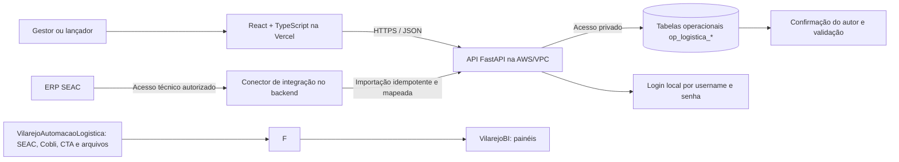

# Portal de lançamento de dados de Logística

**Atualizado em:** 27/10/2026
**Status:** referência funcional da API real de staging. Edições de pessoas e motivos atualizam o cadastro existente; produção continua sendo uma etapa separada.
**Protótipo de referência:** [Painel de Entregas Vilarejo — Adapta](https://skip-artifacts-snapshots.application.production.adapta.tools/user_3I06ziDncMpG4iCubDFbOkPrTAz/fn575irlp4ibn56ddn5vixzsmq/revisions/a6b1778b-3b65-424d-8a21-2c4c2a51f134/index.html)

## 1. Resumo da mudança de escopo

O gestor pediu que o lançamento de dados de Logística seja feito em um site próprio, separado da interface do VilarejoBI. A primeira experiência deve se basear no protótipo que ele construiu na ADAPTA. Depois, o site deve ganhar uma área por setor e por conjunto de dados/formulários logísticos. Os lançamentos precisam ficar persistidos em banco de dados, com controle de acesso por pessoa, função, setor e localidade. A publicação do site deve usar a Vercel.

O site e o BI serão aplicações diferentes. O portal terá contas locais próprias, sem copiar credenciais do BI. Eles podem compartilhar o banco após as decisões de arquitetura, mas os dados que uma pessoa está preenchendo precisam ficar em tabelas operacionais próprias. Não gravar rascunhos ou linhas de formulário diretamente nas tabelas fato mensais do BI.

O protótipo analisado chama-se **Painel de Entregas Vilarejo** e contém lançamento diário de entregas, reclamações/elogios, cadastros, painel gerencial e ranking de pessoas. A especificação abaixo registra o que existe na página e propõe como reconstruir isso como aplicação com backend, autorização e persistência reais.

## 2. O que existe na página da ADAPTA

### 2.1 Navegação e funções visíveis

O protótipo apresenta estas abas:

1. **Lançamento de Entregas:** registro diário por loja/filial e equipe.
2. **Reclamações e Elogios:** registro do relato do cliente e das pessoas envolvidas.
3. **Cadastros:** lojas/filiais, motoristas/entregadores e motivos de não realização.
4. **Painel Gerencial (OTIF):** indicadores e filtros por período, loja, motivo, pessoa e equipe.
5. **Ranking de Pessoas:** comparação de motoristas e ajudantes por entrega e feedback.

Também existem impressão/PDF, importação/exportação de CSV, dados de demonstração e uma configuração manual de Firebase Realtime Database.

### 2.2 Campos do lançamento diário de entregas

O formulário atual solicita:

- data da entrega;
- loja/filial;
- motorista obrigatório;
- até dois ajudantes opcionais;
- quantidade de entregas realizadas;
- quantidade de entregas não realizadas;
- um ou mais motivos com quantidade e observação própria para as entregas não realizadas;
- equipe formada por motorista e até dois ajudantes, classificados no cadastro como Entregas Próprias ou Terceirizadas.

O grupo de ocorrência pertence ao cadastro do motivo, não é digitado no lançamento. O primeiro corte usa quatro grupos controlados: **Transporte próprio**, **Transporte terceirizado**, **Loja** e **Logística**. Ao selecionar uma pessoa, o formulário exibe o tipo da entrega (`PRÓPRIA` ou `TERCEIRIZADA`). Novos lançamentos exigem equipe homogênea; pessoas de tipos diferentes não podem ser combinadas na mesma linha.

A observação passa a pertencer a cada linha de motivo. Novos lançamentos não terão observação geral. A coluna atual no resumo diário será preservada como legado durante a migration para não apagar histórico; a exibição/backfill de observações antigas será definida antes de qualquer remoção dessa coluna.

No CSV novo de Entregas, `observacoes_motivos` recebe uma observação por motivo, na mesma ordem dos itens separados por `|` na coluna `motivos`. A antiga coluna `observacao` não é aceita em lançamentos novos; valores já armazenados permanecem visíveis como legado no histórico.

O protótipo valida que a soma de realizadas e não realizadas seja maior que zero. Se houver entregas não realizadas, exige um motivo por linha e valida que a soma das quantidades dos motivos seja igual ao total não realizado. Esses controles devem ser repetidos no backend, não somente no navegador.

O grão aparente é um resumo diário de loja/filial e equipe, com quantidades agregadas; não é um registro de cada pedido/entrega. A chave de negócio desse lançamento ainda precisa de confirmação. Não adotar automaticamente `data + loja + motorista` como chave única: pode haver mais de uma equipe/rota no mesmo dia e na mesma loja.

### 2.3 Campos de reclamação/elogio

O formulário solicita:

- data;
- tipo: reclamação ou elogio;
- nome do cliente;
- loja;
- motorista obrigatório;
- até dois ajudantes opcionais;
- descrição do ocorrido.

O protótipo atribui `+1` por elogio e `-1` por reclamação a cada pessoa informada. A decisão de produto de 21/10 mantém o nome do cliente no feedback; não se coletam telefone, documento ou outros identificadores. Todos os perfis do piloto podem consultar e exportar dentro dos escopos; OPERADOR também pode registrar/importar. O prazo e a ação de retenção precisam ser definidos antes de usar dados reais.

### 2.4 Cadastros e filtros

Os cadastros editáveis da tela são lojas/filiais, motoristas, ajudantes e motivos de não entrega. Cada versão da pessoa exige classificação de Entregas Próprias ou Terceirizadas. Cada versão do motivo exige um dos quatro grupos controlados: Transporte próprio, Transporte terceirizado, Loja e Logística. Versões já existentes sem grupo/tipo permanecem sem classificação até a gerente revisar e versionar o cadastro; a aplicação não infere dados históricos.

O painel mantém os filtros de período e loja e apresenta volumes e percentuais por motivo/grupo, além de comparar Entregas Próprias e Terceirizadas. Para motivos e grupos, exibe duas taxas: participação entre as entregas não realizadas e incidência sobre o total registrado. Para tipo de entrega, apresenta quantidade, taxa de realização e OTIF. A equipe continua sendo a combinação de motorista e ajudantes do lançamento.

### 2.5 Indicadores exibidos e decisões de negócio necessárias

**Regra de negócio vigente para OTIF:**

```text
OTIF (%) = entregas não realizadas / (entregas realizadas + entregas não realizadas) × 100
```

O indicador é calculado com as quantidades registradas e agregado pelas somas do recorte selecionado. O painel apresenta o resultado geral, por motorista, equipe, loja e tipo de entrega. A taxa de realização continua disponível como indicador separado.

**Decisão do responsável pelo produto em 22/10/2026:** não coletar nem exibir as contagens de entregas no prazo e completas. As colunas já existentes no banco são mantidas por compatibilidade histórica, mas não participam do cálculo. Como o OTIF usa somente realizadas e não realizadas, registros antigos também podem ser calculados.

Metas e faixas de cor ficam para depois do primeiro piloto. O ranking misto de motoristas e ajudantes está incluído no release. Como o formulário registra contagens e motivos por equipe, cada participante recebe resultados coletivos das equipes em que trabalhou; os volumes e motivos não devem ser somados entre pessoas nem tratados como prova de responsabilidade individual. O ranking mostra os motivos das equipes como contexto, sem alterar o score atual (`+1` por elogio e `−1` por reclamação). Até que haja regra aprovada para atribuição e pesos, a ordem segue taxa de realização, score de atendimento, volume realizado e nome.

**Apresentação visual dos indicadores:** a evolução diária/mensal do OTIF usa linha, pois compara uma série temporal; a proporção geral de realizadas/não realizadas usa barra horizontal empilhada a 100%, com contagem e percentual. Não realizadas por grupo e por motivo usam barras horizontais ordenadas pela quantidade, adequadas a nomes longos e ao destaque dos maiores volumes; ao lado de cada barra permanecem o percentual entre as não realizadas e a incidência sobre o total. A comparação Próprias/Terceirizadas usa uma barra empilhada por tipo, separando realizadas e não realizadas e exibindo taxa e volume. Taxa por equipe e por loja usa barras horizontais de 0 a 100%, com as menores taxas primeiro e o tamanho do volume visível para evitar interpretar uma taxa sem contexto. A tabela de Performance por loja permanece no painel; a tabela de Ranking por pessoa mantém suas colunas atuais em uma página própria com filtros adicionais.

### 2.7 Integração futura com o ERP SEAC

Antes do lançamento oficial do Portal, está prevista uma integração com o ERP SEAC para buscar automaticamente dados usados nos lançamentos de Entregas. O conector deverá executar no backend, usar conta técnica com acesso mínimo e aplicar mapeamentos por códigos estáveis; o navegador não acessará o ERP nem receberá credenciais. Ainda precisam ser confirmados os campos/origem disponíveis, frequência, tratamento de duplicatas/divergências e se os dados importados entram como rascunho para conferência ou são confirmados automaticamente. O piloto pode seguir com cadastros e lançamentos manuais enquanto a integração é especificada.

### 2.6 Limite técnico do protótipo

O HTML consultado salva dados no `localStorage` do navegador e oferece uma configuração opcional de Firebase Realtime Database. Há exemplos de dados carregados quando a base está vazia. Isso é útil como referência de interface e fluxo, mas não constitui a persistência central, o login ou a autorização exigidos para uso corporativo multiusuário. A aplicação nova deve remover o acesso/configuração de Firebase feita pelo usuário, o modo de demonstração em produção e qualquer dependência de dados apenas locais.

## 3. Decisões propostas para o produto

### 3.1 Primeira entrega do portal

Escopo definido para a primeira versão funcional:

- reproduzir a identidade visual e a navegação geral do protótipo;
- incluir os módulos do protótipo: **Entregas**, **Reclamações e Elogios**, **Cadastros**, **Painel Gerencial** e **Ranking de Pessoas**;
- oferecer histórico, rascunhos, confirmação, correção e cancelamento auditáveis;
- manter as validações de motivos de não realização e de escopo na API;
- manter a administração de catálogos separada da administração de usuários e acessos;
- deixar pronta a navegação modular para adicionar **Gestão de Frota** e **Operações no CD**.

### 3.2 Módulos posteriores

O plano é acrescentar uma área de trabalho por setor, com formulários tipados e campos definidos a partir das planilhas e das regras já levantadas:

- **Gestão de Frota:** registros mensais por veículo e demais campos manuais que não venham de Cobli/CTA/SEAC.
- **Operações no CD:** formulários/lançamentos definidos a partir dos dados de estoque, entregas, custos, ocorrências, devoluções e backlog.
- **Outros setores logísticos:** somente quando gestor, origem, campos e regras forem mapeados.

Não criar um formulário genérico de qualquer coluna nem uma tabela EAV de `campo/valor`. Cada formulário deve ter tabelas relacionais tipadas. Isso preserva tipos, validações, filtros, histórico e consultas.

## 4. Arquitetura recomendada

### 4.1 Componentes



O navegador nunca acessa MySQL nem o ERP diretamente. O frontend envia dados pela API HTTPS; o backend valida sessão, autorização e regras de negócio e grava as tabelas operacionais. O conector futuro do SEAC também executará no backend, com leitura autorizada, mapeamento por código e idempotência. O fluxo de conferência/confirmação dos dados importados ainda será aprovado. O Portal não publica automaticamente seus lançamentos no VilarejoBI neste release.

### 4.2 Aplicação Python

**Proposta adotada:** organizar o `LancamentoLogistica` como monorepo com `frontend/` e `backend/`. O frontend será React + TypeScript + Vite e cuidará das páginas, formulários, navegação e acessibilidade. O backend será uma API FastAPI em monólito modular, responsável por autenticação, autorização, validação, regras de negócio, persistência e acesso aos repositórios/banco. O contrato entre eles será HTTPS/JSON.

Manter a API do portal separada da API de painéis do VilarejoBI. O frontend é publicado como site estático na Vercel; a API roda na AWS/VPC junto da RDS. Operações de leitura e gravação passam por rotas FastAPI, que autenticam, autorizam e validam cada ação no servidor. A estrutura permanece monolítica no backend, com módulos separados por domínio, e não exige serviços independentes para cada módulo.

O login do portal será próprio, por username e senha. A conta, o hash Argon2id e o estado da credencial ficam em op_logistica_usuario; os três campos de senha ficam todos nulos até a credencial ser provisionada. Não reutilizar nem copiar credenciais do BI. Username é normalizado e único. CPF não será coletado no MVP; se uma necessidade for aprovada futuramente, sua coleta deverá ser feita em tabela própria e com leitura restrita. Os perfis, permissões e escopos continuam nas tabelas existentes: op_logistica_usuario_escopo associa uma conta a um perfil e escopo, e op_logistica_perfil_permissao define as ações daquele perfil.

### 4.3 Vercel e acesso ao RDS

Na Vercel será implantado somente o frontend. A API FastAPI deve executar na AWS/VPC e conectar diretamente ao endpoint privado da RDS pela porta 3306, com regra de Security Group autorizando a origem da API. O navegador chama a API por HTTPS; não há conexão do frontend nem do usuário final ao MySQL.

No desenvolvimento local, a API executada no host pode abrir o túnel SSH via EC2/Tailscale com `USE_DB_TUNNEL=true`. O modo Compose padrão permanece isolado no MySQL local. Essa rota é para desenvolvimento; a API em produção usa rede privada da AWS e não abre túnel SSH para cada acesso. A [arquitetura e guia de conexão](./arquitetura_implantacao.md) registra o desenho e as configurações.

O deploy da API será feito em uma EC2 na VPC aprovada. Não configurar VPC peering entre Vercel e AWS para esse desenho: a interface é pública e só precisa alcançar um endpoint HTTPS da API.

## 5. Banco de dados: o que adicionar

### 5.1 Separar lançamento operacional de fato analítica

O banco analítico atual possui 15 dimensões/fatos mensais. Ele não guarda rascunhos, versões, participantes, motivo por linha ou histórico operacional. Além disso, `fato_entregas_mensais` é mensal por localidade e tipo de transporte; não possui data diária, equipe/pessoa nem contagem separada de não realizadas. `fato_retornos_ocorrencias` também é mensal e não é o lugar para guardar nome do cliente e descrição do feedback.

Por isso, o site grava primeiro em tabelas operacionais e não diretamente nas tabelas fato mensais. Uma rotina controlada transforma somente revisões confirmadas em medidas analíticas, depois de definir como elas se reconciliam com SEAC, Cobli, CTA e com o ETL das planilhas. Não escrever formulário diretamente em `fato_entregas_mensais` ou `fato_retornos_ocorrencias`.

### Convenção de nomes por camada

Padronizar todos os nomes físicos em `snake_case` e usar prefixos que identifiquem a função dos dados:

| Prefixo | Camada | Exemplo |
|---|---|---|
| `stg_<fonte>_<entidade>` | Respostas originais/temporárias recebidas de uma fonte ou ETL. | `stg_cobli_veiculo` |
| `dim_<entidade>` | Dimensão descritiva compartilhada pelo modelo analítico. | `dim_localidade`, já existente. |
| `fato_<processo>_<grao>` | Medidas publicadas para análise, com granularidade definida. | `fato_entregas_mensais`, já existente. |
| `bridge_<relacao>` | Relação analítica multivalorada sem duplicar medidas da fato. | `bridge_entrega_pessoa`. |
| `etl_<dominio>_<entidade>` | Controle técnico de execução e linhagem de cargas. | `etl_logistica_execucao`. |
| `op_logistica_<entidade>` | Dados operacionais gravados pelo site, incluindo rascunhos, confirmações e cadastros. | `op_logistica_entrega_diaria`. |

Assim, `op_logistica_` identifica a camada de operação; não o nome do site. A camada operacional mantém o preenchimento, a confirmação e o histórico de versões. Dimensões/fatos representam dados conformados para análise; pontes representam relações multivaloradas. O [DBML analítico](../../docs/modelos/VilarejoBI/Banco_Logistica_Revisado.dbml) preserva as 15 tabelas da baseline e acrescenta as dimensões/fatos propostos para os novos indicadores. O [DBML operacional do portal](./modelo_operacional_lancamento_logistica.dbml) detalha formulários, versões, autorização e auditoria. As extensões propostas ainda exigem revisão de negócio e migrations próprias; a migration inicial do BI continua limitada às 15 tabelas.

### 5.2 Decisão sobre catálogo/banco

**Proposta inicial:** manter a mesma instância RDS e decidir com Infra se o portal terá catálogo lógico separado. O modelo operacional evita FKs físicas para o banco analítico; localidades, pessoas, motivos e tipos são integrados por códigos estáveis e pela carga. Usar uma sequência de migration coordenada para cada catálogo, sem reescrever a baseline analítica de 15 tabelas.

**Alternativa com mais isolamento:** criar catálogos operacionais na mesma instância RDS (por exemplo, `vilarejo_logistica_operacional_staging` e `vilarejo_logistica_operacional`). Isso separa permissões, retenção e dados de feedback, mas exige sincronizar localidades e publicar informações entre catálogos; em MySQL, planejar essa integração explicitamente em vez de presumir FKs entre eles.

A decisão deve considerar que o protótipo guarda nome de cliente e relatos sobre empregados. Se as credenciais do BI têm leitura ampla do catálogo, a primeira alternativa só é aceitável com grants restritos por tabela/serviço. As tabelas `op_logistica_*` não devem ficar legíveis automaticamente para consumidores de BI.

### 5.3 Tabelas operacionais propostas para a primeira versão

Os nomes e relacionamentos completos estão no [DBML operacional do portal](./modelo_operacional_lancamento_logistica.dbml). A tabela resume o propósito das entidades; revisar campos sensíveis, retenção e fluxos com o gestor antes de gerar migrations.

| Tabela | Grão e finalidade | Campos principais sugeridos |
|---|---|---|
| `op_logistica_setor` | Um cadastro por setor que lança dados. | `id_setor`, `codigo` (`SUPORTE`, `FROTA`, `OPERACOES_CD`), `nome`, `ativo`, timestamps. O módulo de Entregas usa o setor responsável `SUPORTE`. |
| `op_logistica_localidade` | Cópia controlada das localidades permitidas no portal. | `codigo_localidade` canônico, nome, tipo, ativo e horário da sincronização. |
| `op_logistica_perfil` | Um registro por perfil funcional da aplicação. | `id_perfil`, `codigo`, `nome`, `ativo`. Exemplos: `ADMIN_PORTAL`, `DONO_VILAREJO`, `DIRETOR_LOGISTICA`, `GESTOR_SETOR`, `LANCADOR`, `LEITOR`. |
| `op_logistica_recurso` | Catálogo das áreas/páginas funcionais do portal, como Entregas, Frota e Painel Gerencial. | Cada recurso pode pertencer a um setor. Recursos transversais não concedem acesso global aos dados; a consulta continua limitada pelos escopos do usuário. |
| `op_logistica_permissao` e `op_logistica_perfil_permissao` | Ações por recurso e associação dessas ações aos perfis. | Exemplos: `ENTREGAS_DIARIAS:ACESSAR`, `ENTREGAS_DIARIAS:VER`, `ENTREGAS_DIARIAS:CRIAR`, `FEEDBACK_CLIENTES:VER`, `PAINEL_GERENCIAL:EXPORTAR`. A navegação exige `ACESSAR`; cada operação da API exige a ação específica e um escopo compatível. |
| `op_logistica_usuario` | Uma conta local e sua credencial opcional. | Username normalizado, nome, estado, hash Argon2id e campos de alteração/troca de senha; os campos de credencial ficam todos nulos antes da definição da senha. |
| `op_logistica_escopo` e `op_logistica_usuario_escopo` | Cadastro do alvo de acesso e concessões de perfil por período. | Escopo explícito `GLOBAL`, setor, localidade ou combinação; uma pessoa pode ter várias concessões. |
| `op_logistica_formulario_versao` | Uma versão publicada de um formulário vinculada a um setor. | `id_setor`, `codigo_formulario`, `versao`, data de vigência, estado, referência ao contrato e autor da alteração. A API confere se o setor da versão corresponde ao setor do lançamento. O detalhe permanece em tabelas tipadas; não guardar toda a linha em JSON genérico. |
| `op_logistica_lancamento` | Cabeçalho estável de um processo de lançamento. | UUID público estável, setor, autor e chave de idempotência. |
| `op_logistica_lancamento_revisao` | Uma versão editável ou confirmada do cabeçalho e respectivos detalhes. | Formulário/versão, número, UUID estável para linhagem analítica, estado e autor/horário de confirmação. Campos de aprovação/devolução permanecem apenas para dados legados; novas confirmações não aguardam outro usuário. |
| `op_logistica_lancamento_evento` | Uma transição ou ação auditável de uma revisão. | Estado anterior/novo, ator, horário UTC, comentário e nomes dos campos alterados sem copiar valores sensíveis. Append-only. |
| `op_logistica_pessoa` | Cadastro de motoristas/ajudantes que aparecem no formulário. | A API cria uma pessoa nova em um novo cadastro; editar nome, função ou tipo de entrega (`PROPRIA`/`TERCEIRIZADA`) atualiza a linha atual e mantém seu ID e código. O tipo é obrigatório em novos cadastros; linhas antigas podem permanecer nulas até revisão. Alterações de nome ou classificação afetam a leitura dos lançamentos ligados àquela linha; a auditoria conserva antes/depois. |
| `op_logistica_motivo_nao_entrega` | Catálogo controlado de motivos. | A API cria um motivo novo em um novo cadastro; editar descrição ou grupo atualiza a linha atual e mantém ID/código. Cada motivo exige grupo (`TRANSPORTE_PROPRIO`, `TRANSPORTE_TERCEIRIZADO`, `LOJA` ou `LOGISTICA`); registros antigos sem grupo permanecem nulos até revisão. Alterar o grupo afeta os indicadores históricos ligados à linha; a auditoria conserva antes/depois. |
| `op_logistica_entrega_diaria` | Uma linha de resumo diário por localidade/equipe em uma revisão. | Data, código estável da linha, localidade e quantidades. O tipo de entrega é derivado da classificação dos participantes; novos lançamentos não aceitam equipe mista. A coluna atual `observacao` permanece somente como legado, e novos lançamentos não a preenchem. |
| `op_logistica_entrega_participante` | Uma pessoa e um papel por registro de entrega. | `id_entrega`, `id_pessoa`, papel (`MOTORISTA`/`AJUDANTE`), ordem; restringir um motorista e a quantidade de ajudantes aprovada. |
| `op_logistica_entrega_motivo` | Quantidade não realizada e observação específica por motivo em um registro. | `id_entrega`, `id_motivo`, `quantidade`, `observacao`; uma linha consolidada por motivo em cada item. O grupo é obtido da versão do motivo referenciada. Preservar o texto da observação geral histórica durante a migration. |
| `op_logistica_feedback` | Uma manifestação de cliente ligada a uma entrega confirmada. | Vários feedbacks podem apontar para o mesmo item. `Idempotency-Key` única por submissão evita duplicatas em retries; cada novo feedback usa uma chave nova. |

### Regras de integridade que devem virar constraints e validações

- Chaves primárias numéricas ou UUIDs geradas no servidor; username normalizado é único, e a credencial de senha tem relação um-para-um com a conta. A autorização não depende de username, nome ou CPF enviados pelo navegador.
- FKs obrigatórias entre conta/sessão, recurso/setor, permissão/recurso, perfil/permissão, concessões/conta/perfil/escopo, cabeçalho/revisão/evento, revisão/formulário, entrega/revisão/localidade, participante/pessoa, motivo/catálogo e feedback/entrega. Os dois modelos DBML ficam sem FKs cruzadas entre o banco operacional e o analítico.
- Unicidade de username normalizado, código de setor/localidade/recurso/motivo, `(id_recurso, acao)`, `(id_lancamento, numero_revisao)` e chaves de idempotência. O tipo de feedback é restrito por CHECK aos códigos `ELOGIO` e `RECLAMACAO`.
- Quantidades de entregas e motivos não podem ser negativas; motivo informado precisa ter quantidade positiva. Aplicar `CHECK` nas colunas suportadas pelo MySQL e repetir as regras no serviço da API.
- A soma das quantidades de motivos precisa ser igual à quantidade não realizada. Como depende de várias linhas, validar todas as linhas dentro da transação da API antes de enviar o formulário; repetir a validação na publicação.
- Uma entrega tem no máximo um motorista, até dois ajudantes e não pode repetir a mesma pessoa como participante, salvo regra de negócio aprovada. Validar no serviço e, quando possível, reforçar com chaves/índices.
- O tipo de entrega (`PROPRIA`/`TERCEIRIZADA`) vem dos cadastros versionados dos participantes e aparece como identificação visual junto às pessoas no formulário. Definir e validar a regra para participantes de tipos divergentes antes de habilitar a seleção.
- Cada motivo possui grupo de ocorrência obrigatório nos cadastros novos. A edição atualiza a linha existente, sem inserir uma nova versão; mudanças de grupo em motivos usados reclassificam os lançamentos e indicadores associados. A auditoria registra o valor anterior e o novo.
- A observação de novas ocorrências fica em `op_logistica_entrega_motivo`, uma por linha de motivo. Não copiar uma observação antiga geral para vários motivos sem regra de migração aprovada.
- Para cada tabela de histórico, definir índices começando pelos filtros mais comuns: status/data, setor/localidade/data, autor/data e lançamento/revisão. Confirmar o plano de consultas antes de criar índices redundantes.
- Usar `ativo` e vigência para retirar cadastros de uso corrente sem apagar dados históricos. Exclusão física fica restrita a correção administrativa auditada e aprovada.

Essas regras protegem a base contra requests inválidos mesmo quando o formulário é chamado fora da interface. Regras entre várias tabelas (por exemplo, a soma dos motivos) devem validar e gravar em uma única transação.

### 5.4 Cadastros reutilizáveis e tabelas opcionais

- **Localidades:** o portal usa `op_logistica_localidade` como catálogo local de referência. Não há sincronização com `dim_localidade` nem dependência de uma conexão do VilarejoBI.
- **Competência:** usar `dim_competencia` quando a linha for mensal; para os lançamentos do protótipo, armazenar a data do evento e derivar a competência a partir dela no servidor.
- **Equipe fixa:** o protótipo monta equipe a partir das pessoas no lançamento. Só criar `op_logistica_equipe` e `op_logistica_equipe_membro` se o negócio confirmar grupos permanentes e precisar administrá-los.
- **Anexos:** não são requeridos pelo protótipo. Adicionar tabela/armazenamento separado só se gestores aprovarem evidências anexadas.
- **Auditoria de catálogos:** os campos `criado_por`, `criado_em` e `atualizado_em` são preenchidos pelo servidor e registram a manutenção dos catálogos. A interface não deve aceitar essas datas como entrada. Se houver edição administrativa com impacto histórico, adicionar eventos específicos antes de habilitar a alteração pela interface.
- **Integração com SEAC:** antes do lançamento oficial, confirmar a fonte autorizada (API, consulta read-only ou exportação estruturada), conta técnica, códigos e frequência. Implementar adaptador no backend, sincronização idempotente, registro da origem e reconciliação de conflitos; confirmar se entradas importadas chegam como rascunho ou confirmadas.

## 6. Fronteira com o modelo analítico e com a automação

### 6.1 Fluxo dos dados do portal

1. A pessoa preenche o formulário de lançamento.
2. Ao enviar, a API valida sessão, setor, localidade, datas, pessoas, campos obrigatórios e regras aritméticas e registra diretamente o lançamento, sem uma tela de conferência final.
3. A confirmação registra o lançamento imediatamente, torna a versão imutável e cria um evento de auditoria. Não há aprovação obrigatória por outra pessoa.
4. Uma correção posterior deve criar nova versão vinculada à anterior e preservar o histórico.
5. Os painéis do Portal usam diretamente os registros operacionais confirmados, respeitando as permissões e o escopo da conta.
6. O Portal não gera execução de publicação nem envia registros a outro projeto neste release.
7. A integração de dados analíticos pertence ao VilarejoBI e segue o plano próprio daquele projeto.

Para novos registros, `RASCUNHO` é editável e `ENVIADA` representa confirmação final. `CANCELADA` depende de política e justificativa. `EM_REVISAO`, `DEVOLVIDA` e `APROVADA` são estados legados mantidos para compatibilidade histórica; não fazem parte do fluxo novo nem devem ser atribuídos a novos lançamentos.

### 6.2 Modelo analítico do VilarejoBI (fora do escopo deste Portal)

Os pontos abaixo descrevem o modelo analítico do outro projeto; não são entregáveis nem dependências
do release deste Portal.

O DBML do VilarejoBI mantém as 15 tabelas analíticas de baseline e adiciona uma extensão proposta para esse portal:

- `dim_data` permite analisar registros por dia e navegar para competência.
- `dim_pessoa_logistica` preserva versões históricas de função usando chave pseudonimizada; `dim_pessoa_logistica_identidade` guarda o nome em tabela separada com leitura restrita. Pontes e indicadores individuais continuam sujeitos a autorização.
- `dim_localidade_codigo_origem` associa códigos exatos de cada sistema à localidade canônica em períodos de vigência. A carga valida sobreposições temporalmente, sem usar nome/cidade como chave.
- `dim_motivo_nao_entrega` e `dim_tipo_feedback` normalizam categorias usadas nos formulários.
- `fato_entregas_diarias` tem grão de uma linha de resumo diária/localidade/equipe por revisão publicada. Deve carregar as quantidades realizadas e não realizadas, que permitem calcular o OTIF aprovado. A chave de idempotência é formada por sistema, UUID do lançamento, UUID da revisão e UUID estável do item. Reprocessar a mesma revisão não duplica linhas; uma nova revisão preserva a versão anterior e atualiza `eh_revisao_atual` na mesma transação de publicação.
- `fato_entregas_nao_realizadas_motivo` tem grão de uma linha de resumo por motivo e revisão, e guarda a quantidade não realizada daquele motivo. O ETL valida que a soma por linha coincide com o resumo diário.
- `fato_feedback` tem grão de um evento por revisão e guarda somente contagem, tipo, data e localidade. Nome e relato permanecem no banco operacional e não são publicados nos fatos; o Portal coleta o nome do cliente, mas não telefone, documento ou outros identificadores.
- `bridge_entrega_pessoa` e `bridge_feedback_pessoa` representam participantes no modelo analítico. O ranking do Portal apresenta a cada pessoa as quantidades coletivas das equipes de que participou; esses volumes não podem ser somados entre pessoas nem interpretados como medidas individuais por pedido.
- `etl_logistica_execucao` registra a execução técnica e as contagens da carga; seu UUID é o mesmo `codigo_execucao` da publicação operacional. Os catálogos podem ficar em databases separados, portanto essa correlação não depende de FK entre eles.

Os fatos novos mantêm versões analíticas de correções confirmadas em vez de apagar a versão anterior. Consultas de indicadores vigentes filtram `eh_revisao_atual = true`; a rotina de publicação garante que somente a última versão confirmada de cada lançamento permaneça marcada nas três fatos. Esse marcador deve ser atualizado transacionalmente para evitar uma janela com duas versões somadas ou nenhuma versão visível. O UUID `codigo_revisao` da camada operacional é gravado como `codigo_revisao_origem` no analítico.

Esses fatos não substituem automaticamente `fato_entregas_mensais`, cujo grão e medidas são diferentes. O OTIF deste produto é calculado a partir das quantidades realizadas e não realizadas. A publicação analítica deve preservar essas medidas para que o indicador possa ser agregado por motorista, equipe e loja.

### 6.3 Evitar conflito com `VilarejoAutomacaoLogistica`

O portal e o projeto de automação podem avançar em paralelo, mas podem produzir dados sobre o mesmo indicador. O portal recebe lançamentos humanos; a automação lê SEAC, Cobli, CTA e arquivos. Antes de ambos escreverem na mesma fato, definir por indicador:

- qual origem é oficial;
- se o portal complementa, corrige ou apenas valida a origem automática;
- como identificar duplicatas e substituições;
- quem aprova divergências;
- qual processo é dono da publicação final.

No exemplo atual, o formulário da ADAPTA registra totais diários por equipe, enquanto `fato_entregas_mensais` recebe agregados mensais por localidade e tipo de transporte e pode receber dados do SEAC. Essas granularidades e semânticas não devem ser somadas automaticamente. Feedbacks também não devem ser convertidos em devoluções do SEAC sem uma regra aprovada.

A integração SEAC solicitada para o Portal é entrada de dados operacionais; não é publicação do Portal no VilarejoBI nem substitui o ETL das planilhas. Reusar adaptadores/contratos somente depois de validar a fonte e os identificadores com a equipe do ERP. Toda importação deve ser idempotente, rastreável e reconciliável, sem duplicar lançamentos manuais.

Manter os projetos separados em código:

| Projeto | Responsabilidade |
|---|---|
| `LancamentoLogistica` (novo) | Interface de lançamento, login/permissões do portal, tabelas operacionais e confirmação dos dados manuais autorizados. |
| `VilarejoAutomacaoLogistica` | Extração, normalização, validação e consolidação mensal das fontes externas/planilhas. |
| `VilarejoBI` | Modelo analítico, migrations atuais, API/painéis de BI e consumo dos dados publicados nas tabelas fato. |

Os modelos ORM operacionais pertencem ao backend do portal, que é o serviço dono dos lançamentos, credenciais e regras. Se as tabelas forem criadas no mesmo catálogo MySQL do BI, a migration deve ser coordenada na cadeia Alembic `logistica` desse catálogo, sem uma segunda tabela `alembic_version` concorrente. A revisão operacional não deve alterar ou recriar as 15 tabelas analíticas existentes.

## 7. Autenticação e autorização

### 7.1 Identidade

O portal terá autenticação local por username e senha. op_logistica_usuario guarda os dados da conta e os campos opcionais da credencial local: hash Argon2id codificado, data de alteração e indicador legado de troca obrigatória, mantido para compatibilidade e sem impor troca no primeiro acesso. Os três campos devem estar todos nulos ou todos preenchidos; conta sem hash não autentica. O hash inclui salt aleatório e parâmetros do algoritmo, permitindo atualizar o custo quando necessário. Nunca armazenar senha em texto puro, criptografia reversível, SHA-256 simples ou outro hash rápido. A API nunca retorna o hash nem o registra em logs.

O username deve ser normalizado (remover espaços externos e converter para minúsculas) antes de salvar e comparar. CPF não faz parte do esquema nem da coleta no MVP. Se for aprovado futuramente, deve ser armazenado em tabela própria, validado no serviço e nunca usado como username, recuperação de conta ou autorização.

O nível de acesso não é um número único na conta. A autorização combina três partes: `op_logistica_perfil` identifica o papel; `op_logistica_perfil_permissao` concede ao papel ações em recursos/páginas cadastrados em `op_logistica_recurso`; `op_logistica_usuario_escopo` delimita onde a pessoa pode usar essas ações. A página aparece na navegação quando a pessoa tem `ACESSAR` no recurso e escopo compatível; a API volta a validar a ação e filtra os dados pelo escopo em toda operação.

`op_logistica_autorizacao_evento` mantém a trilha append-only de concessões e revogações de permissões de perfil e de escopos de usuários. A alteração do estado atual e o evento correspondente devem ser gravados na mesma transação. Revogar uma permissão de perfil remove sua associação vigente e grava quem fez a revogação, quando e o motivo; revogar um escopo desativa/encerra sua concessão sem apagar a linha e grava o mesmo evento. A tabela de eventos é apenas histórica: a API decide acesso consultando as concessões vigentes, nunca inferindo permissão a partir do log.

Assim, os gestores X e Y podem receber o mesmo perfil e escopo do setor que administram, vendo os lançamentos daquele setor. O diretor de Logística e o dono da Vilarejo podem receber permissões de leitura nos recursos necessários e escopo `GLOBAL` explícito. O sistema não infere acesso pela cadeia hierárquica: esses acessos superiores são concessões explícitas. Um gestor de outro setor não vê uma página/recurso sem permissão no perfil ou sem escopo compatível.

O cadastro administrativo cria a conta e sua primeira concessão de perfil/escopo na mesma transação. O servidor gera uma senha numérica aleatória de seis dígitos, armazena somente o hash e revela a senha uma vez para entrega por canal privado. A troca no primeiro login é opcional. A pessoa pode trocar a senha na área autenticada ou redefini-la informando nome completo, username e uma nova senha; a redefinição revoga as sessões abertas, é limitada por tentativas e não revela se os dados informados correspondem a uma conta. A administração também pode emitir outra senha numérica de seis dígitos. Não confiar em perfil, setor, localidade ou usuário enviados pelo navegador.

Concentrar autorização numa camada de serviços/repositórios Python e validar operações sensíveis no servidor; esconder botões na interface é apenas conveniência visual. FastAPI fornece dependências de segurança e scopes que podem compor essa autorização ([OAuth2 scopes no FastAPI](https://fastapi.tiangolo.com/advanced/security/oauth2-scopes/)).

### 7.2 Papéis iniciais para discutir

| Perfil | Permissões candidatas | Escopo |
|---|---|---|
| `DIRETOR_LOGISTICA` | Ver recursos autorizados de todos os setores e acompanhar os lançamentos. | Global explícito. |
| `DONO_VILAREJO` | Ver os recursos executivos autorizados. | Global explícito; não recebe permissões administrativas automaticamente. |
| `GESTOR_SETOR` | Ver dados e formulários do(s) setor(es) atribuído(s); acompanhar lançamentos confirmados. | Setor(es) e localidades autorizados. |
| `LANCADOR` | Criar, editar o próprio rascunho, confirmar e ver lançamentos autorizados. | Setor/localidade atribuídos. |
| `LEITOR` | Somente consultar dados permitidos. | Setor/localidade atribuídos. |
| `ADMIN_PORTAL` | Administrar permissões, catálogos e versões de formulário. | Operacional; não recebe acesso amplo a feedback/PII automaticamente. |

Um perfil pode ser atribuído mais de uma vez com escopos diferentes. Usar uma concessão por pessoa/perfil/setor/localidade; para diretoria, registrar escopo global de forma explícita, não usar `localidade NULL` como convenção ambígua. Cargo é atributo organizacional, não autorização por si só.

O fluxo diário não exige cargo de gestão para confirmar um lançamento próprio. Se no futuro houver outra operação que exija perfil gerencial, a concessão ativa em `op_logistica_usuario_escopo` deve indicar as ações e os setores/localidades permitidos. Não aceitar cargo informado pelo navegador nem conceder acesso apenas por correspondência textual de título.

### 7.3 Regras obrigatórias no servidor

- Conferir identidade e estado ativo em cada chamada protegida.
- No login, comparar o username normalizado, verificar o hash com a biblioteca de senha escolhida e aplicar limitação progressiva de tentativas para evitar ataques de adivinhação. Não revelar se username existe; não registrar senha, hash, CPF ou payload sensível em logs.
- Como o desenho atual prevê senha sem MFA, exigir no mínimo 6 caracteres e permitir pelo menos 64. Aceitar espaços e caracteres imprimíveis; rejeitar senhas comuns ou conhecidas como comprometidas, permitir gerenciadores/autopreenchimento e não impor regras arbitrárias de composição nem troca periódica sem evidência de comprometimento. Se MFA for adotado, revisar o mínimo conforme a política escolhida.
- Criar sessões opacas no servidor depois da autenticação; usar HTTPS e cookies `HttpOnly`, `Secure` e `SameSite` adequado, com expiração e invalidação.
- Conferir ação, setor e localidade com as concessões ativas do usuário.
- Aplicar filtros de escopo no SQL/API antes de retornar dados.
- Validar que o ID enviado pertence ao escopo; não aceitar alteração de `id_localidade`, `id_setor`, perfil ou autor sem permissão.
- Exigir permissão de criação para confirmar e permissão própria para cancelar, corrigir ou administrar cadastros conforme política definida. Não exigir permissão de aprovador para registrar lançamentos diários.
- Registrar concessões e revogações de perfil/permissão e usuário/escopo em `op_logistica_autorizacao_evento`, na mesma transação da mudança efetiva; exigir motivo para revogações e restringir `UPDATE`/`DELETE` da trilha.
- Registrar ator, ação, data/hora e resultado nas transições relevantes.
- Restringir descrição/nome de cliente, exportação e dados do ranking a perfis autorizados.
- Proteger operações de escrita contra CSRF.
- Guardar segredos somente no servidor/gerenciador de segredos. Nenhum segredo de banco pode ir para código ou variável de ambiente enviada ao navegador.

Referências para implementar armazenamento e política de senha: [OWASP Password Storage Cheat Sheet](https://cheatsheetseries.owasp.org/cheatsheets/Password_Storage_Cheat_Sheet.html) recomenda hashing adaptativo como Argon2id, e [NIST SP 800-63B](https://pages.nist.gov/800-63-4/sp800-63b.html) cobre tamanho, blocklist, limitação de tentativas e sessões.

### 7.4 Contrato inicial dos endpoints

Este contrato é uma proposta de divisão por responsabilidade; nomes e formatos finais podem ser ajustados ao padrão adotado pela API.

| Método e rota | Uso | Regra de autorização essencial |
|---|---|---|
| `GET /api/v1/me` | Retorna identidade autenticada, módulos, ações e localidades disponíveis para montar a navegação. | O servidor calcula as capacidades a partir de concessões vigentes. |
| `POST /api/v1/auth/change-password` | Atualiza opcionalmente a senha da própria conta. | Exige sessão e CSRF; a senha atual é validada, as demais sessões são revogadas e a nova credencial usa Argon2id. |
| `POST /api/v1/auth/reset-password` | Redefine senha localmente sem e-mail. | Confere nome completo e username, aplica limite de tentativas, revoga as sessões abertas e registra auditoria; a resposta não indica se os dados corresponderam a uma conta. |
| `GET/POST /api/v1/access/users`, `PATCH /api/v1/access/users/{id}` | Lista contas, cria conta interna junto com o perfil/escopo inicial ou ativa/desativa usuário. | Somente `CONTROLE_ACESSO:ADMINISTRAR` global. Não existe auto cadastro; a conta e a concessão inicial são gravadas juntas, sem data final preenchida pelo usuário. A senha inicial é numérica de seis dígitos, sem troca obrigatória. Desativar revoga as sessões. |
| `GET /api/v1/access/scope-options` | Carrega setores e lojas para concessões de perfil/escopo. | Somente administração global de acesso; retorna somente opções ativas. |
| `GET/POST/PATCH /api/v1/cadastros/localidades` | Lista, cadastra e ativa/desativa lojas/unidades. | Exigir `CADASTROS:ADMINISTRAR` global; código estável e imutável, sem exclusão física. Confirmar códigos com a referência oficial. |
| `GET/POST/PUT/PATCH /api/v1/cadastros/pessoas` | Lista e cria pessoas, edita a linha identificada por `id_pessoa` ou desativa o cadastro. | Exigir `CADASTROS:ADMINISTRAR` global; `PUT` altera a mesma linha, não cria versão. A auditoria guarda os campos modificados. |
| `GET/POST/PUT/PATCH /api/v1/cadastros/motivos` | Lista e cria motivos, edita a linha identificada por `id_motivo_nao_entrega` ou desativa o cadastro. | Exigir `CADASTROS:ADMINISTRAR` global; `PUT` altera a mesma linha, não cria versão. A auditoria guarda descrição/grupo anterior e novo. |
| `GET /api/v1/audit/events` | Consulta eventos de entregas, acessos e feedback com ator, alvo e alterações seguras. | Exigir `AUDITORIA:VER` global. Não retornar credenciais, motivos livres de revogação, comentários de lançamento ou texto do feedback. |
| `GET /api/v1/localidades`, `/pessoas`, `/motivos` | Carrega opções válidas para o formulário. | Retornar somente localidades autorizadas e cadastros ativos que o usuário pode consultar. |
| `GET /api/v1/entregas` | Histórico paginado por data, localidade, equipe, situação e autor. | Aplicar o escopo no servidor antes de filtros/paginação. |
| `POST /api/v1/entregas` | Cria um rascunho com cabeçalho, participantes e motivos. | Exigir setor/localidade permitidos; aceitar `Idempotency-Key` para proteger retries. |
| `PATCH /api/v1/entregas/{id}` | Atualiza o próprio rascunho ou rascunho autorizado. | Revalidar escopo e estado; não aceitar autor, perfil ou localidade alterados pelo cliente sem permissão. |
| `POST /api/v1/deliveries/{codigo_lancamento}/confirm` | Valida e registra definitivamente o lançamento enviado pelo autor. | Exigir permissão de criação e escopo compatível; confirmação idempotente, sem etapa/tela intermediária de conferência. |
| `POST /api/v1/feedbacks` e `GET /api/v1/feedbacks` | Registra ou consulta reclamações/elogios. | Aplicar permissões e escopos para nome e relato; exigir nome do cliente, sem coletar outros identificadores. POST exige `Idempotency-Key`, permite vários feedbacks por entrega e valida o motorista/ajudantes selecionados contra a equipe da entrega confirmada. |
| `GET /api/v1/indicadores/entregas` | Painel gerencial com filtros. | Indicadores e exportações usam os mesmos escopos e filtros que a listagem. |
| `POST /api/v1/access/users` | Provisiona funcionários autorizados a entrar no portal com perfil e escopo iniciais. | Exigir `CONTROLE_ACESSO:ADMINISTRAR` global; criar conta e concessão na mesma transação e emitir senha numérica de seis dígitos exibida uma vez. |

As rotas devem usar respostas paginadas, validação de schema, códigos HTTP consistentes e mensagens que não revelem dados de outro escopo. A interface pode ocultar funções, mas a API é a autoridade final. Logs técnicos registram request ID, rota, ator e resultado sem gravar tokens ou textos integrais de feedback.

## 8. Estrutura sugerida do novo repositório

O repositório contém duas aplicações separadas e documentação compartilhada. O backend é um monólito modular: os módulos pertencem ao mesmo deploy/API e são agrupados por domínio.

```text
LancamentoLogistica/
  backend/
    app/
      main.py                             # criação da aplicação FastAPI
      api/v1/                             # composição de rotas e dependências HTTP
      core/                               # configuração, banco, segurança, logs e erros
      modules/
        auth/                             # login e sessão
        access_control/                   # perfis, permissões e escopos
        catalogs/                         # setor, localidade, pessoa e motivo
        deliveries/                       # lançamentos de Entregas
        workflow/                         # envio, revisão, aprovação e correção
        feedback/                          # reclamação/elogio; usar dados fictícios até definir retenção
        audit/                             # trilha de ações
    migrations/                           # Alembic e revisões incrementais
    Dockerfile
    requirements.txt
  frontend/
    src/app/                              # composição, rotas e layout
    src/shared/                           # cliente HTTP e componentes compartilhados
    src/features/                         # telas e contratos por funcionalidade
    src/styles/                           # estilos globais e responsividade
    package.json
    vercel.json
  docker-compose.yml                      # API local em container
  .env.example                            # modelo local sem segredos reais
  docs/
```

Na Vercel, configurar `frontend/` como Root Directory, executar `npm run build` e publicar `dist`. O backend usa Docker e será implantado na AWS/VPC aprovada. Arquivos enviados ao navegador não devem conter dados protegidos nem credenciais; toda operação que depende de permissão passa por rotas verificadas no servidor.

## 9. Plano de implementação em ordem

### Etapa 0 — Decisões registradas e pendências de piloto

As decisões abaixo já orientam a primeira versão funcional:

1. O release inclui as cinco áreas do protótipo: Entregas, feedback, cadastros, painel e ranking.
2. O lançamento registra quantidades por data, loja e equipe; pode haver mais de uma equipe para a mesma loja/data. O Portal preserva essa granularidade coletiva.
3. OTIF é calculado como não realizadas ÷ total registrado, no geral e por motorista, equipe e loja. Metas e faixas de cor ficam para depois do primeiro piloto.
4. O ranking é misto: motoristas e ajudantes recebem os resultados coletivos das equipes em que participaram. A ordem atual usa taxa de realização, score (+1 elogio/−1 reclamação), volume realizado e nome.
5. OPERADOR pode lançar Entregas, manter catálogos e registrar/importar/consultar/exportar feedback dentro dos escopos; não acessa indicadores, auditoria nem usuários e acessos. Os perfis GESTOR, DIRETORIA e DEV mantêm as permissões já previstas.
6. O feedback exige nome do cliente. Todos os perfis do piloto podem consultar/exportar dentro dos escopos; OPERADOR também pode registrar/importar. Definir retenção de nome/relato antes de usar dados reais.
7. O staging usa `vilarejo_bi_logistica_staging`; EC2 hospedará a API, Vercel o frontend e migrations seguem a cadeia `logistica` mantida pelo VilarejoBI.
8. Atualização solicitada em 27/10/2026: motivos terão grupo de ocorrência; pessoas terão tipo de entrega própria/terceirizada; cada motivo terá observação; indicadores separarão grupos de motivo e tipo de entrega; a integração automática de entrada do SEAC está prevista antes do lançamento oficial.

Antes de iniciar o piloto, ainda falta validar os CSVs com amostras anonimizadas, carregar os catálogos oficiais, provisionar os acessos identificados e concluir DNS/TLS/rede/segredos da infraestrutura.

### Etapa 1 — Criar repositório e preparar frontend e backend

1. Usar o projeto/repositório separado `LancamentoLogistica` e definir acesso Git privado, responsável, branches e revisão de PR.
2. Preparar o frontend React/TypeScript/Vite e a API FastAPI em monólito modular, com contratos HTTP versionados.
3. Definir lint, formatação, tipagem, configuração local, ambientes e guia de execução.
4. Implementar layout e navegação por módulos inspirados na página da ADAPTA sem trazer persistência de `localStorage` ou credenciais de Firebase.
5. Manter dados fictícios somente em desenvolvimento; produção deve iniciar vazia e buscar dados da API.

**Aceite:** login e shell da aplicação funcionam localmente; não há conexão direta do navegador ao banco; o repositório novo não altera `VilarejoBI` ou `VilarejoAutomacaoLogistica`.

### Etapa 2 — Revisar DBML e implementar a migration operacional

1. Atualizar um DBML de portal que mantenha separadas tabelas operacionais e tabelas fato analíticas.
2. Confirmar o formato/normalização dos usernames, política de CPF opcional, localidade, pessoa e motivo.
3. Revisar os models SQLAlchemy já mapeados no backend do portal, incluindo constraints, índices para data/localidade/status/usuário e FKs.
4. Criar migration incremental depois da revisão do DBML; não modificar a baseline `f4a7c9d2e1b6` das 15 fatos/dimensões.
5. Aplicar somente em banco de desenvolvimento/staging e verificar migrations, constraints, permissões e backup/restore.
6. Carregar catálogos iniciais de localidades, pessoas e motivos com valores aprovados.

**Aceite:** tabelas `op_logistica_*` existem em staging com chaves, status e escopos consistentes; fatos antigas permanecem iguais.

### Etapa 3 — Implementar autenticação e matriz de acesso antes de dados reais

1. Implementar login/logout local, verificação de hash, provisionamento de conta, troca/recuperação de senha e expiração/invalidação de sessão conforme política aprovada.
2. Criar lookup servidor de `op_logistica_usuario_escopo` e permissões por ação.
3. Implementar dependências FastAPI para autenticar e autorizar setor/localidade/ação.
4. Colocar filtros de escopo dentro dos repositórios/consultas, não só em filtros do frontend.
5. Implementar `GET /api/v1/me` para retornar capacidades permitidas para montar a navegação.
6. Criar cenários de validação para diretor global, gestor de setor, lançador restrito, usuário inativo e pessoa sem escopo.

**Aceite:** chamadas HTTP diretas não permitem ler ou alterar localidade/setor de terceiros; a aplicação não usa o papel enviado pelo navegador como autorização.

### Etapa 4 — Implementar o módulo Entregas

1. Criar endpoints de catálogos: localidades permitidas, pessoas ativas e motivos ativos.
2. Criar endpoint de rascunho e endpoint de confirmação final pelo próprio autor. A API recebe uma chave de idempotência para evitar duplicação em retry do navegador.
3. Validar campos obrigatórios, datas, pessoa ativa e escopo permitido.
4. Validar no servidor `realizadas + nao_realizadas > 0` e `soma(motivos.quantidade) == nao_realizadas` quando existirem não realizadas.
5. Salvar registro, participantes, motivos, autor e evento de auditoria numa transação.
6. Implementar histórico com paginação e filtros já autorizados no servidor.
7. Permitir edição de rascunho conforme permissão; depois da confirmação, manter o registro imutável. Correções futuras criam nova revisão/evento, sem sobrescrita silenciosa.

**Aceite:** registro não se perde ao trocar de computador/navegador, erros de regra são claros e nenhuma repetição por timeout cria duplicata.

### Etapa 5 — Implementar cadastros, feedback e correções auditáveis

1. Usar o catálogo local de localidades para as lojas/filiais; impedir criação duplicada de texto livre.
2. Restringir criação, alteração e desativação de motoristas, ajudantes e motivos a quem possuir permissão de cadastro.
3. Desativar motivos/pessoas antigas sem apagar referências históricas.
4. Implementar feedback com controles de acesso por perfil e escopo; dados reais dependem da definição de retenção.
5. Implementar política de cancelamento e correção por nova revisão. Não criar etapa de aprovação por outra pessoa no fluxo diário.
6. Registrar cada transição com ator, hora, estado anterior/novo e comentário.

**Aceite:** o gestor acompanha os lançamentos confirmados no seu escopo; o autor consegue concluir o lançamento sem aguardar revisão; usuários comuns não conseguem apagar o histórico.

### Etapa 6 — Indicadores, filtros, CSV e impressão

1. Usar a fórmula aprovada: entregas não realizadas ÷ total registrado, no geral e por motorista/equipe/loja.
2. Manter os filtros implementados de período e localidade com consultas paginadas e escopo de acesso. Os indicadores de grupo/motivo e tipo de entrega são exibidos como dimensões do painel.
3. Implementar dados por equipe/pessoa conforme a regra aprovada: cada integrante recebe as quantidades coletivas das equipes de que participou, sem somar resultados entre pessoas.
4. Usar o score aprovado no ranking misto: +1 por elogio e −1 por reclamação para cada participante da equipe relacionada.
5. Importação CSV faz parte da primeira versão; validar todas as linhas e apresentar prévia/erros antes de gravar.
6. Implementar exportação/impressão com os mesmos filtros e autorização do relatório visual.

**Aceite:** indicadores conferem com casos manuais conhecidos e exportações não ampliam o escopo de dados do usuário.

### Etapa 6.1 — Grupos de motivo, tipo de entrega e observação por motivo (solicitado em 27/10/2026)

1. O código da API real, contratos, ORM, telas de cadastro, formulário, histórico/CSV e painel já foi atualizado no branch de trabalho. Os grupos adotados neste primeiro corte são fixos; novas equipes devem ser homogêneas.
2. `d2a8f6c1b904`, aplicada em staging após `c9b61a2f4d80`, acrescenta tipo da pessoa, grupo do motivo e observação por motivo como colunas nullable para preservar registros históricos. O banco está confirmado em `d2a8f6c1b904 (head)`.
3. Reclassificar as versões atuais de pessoas e motivos no cadastro; não atribuir valores a linhas antigas por inferência. Os endpoints bloqueiam novos lançamentos que selecionem cadastros sem classificação ou equipe mista.
4. O painel mostra contagem e percentuais por grupo/motivo e separa desempenho por tipo de entrega. O ranking exibe ocorrências das equipes por pessoa como informação coletiva; a fórmula continua sem penalidade por motivo até aprovação dos pesos e da regra de atribuição.
5. Executar a CI no GitHub e fazer aceite funcional com cadastros e usuários de staging; publicar a API e o frontend atualizados somente com o workflow concluído. Produção é etapa posterior.

**Aceite:** cada pessoa e motivo possui classificação válida; o lançamento mostra o tipo derivado da equipe; cada ocorrência guarda sua própria observação; indicadores conciliam os totais com o detalhe, sem duplicar quantidades.

### Etapa 6.2 — Integração de entrada com SEAC antes do lançamento oficial

1. Confirmar com a equipe SEAC a fonte autorizada (API, consulta read-only ou exportação estruturada), conta técnica, campos, códigos e frequência.
2. Definir se dados importados do SEAC entram como rascunho ou são confirmados automaticamente, como idempotência será calculada e como divergências com lançamentos manuais serão tratadas. O lançamento manual não tem tela de conferência final.
3. Implementar adaptador no backend, trilha de origem, validação e reconciliação em staging com amostras aprovadas; nunca conectar o navegador diretamente ao ERP.
4. Habilitar a carga automática oficial após aceite do gestor e autorização da Infra.

### Etapa 7 — Integração com VilarejoBI (fora do escopo)

O Portal não consulta nem publica dados no VilarejoBI neste projeto. O projeto do BI mantém seu
próprio processo de integração. A cadeia Alembic `logistica` versiona o schema operacional por estar
no repositório responsável pelo catálogo MySQL; isso não conecta as aplicações.

### Etapa 8 — Adicionar setores e seus formulários

Para cada novo setor:

1. mapear Notion/planilha para campos, origem, tipo, unidade, grão, chave e regra;
2. definir formulário tipado e versão efetiva;
3. definir papéis, localidade, confirmação e política de correção;
4. criar tabelas operacionais/migration incremental somente para dados que não cabem em tabelas existentes;
5. implementar endpoint, validações, consulta, relatório e reconciliação;
6. pilotar com poucos gestores/uma competência e depois expandir.

## 10. Implantação na Vercel e do backend

### 10.1 Preparar o frontend na Vercel e a API na AWS

1. Conectar o repositório Git privado `LancamentoLogistica` ao projeto da equipe na Vercel.
2. Configurar `frontend/` como Root Directory, `npm run build` como build e `dist` como diretório de saída.
3. Usar PRs/branches para gerar previews da interface. No piloto de staging, configurar `VITE_API_BASE_URL=/api/v1` e `VITE_DEMO_MODE=false`; o rewrite do `frontend/vercel.json` aponta para a API de staging. Vercel documenta deploy por Git e previews ([Git deployments](https://vercel.com/docs/git)).
4. Implantar a imagem Docker do backend na EC2 de staging, dentro da VPC, e disponibilizar um endpoint HTTPS para o frontend.
5. Configurar o domínio oficial e TLS após liberação de DNS/Infra; confirmar health check, logs e região AWS próxima da RDS.

### 10.2 Configurar variáveis por ambiente

Criar configurações separadas para `Development`, `Preview/Staging` e `Production`:

- `VITE_API_BASE_URL` na Vercel, contendo somente uma URL pública ou caminho relativo correspondente ao ambiente, sem segredo; todas as variáveis `VITE_*` são públicas no bundle;
- `OP_LOGISTICA_DATABASE_URL`, segredo de sessão e configurações privadas somente no backend, por secret store aprovado;
- `CORS_ALLOWED_ORIGINS` no backend, limitado às URLs oficiais e de preview autorizadas;
- credenciais de runtime e de migration distintas, ambas separadas entre staging e produção.

Variáveis da Vercel passam a valer em novos deployments. Nenhuma credencial SQL ou segredo de sessão deve existir no projeto Vercel/frontend ([Vercel Environment Variables](https://vercel.com/docs/environment-variables)).

### 10.3 Backend na AWS/VPC e conexão com a RDS

1. Construir a imagem Docker do FastAPI com health check, logs sem PII desnecessária e conexão privada à RDS.
2. Implantar a API na EC2 aprovada, com endpoint HTTPS autenticado.
3. Configurar o Security Group da RDS para aceitar TCP 3306 a partir do Security Group da API, além de fornecer segredos de runtime e migrations por mecanismo aprovado.
4. Publicar o frontend estático na Vercel para chamar o endpoint HTTPS; aplicar autenticação, CORS e controles de tráfego no backend/gateway.
5. Manter a RDS inacessível ao navegador e à internet; somente a API dentro da VPC conecta diretamente ao banco.
6. Executar Alembic como etapa controlada de release no ambiente com conectividade à RDS; não executar migration no build Vercel ou no startup da API.

### 10.4 Túnel local de desenvolvimento

Para acesso local ao staging, a API executada diretamente no host pode abrir um túnel SSH via EC2/Tailscale quando `USE_DB_TUNNEL=true`. A chave permanece no computador do desenvolvedor. A aplicação em produção, executada na VPC, usa a rota privada até a RDS e não depende desse túnel. Ver [arquitetura e conexão com a RDS](./arquitetura_implantacao.md) para as variáveis locais.

### 10.5 Segredos e releases

- manter `.env` e `frontend/.env.local` fora do Git e usar o dashboard/CLI da Vercel para a URL pública da API por ambiente;
- não colocar tokens reais em PR, HTML, JavaScript enviado ao browser ou variáveis públicas;
- `Preview` deve usar banco e credenciais de staging, nunca credenciais de produção;
- fazer o merge para branch de produção somente depois de revisão, aceite funcional e migration aprovada;
- documentar rollback do app e procedimento de rollback/forward-fix de migration antes do piloto.

## 11. Segurança, qualidade e privacidade

- Aplicar menor privilégio a usuários, API, Vercel e credenciais SQL; separar usuário de runtime e usuário de migration.
- Aplicar autorização tanto a consultas quanto a mutações, exportações, cadastros e confirmação/cancelamento de lançamentos.
- Limitar a exposição de nome de cliente e descrição de feedback; definir retenção/expurgo com a empresa.
- Registrar auditoria sem guardar tokens, senha, payload sensível ou conteúdo integral de reclamações nos logs técnicos.
- Usar validação server-side, consultas parametrizadas/ORM, CSRF se sessão por cookie, proteção contra brute force e rate limiting.
- Fazer backup e testar restauração do banco operacional; preservar histórico aprovado e evitar exclusões físicas em cadastros usados.
- Testar casos de autorização por escopo, edição concorrente, repetição de requests, validações de motivos, períodos, paginação e exportação.
- Usar dados fictícios claramente identificados em desenvolvimento; não misturar fixtures com a base real.
- Revisar acessibilidade de teclado, mensagens de erro, telas móveis e confirmação de ações destrutivas.

## 12. Como trabalhar em paralelo com a automação das planilhas

| Trilha | Pode avançar independentemente | Dependência compartilhada |
|---|---|---|
| Portal | Frontend React/TypeScript e API FastAPI, login, permissões, tabelas operacionais, formulários manuais, confirmação e publicação. | Contrato das dimensões, migration/DB e decisão de quais dados alimentam fatos. |
| Automação | Adaptadores SEAC/Cobli/CTA/arquivos, validações, geração de planilhas candidatas e reconciliação. | Mesmas localidades/veículos/motivos, DBML, staging e propriedade dos fatos. |
| BI | API de leitura e painéis sobre dados publicados nas tabelas fato. | Grão e regras de publicação de cada origem. |

Processo de coordenação:

1. Manter código e backlog em repositórios separados; centralizar contratos e decisões em `ProjetoLogistica/docs/`.
2. Para cada indicador, registrar um único processo dono da publicação e a origem principal.
3. Alterar DBML/modelos antes de migration e abrir uma revisão coordenada se portal e automação dependerem do mesmo fato.
4. Manter uma única cadeia Alembic por catálogo compartilhado e combinar a ordem de merge das migrations.
5. Usar fixtures e mocks para desenvolver a UI/API enquanto a extração SEAC ainda não estiver disponível.
6. Fazer integração conjunta no staging, com cópia/versão de dados e fonte marcada (`PORTAL`, `SEAC`, `COBLI`, `CTA`, arquivo).
7. Aprovar a planilha e o portal em paralelo por setor; não retirar a planilha até um ciclo completo ter reconciliação aceita.

## 13. Pendências para iniciar o piloto

1. Definir quanto tempo nomes e relatos de feedback real serão mantidos e se serão apagados ou anonimizados depois.
2. Receber a lista oficial de lojas/filiais com cidade e UF, pessoas/equipes e motivos de ocorrência, com responsável pela validação.
3. Validar o formato e o mapeamento dos CSVs de Entregas e feedback com amostras anonimizadas e códigos estáveis para relacionar cada feedback à entrega.
4. Informar username e nome completo da conta DEV a provisionar e definir as concessões de Suporte/localidade para o piloto.
5. Concluir o ambiente EC2, endpoint HTTPS, DNS/TLS, Security Groups, secrets do GitHub e variáveis da Vercel conforme o guia de deploy.
6. Confirmar se impressão/PDF é necessária no piloto. Metas e faixas de cor do OTIF estão adiadas para depois do piloto e não bloqueiam a primeira versão.
7. Confirmar com o responsável do produto as premissas do primeiro corte (quatro grupos fixos e equipe homogênea) e a política de pesos/atribuição de motivos no ranking.
8. Confirmar a migration `d2a8f6c1b904 (head)`, executar CI e publicar API/frontend atualizados em staging para aceite do piloto.
9. Implementar e aprovar a integração SEAC de entrada antes do lançamento oficial; manter o staging/piloto em modo manual enquanto o contrato não estiver fechado.

## 14. Critérios de aceite do primeiro módulo

- O visual e o fluxo principal correspondem à referência aprovada pelo gestor.
- Usuários autenticam e só veem ações, setores e localidades autorizados pelo servidor.
- Entrega diária e motivos ficam persistidos no banco central e podem ser acessados em outro dispositivo.
- Validações de quantidades, motivos e localidade são feitas na API.
- Rascunho e confirmação deixam trilha de auditoria; a confirmação pelo autor registra a entrega imediatamente, sem aprovação de outro usuário. Correções futuras preservam a versão anterior.
- Repetição de requisição não duplica registros.
- Feedback e dados pessoais são protegidos segundo a matriz aprovada.
- A fórmula do OTIF e o ranking misto seguem as regras aprovadas; o painel identifica que os volumes por pessoa são resultados coletivos da equipe.
- A carga analítica usa somente lançamentos confirmados e não duplica valores do SEAC/ETL.
- Staging e produção da Vercel usam configurações diferentes; RDS não tem credenciais no frontend.
- O piloto roda em paralelo à planilha e recebe aceite do gestor antes da adoção oficial.
- Motivos guardam grupo e observação por item; pessoas guardam classificação de Entregas Próprias/Terceirizadas; o painel separa os recortes e documenta os denominadores.
- Antes do lançamento oficial, a integração de backend com SEAC importa dados sem duplicidade, registra a origem e segue o fluxo de conferência/confirmação aprovado.

## 15. Referências

- [Protótipo de Entregas da ADAPTA](https://skip-artifacts-snapshots.application.production.adapta.tools/user_3I06ziDncMpG4iCubDFbOkPrTAz/fn575irlp4ibn56ddn5vixzsmq/revisions/a6b1778b-3b65-424d-8a21-2c4c2a51f134/index.html)
- [DBML analítico atual do VilarejoBI](../../docs/modelos/VilarejoBI/Banco_Logistica_Revisado.dbml)
- [Contexto e regras atuais de Logística](../../docs/contexto_projeto_logistica.md)
- [Plano da automação de planilhas](../../VilarejoAutomacaoLogistica/docs/analise_e_plano_implementacao_logistica.md)
- [ETL Cobli de Gestão de Frota](../../VilarejoAutomacaoLogistica/docs/etl_cobli_gestao_frota.md)
- [React: documentação](https://react.dev/learn)
- [Vite: guia](https://vite.dev/guide/)
- [FastAPI: documentação](https://fastapi.tiangolo.com/)
- [FastAPI: scopes OAuth2](https://fastapi.tiangolo.com/advanced/security/oauth2-scopes/)
- [Vercel: deploy com Git](https://vercel.com/docs/git)
- [Vercel: variáveis de ambiente](https://vercel.com/docs/environment-variables)

## Atualização de requisitos — entregas, coletas e indicadores (27/10/2026)

- O formulário mantém entrega e coleta dentro do mesmo item: data, localidade, motorista e ajudantes são preenchidos uma vez e compartilhados. As quantidades realizadas e não realizadas são separadas por operação.
- Para cada unidade não realizada existe uma associação de motivo individual com sua própria observação. O mesmo código de motivo pode repetir na mesma linha.
- O OTIF agrega entregas e coletas não realizadas sobre o total registrado das duas operações. Resumos e gráficos também mantêm os valores separados por operação.
- O fluxo normal registra diretamente, sem tela de conferência final. O histórico permite editar/abrir correção ou cancelar; editar não exige justificativa e cancelar lançamento confirmado continua auditado e exige justificativa.
- O painel global aceita filtro de transporte próprio/terceirizado. O ranking por pessoa tem página própria em `/indicadores/pessoas`, preservando a classificação conjunta de motoristas e ajudantes e acrescentando filtros por pessoa, função, situação, período, localidade e tipo de transporte.
- CSV usa uma linha por item compartilhado, com quantidades, motivos e observações identificados por operação. Arquivos antigos com `tipo_operacao` continuam aceitos e são convertidos para o modelo combinado.

O plano de banco e o deploy em staging planejado para 28/10/2026 estão em [alteracoes-coletas-edicao-indicadores.md](./alteracoes-coletas-edicao-indicadores.md). A integração automática com o ERP SEAC permanece necessária antes do lançamento oficial.
