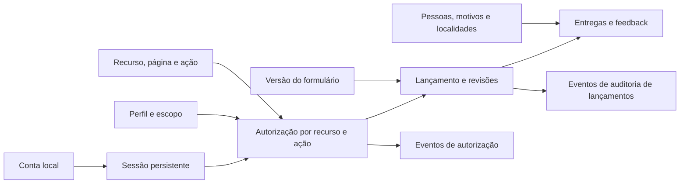

# Guia das tabelas do modelo operacional de Logística

**Status em 27/10/2026:** staging está na revisão `e31f9a7c2b64 (head)`. O código do Portal foi publicado em `staging` e o CI passou; a migration `a640c9e2f7b1` também está publicada na cadeia `logistica`, mas ainda não foi aplicada. Antes do upgrade falta snapshot RDS; depois, deploy manual da API e aceite funcional.

Este guia explica o papel de cada tabela `op_logistica_*` definida no [DBML operacional](./modelo_operacional_lancamento_logistica.dbml). O modelo dá suporte à autenticação e às sessões, aos cadastros, às permissões, ao preenchimento de formulários e aos eventos auditáveis. Algumas colunas de vigência/versionamento permanecem por compatibilidade com dados anteriores; a edição corrente de pessoas e motivos atualiza o registro existente.

As tabelas operacionais guardam o processo e seu histórico. As tabelas `dim_*` e `fato_*` do VilarejoBI são voltadas à análise. O prefixo `op_logistica_` identifica a camada operacional; não significa, por si só, que ela esteja em outro servidor, banco ou catálogo. O DBML mantém clara essa responsabilidade. As migrations-base, de sessão, de simplificação do feedback e de localidades já foram aplicadas em staging.

## Visão geral do fluxo

1. O usuário entra com username e senha; o serviço verifica o hash da senha e cria uma sessão opaca, persistindo somente o hash do token.
2. Em cada solicitação protegida, o backend valida a sessão, a conta, as permissões e os escopos concedidos.
3. O usuário inicia um lançamento usando uma versão publicada do formulário.
4. O sistema grava uma ou mais revisões e os dados tipados do formulário.
5. Quem preenche envia o lançamento diretamente, sem tela de conferência final. A confirmação é auditada; o histórico permite editar ou cancelar, e as correções preservam a versão anterior.
6. O Portal mantém os dados neste catálogo operacional e não os publica no modelo analítico.

O painel apresenta séries temporais em linha, proporções em barra empilhada, motivos/grupos em barras horizontais ordenadas por quantidade e taxas por equipe/loja em barras horizontais ordenadas da menor para a maior. O ranking por pessoa fica em página própria com filtros de período, localidade, tipo de transporte, nome, função e situação.

## Setores, localidades e autorização

| Tabela | O que guarda | Por que é importante |
|---|---|---|
| `op_logistica_setor` | Os setores responsáveis por registrar dados, como Suporte. | Organiza os lançamentos e os escopos de acesso por área. O módulo de Entregas grava no setor `SUPORTE`; ele não é uma localidade nem um cadastro de cada loja. |
| `op_logistica_localidade` | Catálogo local de localidades usadas pelo portal, com código, nome e tipo. | Evita variações de texto livre. O catálogo pertence a este projeto e não sincroniza com o VilarejoBI. |
| `op_logistica_perfil` | Os papéis do sistema, como operador, cadastrador, gestor ou administrador. | Agrupa as regras de acesso que serão concedidas aos usuários. `CADASTRADOR` recebe somente `CADASTROS:ADMINISTRAR`; `CONTROLE_ACESSO:ADMINISTRAR` é uma permissão separada. |
| `op_logistica_recurso` | Áreas ou páginas funcionais do portal, como Entregas, Frota e Painel Gerencial. | Permite configurar quais perfis podem acessar cada área. Um recurso associado a um setor respeita o escopo daquele setor; páginas transversais continuam sujeitas aos escopos dos dados. |
| `op_logistica_permissao` | Uma ação dentro de um recurso, como `ENTREGAS_DIARIAS:ACESSAR`, `ENTREGAS_DIARIAS:VER` ou `ENTREGAS_DIARIAS:CRIAR`. | Separa acesso à página das ações feitas nela. A API verifica a ação específica em cada chamada; mostrar/ocultar menu não substitui autorização no servidor. Confirmar um lançamento exige a permissão de criação, não uma permissão de aprovador. |
| `op_logistica_perfil_permissao` | Associação que representa as permissões atualmente concedidas a cada perfil, com data e autor da concessão. | Combina ações diferentes em cada área sem codificar a regra em uma página. Na revogação, a associação atual pode ser removida, mas o evento correspondente preserva ator, data e motivo na trilha de auditoria. |
| `op_logistica_usuario` | Conta local, estado ativo e credencial opcional. | Guarda username normalizado, dados da conta e hash Argon2id. Os três campos de credencial ficam todos nulos até a senha ser provisionada; nunca retornar hash pela API nem registrá-lo em logs. |
| `op_logistica_sessao` | Sessões emitidas após o login, com hash SHA-256 do token opaco, conta, criação, expiração, último uso e revogação. | Permite manter o login entre solicitações e invalidar sessões expiradas ou revogadas sem guardar o token utilizável no banco. A API consulta pelo hash, verifica expiração/revogação e não registra tokens em logs. |
| `op_logistica_escopo` | O contexto em que um acesso vale: global, setor, localidade ou combinação de setor e localidade. | Limita os dados e as ações ao contexto autorizado, como um setor em determinadas unidades. O escopo acompanha cada concessão de perfil: adicionar um perfil global de catálogos não amplia o escopo das permissões de Entregas ou feedback recebidas por outra concessão. |
| `op_logistica_usuario_escopo` | Perfil e escopo concedidos a uma conta, com período de vigência e autor da concessão. | O servidor registra o início e a criação da concessão; os acessos começam sem data final. A administração revoga quando necessário, encerrando a concessão sem apagar a linha; a trilha registra quem fez isso, quando e o motivo. Uma nova concessão gera outra linha. A API valida a concessão e o escopo em cada leitura, gravação e exportação. |
| `op_logistica_autorizacao_evento` | Alterações de perfis, recursos, permissões, contas, concessões de acesso e cadastros operacionais. | Preserva ator, alvo, ação, data e diffs permitidos; o evento e a alteração correspondente são gravados na mesma transação. A tela resolve nome/username atual do ator pelo ID e exibe campos seguros. Nunca retorna credenciais, motivo privado de revogação ou texto livre. A tabela é append-only e serve para auditoria, não para decidir o acesso atual. |

Em conjunto, essas tabelas respondem: qual é a conta, se há uma sessão autenticada, quais recursos seus perfis podem acessar, quais ações pode executar e em quais setores ou localidades. A sessão comprova a autenticação, mas não concede permissões por si só. Não há um número único de nível de acesso: perfis podem ter permissões diferentes por recurso e valer em escopos distintos. CPF não faz parte do MVP; se for aprovado depois, deve entrar em uma tabela própria e com acesso restrito.

Exemplo: uma pessoa de Suporte recebe `OPERADOR` com escopo `SETOR` ou `SETOR_LOCALIDADE`. Esse perfil inclui a manutenção dos catálogos compartilhados, cuja lista inteira fica visível para quem tem `CADASTROS:ADMINISTRAR`; o escopo continua limitando as entregas e o feedback. A interface esconde a área de usuários para quem não tem `CONTROLE_ACESSO:ADMINISTRAR`, e as rotas de contas e concessões aplicam a mesma verificação no servidor.

### Como a autorização deve funcionar

Para cada solicitação protegida, o backend deve resolver a autorização no servidor nesta ordem:

1. Confirmar que a conta autenticada existe e está ativa.
2. Identificar o recurso e a ação exigidos pela operação, como `ENTREGAS_DIARIAS:VER`, `ENTREGAS_DIARIAS:CRIAR` ou `ENTREGAS_DIARIAS:EDITAR_RASCUNHO`.
3. Encontrar uma concessão ativa e vigente em `op_logistica_usuario_escopo` e confirmar que o perfil concedido possui aquela permissão em `op_logistica_perfil_permissao`.
4. Comparar o setor e a localidade do registro solicitado com o escopo concedido. Para um recurso transversal, a consulta ainda precisa aplicar os escopos do usuário aos dados.
5. Negar por padrão se a conta estiver inativa, a concessão estiver vencida, faltar a ação ou o registro estiver fora do escopo.

O menu pode esconder recursos sem `ACESSAR`, mas isso é apenas navegação: a API deve repetir a verificação para toda operação e filtrar resultados no banco antes de paginar, exportar ou retornar registros. Também deve verificar se cada identificador recebido pertence ao escopo autorizado, evitando que a troca de um ID na URL permita consultar dados de outro setor.

| Exemplo | Concessão esperada | Resultado |
|---|---|---|
| Gestores X e Y do mesmo setor | Ambos recebem o perfil de gestor, permissões do recurso Entregas e escopo daquele setor. | Ambos consultam os registros autorizados do setor. |
| Diretor de Logística ou dono da Vilarejo | Recebe permissões explícitas de leitura nos recursos necessários e escopo `GLOBAL`. | Consulta os recursos concedidos em todos os setores; isso não concede automaticamente administração ou acesso a dados pessoais restritos. |
| Gestor de outro setor | Não possui a permissão do recurso ou não possui escopo compatível com o registro. | A página/operação é negada, mesmo que o usuário tente chamar a API diretamente. |

A hierarquia de cargos não concede acesso automaticamente neste modelo. Se futuramente a empresa quiser que mudanças na estrutura organizacional propaguem acesso sem concessões explícitas, será necessário definir uma fonte confiável dessa hierarquia e uma regra de herança; não basta comparar o nome do cargo.

As definições e concessões atuais têm papéis distintos do histórico. `op_logistica_perfil`, `op_logistica_recurso` e `op_logistica_permissao` guardam o catálogo editável; `op_logistica_perfil_permissao` e `op_logistica_usuario_escopo` representam o estado que a API consulta para autorizar. `op_logistica_autorizacao_evento` registra alterações dessas definições e concessões em trilha append-only. A mudança e a inclusão do evento devem ocorrer na mesma transação; exigir motivo para revogações e impedir que a credencial de runtime altere ou apague eventos. Para revogar uma associação de perfil/permissão, remover a associação atual e preservar o evento; para revogar usuário/escopo, desativar ou antecipar o fim da concessão e preservar sua linha. O vencimento natural em `vigente_ate` já impede o acesso e não é uma revogação manual que precise de novo evento.

## Formulários, lançamentos e auditoria

| Tabela | O que guarda | Por que é importante |
|---|---|---|
| `op_logistica_formulario_versao` | Versões de cada formulário, vinculadas a um setor, com status, período de vigência, hash do contrato de campos e responsáveis pela publicação. | Permite identificar qual versão e quais validações se aplicavam a um lançamento histórico. A API confere se o setor da versão corresponde ao setor do lançamento. A definição tipada dos campos fica no código validado, não em um JSON genérico. O provisionamento cria uma versão inicial; a tabela só precisa de novas linhas quando o contrato do formulário mudar. |
| `op_logistica_lancamento` | Cabeçalho estável do processo: setor, criador, UUID público e chave de idempotência. | Agrupa as revisões de um mesmo processo. Não guarda o estado atual; esse estado é derivado da revisão mais recente. |
| `op_logistica_lancamento_revisao` | Cada versão do conteúdo lançado, com número, estado, formulário usado, hash e responsáveis/datas de criação e confirmação. Campos de aprovação/devolução dão suporte somente a registros legados. | Preserva o que foi confirmado. A versão confirmada é imutável; uma correção futura cria outra revisão. O UUID da revisão identifica cada versão dentro do Portal. |
| `op_logistica_lancamento_evento` | Ações e mudanças de estado, com ator, data, comentário e nomes dos campos alterados. | Mantém a trilha de auditoria. Deve ser append-only: a aplicação não deve alterar nem apagar eventos antigos. `campos_alterados` guarda metadados, não valores sensíveis do formulário. |

Para novos lançamentos, `RASCUNHO` é editável e `ENVIADA` significa confirmado e registrado; não há fila de aprovação. `CANCELADA` pode ser usada conforme a política de cancelamento. `EM_REVISAO`, `DEVOLVIDA` e `APROVADA` permanecem no esquema apenas para leitura de registros legados, sem novas transições para esses estados. A revisão registra o estado e as datas; a tabela de eventos explica as ações que levaram a essas mudanças.

## Cadastros usados nos formulários

| Tabela | O que guarda | Por que é importante |
|---|---|---|
| `op_logistica_pessoa` | Pessoas que podem participar dos registros, com nome, função e tipo de entrega (`PROPRIA`/`TERCEIRIZADA`). Pode incluir o código correspondente no sistema de origem. | A classificação aparece no seletor da equipe e separa os indicadores; a API bloqueia equipes mistas. Edições atualizam a linha atual, sem inserir outra versão, e geram evento com valores anteriores/novos. Mudanças de nome ou tipo também alteram a leitura histórica dos lançamentos ligados à mesma linha. Registros antigos sem classe permanecem nulos até conferência. Contém dados identificáveis; o BI deve receber apenas dados autorizados e necessários, com pseudonimização quando aplicável. |
| `op_logistica_motivo_nao_entrega` | Motivos controlados para uma entrega não realizada, com código, descrição e grupo de ocorrência. | Os quatro grupos controlados são Transporte próprio, Transporte terceirizado, Loja e Logística. Edições atualizam a linha atual, sem inserir outra versão; a auditoria conserva descrição/grupo anterior e novos. Mudar o grupo reclassifica os indicadores históricos ligados a esse motivo. Registros antigos sem classificação permanecem nulos até revisão, sem inferência. Um motivo usado não deve ser apagado nem reutilizado com outro significado. |
Os IDs e as colunas de vigência/versionamento permanecem no schema por compatibilidade e para manter referências já gravadas. O fluxo atual cria novas linhas apenas para novos cadastros; o botão **Editar** envia `PUT` para a linha existente. A atualização não cria uma versão nem uma linha nova. Como os lançamentos referenciam o mesmo ID, alterações de pessoa/motivo passam a aparecer também na leitura histórica; a trilha de auditoria guarda os valores anteriores e novos.

## Dados preenchidos

| Tabela | O que guarda | Por que é importante |
|---|---|---|
| `op_logistica_entrega_diaria` | Resumo de entregas ou coletas realizadas e não realizadas por data, localidade e equipe, dentro de uma revisão. Mantém colunas legadas de prazo/completude e observação geral durante a transição. | `tipo_operacao` identifica `ENTREGA` ou `COLETA`; linhas antigas recebem `ENTREGA`. O grão é por equipe; por isso, podem existir vários registros para a mesma data e localidade. OTIF é `não realizadas / total registrado`, incluindo entregas e coletas, enquanto os painéis mantêm totais separados por operação. A nova interface deixa de gravar observação geral; preserva-se o campo para histórico existente. |
| `op_logistica_entrega_participante` | Associação de cada resumo de entrega às pessoas participantes e seus papéis, como motorista ou ajudante. | Permite atribuir a entrega à equipe sem repetir as quantidades para cada pessoa. O serviço deve validar as regras da equipe, incluindo limite de motorista e ajudantes. |
| `op_logistica_entrega_motivo` | Uma ocorrência de motivo e sua observação individual em uma entrega ou coleta. | `id_entrega_motivo` permite repetir o mesmo motivo no mesmo item sem compartilhar observação. Cada unidade não realizada exige uma linha; registros antigos com `quantidade` agrupada são expandidos pela API para manter compatibilidade. O grupo é obtido do cadastro do motivo. |
| `op_logistica_feedback` | Feedback com tipo, data, nome do cliente e relato, ligado a uma entrega confirmada. O formulário permite escolher motorista e até dois ajudantes e valida essa equipe contra a entrega; loja e data vêm do registro relacionado. | Registra elogios e reclamações ligados à equipe da entrega; vários feedbacks podem apontar para a mesma entrega. O tipo usa um dos dois códigos fixos `ELOGIO` ou `RECLAMACAO`, validado no contrato e por `CHECK`. Nome e relato são protegidos pelas permissões de consulta/exportação e não são copiados para fatos nem logs técnicos. Não se coletam telefone, documento ou outros identificadores. Todos os perfis do piloto consultam/exportam dentro dos escopos; OPERADOR também registra/importa. |

`op_logistica_entrega_participante` e `op_logistica_entrega_motivo` são tabelas de ligação: cada uma representa relações que podem envolver várias pessoas ou motivos sem guardar listas dentro de uma única coluna.

O painel agrega ocorrências por grupo/motivo e por tipo da entrega, mostrando tanto a participação nas não realizadas quanto a incidência sobre o total registrado. Também exibe os motivos associados às equipes no ranking. Como quantidades e motivos são registrados no nível da equipe, os mesmos resultados aparecem para cada integrante e não representam causalidade individual. O score atual soma elogios e subtrai reclamações; motivos são informativos até que haja aprovação explícita de atribuição e pesos.

O legado `op_logistica_entrega_diaria.observacao` deve ser preservado em migration. O novo campo `op_logistica_entrega_motivo.observacao` atende novos registros. Antes de qualquer remoção futura da coluna legada, definir como consultar/exportar observações antigas, especialmente nos lançamentos que tenham vários motivos.

O modelo CSV novo usa `observacoes_motivos` com um valor por item da coluna `motivos`, na mesma ordem e separados por `|`. A coluna antiga `observacao` é rejeitada para novos lançamentos; o histórico exporta o campo geral somente para consulta dos registros antigos.

Uma simplificação futura possível é incorporar a versão/hash do formulário diretamente na revisão e remover `op_logistica_formulario_versao`. Mantive-a porque o backend hoje consulta uma versão publicada antes de aceitar lançamentos e usa essa referência no histórico. Se o produto decidir que o formulário será sempre uma constante do código, sem ciclo próprio de publicação, podemos eliminar essa tabela numa migration separada.

O painel calcula `OTIF = entregas não realizadas / (entregas realizadas + entregas não realizadas) × 100`. O cálculo é feito sobre as somas do recorte selecionado e aparece no geral e por motorista, equipe e loja. A taxa de realização continua sendo uma medida separada. As colunas de prazo/completude permanecem no banco apenas para compatibilidade com registros e revisões existentes.

## Relação com o modelo analítico

O DBML operacional não declara FKs diretas para dimensões ou fatos do BI. O Portal mantém seus próprios catálogos operacionais e não envia versões confirmadas ao modelo analítico neste release.

Essa separação mantém rascunhos, histórico de versões e dados pessoais na camada operacional. As tabelas podem estar no mesmo banco físico sem misturar suas responsabilidades: o Portal usa as tabelas `op_logistica_*` para login, autorização, formulários e histórico.

## Estado das migrations do banco de Logística

Staging está na revisão `d2a8f6c1b904 (head)`, confirmada em 27/10/2026. A revisão
`f3c8a1d6b907` simplificou o modelo de feedback, `b817e6c2a904` acrescentou cidade/UF e auditoria
de alterações de localidades, `c9b61a2f4d80` habilitou auditoria de alterações de identidade, e
`d2a8f6c1b904` adicionou classificações de pessoa/motivo e observação por motivo. Essas revisões
não alteraram as tabelas `dim_*` ou `fato_*` do VilarejoBI.

Mudanças futuras devem seguir a cadeia existente, sem criar uma tabela `alembic_version` ou uma cadeia paralela para o Portal:

1. Confirmar o banco/alvo, o mecanismo e a versão, o schema/catálogo e a revisão Alembic atual de Logística.
2. Revisar a migration e confirmar que a revisão está versionada e disponível no ambiente de execução.
3. Conferir os pré-requisitos e o comportamento de reversão antes da mudança.
4. Aplicar primeiro em staging e comparar a estrutura criada com o DBML. Preservar as tabelas `dim_*` e `fato_*`.
5. Antes de produção, validar backup/restauração e planejar a janela de aplicação.

As tabelas de autorização e cadastros de referência poderão receber dados iniciais controlados em uma etapa de seed. Não criar usuários reais nem senhas padrão dentro da migration de schema. Contas são criadas por uma pessoa administradora autenticada, com senha aleatória numérica de seis dígitos exibida uma vez; não existe auto cadastro público nem troca obrigatória no primeiro acesso. A pessoa pode trocar a senha autenticada ou redefini-la com nome completo e username. A página registra concessões e revogações com evento de auditoria.

**Estado confirmado em staging em 27/10/2026:** a revisão `e31f9a7c2b64` foi aplicada após `d2a8f6c1b904`; ela amplia os CHECKs de auditoria para aceitar atualizações de pessoa e motivo. A migration `a640c9e2f7b1` ainda está pendente e acrescenta `tipo_operacao` para coletas e uma chave substituta em `op_logistica_entrega_motivo`, permitindo motivos repetidos por ocorrência. Ela depende de `e31f9a7c2b64`; não aplique `upgrade` até revisar/publicar a migration e confirmar o alvo de staging.

## Atualização de requisitos — coletas e ocorrências individuais (27/10/2026)

- O formulário registra entregas e coletas em seções separadas; ambas têm quantidades realizadas e não realizadas e entram no OTIF combinado.
- Cada unidade não realizada exige seu próprio motivo e sua própria observação. A chave `id_entrega_motivo` permite repetir o mesmo motivo no mesmo item.
- O histórico continua sendo o caminho para editar ou cancelar. O formulário envia diretamente sem etapa de conferência; iniciar uma correção não exige justificativa, mas permanece auditado. Cancelar continua exigindo justificativa.
- O painel filtra por tipo de transporte, apresenta coletas separadas das entregas nos resumos e motivos e usa uma página própria para o ranking por pessoa.
- A migration `a640c9e2f7b1` ainda não foi aplicada em staging; código, migration, CI e publicação precisam ser coordenados antes do aceite funcional.

Detalhes de contrato, interface e passos de release: [alterações de coletas e indicadores](./alteracoes-coletas-edicao-indicadores.md).
