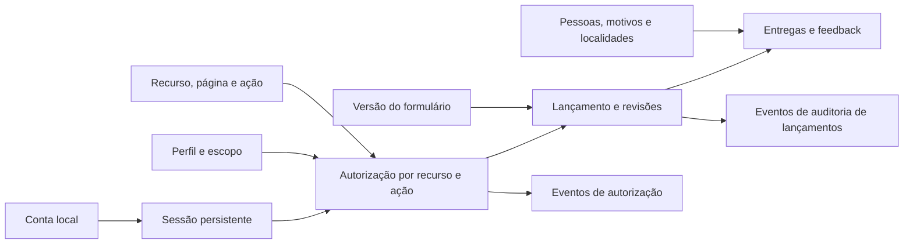

# Guia das tabelas do modelo operacional de Logística

**Status:** o modelo ORM revisado tem 21 tabelas. O staging ainda está na `d7c9a4f2b610` e mantém as quatro tabelas que a revisão `f3c8a1d6b907` vai retirar; essa migration está preparada, mas não foi aplicada.

Este guia explica o papel de cada tabela `op_logistica_*` definida no [DBML operacional](./modelo_operacional_lancamento_logistica.dbml). O modelo dá suporte à autenticação e às sessões, aos cadastros, às permissões, ao preenchimento de formulários e ao histórico de versões.

As tabelas operacionais guardam o processo e seu histórico. As tabelas `dim_*` e `fato_*` do VilarejoBI são voltadas à análise. O prefixo `op_logistica_` identifica a camada operacional; não significa, por si só, que ela esteja em outro servidor, banco ou catálogo. O DBML mantém clara essa responsabilidade. As migrations-base e de sessão já foram aplicadas em staging; a revisão de simplificação permanece pendente.

## Visão geral do fluxo

1. O usuário entra com username e senha; o serviço verifica o hash da senha e cria uma sessão opaca, persistindo somente o hash do token.
2. Em cada solicitação protegida, o backend valida a sessão, a conta, as permissões e os escopos concedidos.
3. O usuário inicia um lançamento usando uma versão publicada do formulário.
4. O sistema grava uma ou mais revisões e os dados tipados do formulário.
5. Quem preenche confere e confirma o lançamento. Eventos registram essa confirmação; correções futuras criam uma nova versão e preservam o histórico.
6. O Portal mantém os dados neste catálogo operacional e não os publica no modelo analítico.

## Setores, localidades e autorização

| Tabela | O que guarda | Por que é importante |
|---|---|---|
| `op_logistica_setor` | Os setores ou módulos da operação, como Entregas. | Organiza os lançamentos e os escopos de acesso por área. No lançamento inicial, o provisionamento cria apenas o setor `ENTREGAS`; ele não é uma localidade nem um cadastro de cada loja. |
| `op_logistica_localidade` | Catálogo local de localidades usadas pelo portal, com código, nome e tipo. | Evita variações de texto livre. O catálogo pertence a este projeto e não sincroniza com o VilarejoBI. |
| `op_logistica_perfil` | Os papéis do sistema, como operador, gestor ou administrador. | Agrupa as regras de acesso que serão concedidas aos usuários. |
| `op_logistica_recurso` | Áreas ou páginas funcionais do portal, como Entregas, Frota e Painel Gerencial. | Permite configurar quais perfis podem acessar cada área. Um recurso associado a um setor respeita o escopo daquele setor; páginas transversais continuam sujeitas aos escopos dos dados. |
| `op_logistica_permissao` | Uma ação dentro de um recurso, como `ENTREGAS_DIARIAS:ACESSAR`, `ENTREGAS_DIARIAS:VER` ou `ENTREGAS_DIARIAS:CRIAR`. | Separa acesso à página das ações feitas nela. A API verifica a ação específica em cada chamada; mostrar/ocultar menu não substitui autorização no servidor. Confirmar um lançamento exige a permissão de criação, não uma permissão de aprovador. |
| `op_logistica_perfil_permissao` | Associação que representa as permissões atualmente concedidas a cada perfil, com data e autor da concessão. | Combina ações diferentes em cada área sem codificar a regra em uma página. Na revogação, a associação atual pode ser removida, mas o evento correspondente preserva ator, data e motivo na trilha de auditoria. |
| `op_logistica_usuario` | Conta local, estado ativo e credencial opcional. | Guarda username normalizado, dados da conta e hash Argon2id. Os três campos de credencial ficam todos nulos até a senha ser provisionada; nunca retornar hash pela API nem registrá-lo em logs. |
| `op_logistica_sessao` | Sessões emitidas após o login, com hash SHA-256 do token opaco, conta, criação, expiração, último uso e revogação. | Permite manter o login entre solicitações e invalidar sessões expiradas ou revogadas sem guardar o token utilizável no banco. A API consulta pelo hash, verifica expiração/revogação e não registra tokens em logs. |
| `op_logistica_escopo` | O contexto em que um acesso vale: global, setor, localidade ou combinação de setor e localidade. | Limita os dados e as ações ao contexto autorizado, como um setor em determinadas unidades. |
| `op_logistica_usuario_escopo` | Perfil e escopo concedidos a uma conta, com período de vigência e autor da concessão. | O servidor registra o início e a criação da concessão; os acessos começam sem data final. A administração revoga quando necessário, encerrando a concessão sem apagar a linha; a trilha registra quem fez isso, quando e o motivo. Uma nova concessão gera outra linha. A API valida a concessão e o escopo em cada leitura, gravação e exportação. |
| `op_logistica_autorizacao_evento` | Alterações de perfis, recursos, permissões, contas, concessões de acesso e cadastros operacionais. | Preserva o histórico quando definições ou associações mudam. O evento e a alteração correspondente são gravados na mesma transação; metadados não sensíveis ficam em `detalhes`. A tabela é append-only e serve para auditoria, não para decidir o acesso atual. |

Em conjunto, essas tabelas respondem: qual é a conta, se há uma sessão autenticada, quais recursos seus perfis podem acessar, quais ações pode executar e em quais setores ou localidades. A sessão comprova a autenticação, mas não concede permissões por si só. Não há um número único de nível de acesso: perfis podem ter permissões diferentes por recurso e valer em escopos distintos. CPF não faz parte do MVP; se for aprovado depois, deve entrar em uma tabela própria e com acesso restrito.

### Como a autorização deve funcionar

Para cada solicitação protegida, o backend deve resolver a autorização no servidor nesta ordem:

1. Confirmar que a conta autenticada existe e está ativa.
2. Identificar o recurso e a ação exigidos pela operação, como `ENTREGAS_DIARIAS:VER`, `ENTREGAS_DIARIAS:CRIAR` ou `ENTREGAS_DIARIAS:EDITAR_RASCUNHO`.
3. Encontrar uma concessão ativa e vigente em `op_logistica_usuario_escopo` e confirmar que o perfil concedido possui aquela permissão em `op_logistica_perfil_permissao`.
4. Comparar o setor e a localidade do registro solicitado com o escopo concedido. Para um recurso transversal, a consulta ainda precisa aplicar os escopos do usuário aos dados.
5. Negar por padrão se a conta estiver inativa, a concessão estiver vencida, faltar a ação ou o registro estiver fora do escopo.

O menu pode esconder recursos sem `ACESSAR`, mas isso é apenas navegação: a API deve repetir a verificação para toda operação e filtrar resultados no banco antes de paginar, exportar ou retornar registros. Também deve verificar se cada identificador recebido pertence ao escopo autorizado, evitando que a troca de um ID na URL permita consultar dados de outro setor.

| Exemplo | Concessão esperada | Resultado |
|---|---|---|
| Gestores X e Y do mesmo setor | Ambos recebem o perfil de gestor, permissões do recurso Entregas e escopo daquele setor. | Ambos consultam os registros autorizados do setor. |
| Diretor de Logística ou dono da Vilarejo | Recebe permissões explícitas de leitura nos recursos necessários e escopo `GLOBAL`. | Consulta os recursos concedidos em todos os setores; isso não concede automaticamente administração ou acesso a dados pessoais restritos. |
| Gestor de outro setor | Não possui a permissão do recurso ou não possui escopo compatível com o registro. | A página/operação é negada, mesmo que o usuário tente chamar a API diretamente. |

A hierarquia de cargos não concede acesso automaticamente neste modelo. Se futuramente a empresa quiser que mudanças na estrutura organizacional propaguem acesso sem concessões explícitas, será necessário definir uma fonte confiável dessa hierarquia e uma regra de herança; não basta comparar o nome do cargo.

As definições e concessões atuais têm papéis distintos do histórico. `op_logistica_perfil`, `op_logistica_recurso` e `op_logistica_permissao` guardam o catálogo editável; `op_logistica_perfil_permissao` e `op_logistica_usuario_escopo` representam o estado que a API consulta para autorizar. `op_logistica_autorizacao_evento` registra alterações dessas definições e concessões em trilha append-only. A mudança e a inclusão do evento devem ocorrer na mesma transação; exigir motivo para revogações e impedir que a credencial de runtime altere ou apague eventos. Para revogar uma associação de perfil/permissão, remover a associação atual e preservar o evento; para revogar usuário/escopo, desativar ou antecipar o fim da concessão e preservar sua linha. O vencimento natural em `vigente_ate` já impede o acesso e não é uma revogação manual que precise de novo evento.

## Formulários, lançamentos e auditoria

| Tabela | O que guarda | Por que é importante |
|---|---|---|
| `op_logistica_formulario_versao` | Versões de cada formulário, vinculadas a um setor, com status, período de vigência, hash do contrato de campos e responsáveis pela publicação. | Permite identificar qual versão e quais validações se aplicavam a um lançamento histórico. A API confere se o setor da versão corresponde ao setor do lançamento. A definição tipada dos campos fica no código validado, não em um JSON genérico. O provisionamento cria uma versão inicial; a tabela só precisa de novas linhas quando o contrato do formulário mudar. |
| `op_logistica_lancamento` | Cabeçalho estável do processo: setor, criador, UUID público e chave de idempotência. | Agrupa as revisões de um mesmo processo. Não guarda o estado atual; esse estado é derivado da revisão mais recente. |
| `op_logistica_lancamento_revisao` | Cada versão do conteúdo lançado, com número, estado, formulário usado, hash e responsáveis/datas de criação e confirmação. Campos de aprovação/devolução dão suporte somente a registros legados. | Preserva o que foi confirmado. A versão confirmada é imutável; uma correção futura cria outra revisão. O UUID da revisão identifica cada versão dentro do Portal. |
| `op_logistica_lancamento_evento` | Ações e mudanças de estado, com ator, data, comentário e nomes dos campos alterados. | Mantém a trilha de auditoria. Deve ser append-only: a aplicação não deve alterar nem apagar eventos antigos. `campos_alterados` guarda metadados, não valores sensíveis do formulário. |

Para novos lançamentos, `RASCUNHO` é editável e `ENVIADA` significa confirmado e registrado; não há fila de aprovação. `CANCELADA` pode ser usada conforme a política de cancelamento. `EM_REVISAO`, `DEVOLVIDA` e `APROVADA` permanecem no esquema apenas para leitura de registros legados, sem novas transições para esses estados. A revisão registra o estado e as datas; a tabela de eventos explica as ações que levaram a essas mudanças.

## Cadastros usados nos formulários

| Tabela | O que guarda | Por que é importante |
|---|---|---|
| `op_logistica_pessoa` | Pessoas que podem participar dos registros, com nome, função e período de vigência. Pode incluir o código correspondente no sistema de origem. | Evita nomes digitados livremente e preserva qual versão de nome/função valia na data do registro. A vigência e os horários de criação/alteração são preenchidos pelo servidor. Contém dados identificáveis; o BI deve receber apenas os dados autorizados e necessários, com pseudonimização quando aplicável. |
| `op_logistica_motivo_nao_entrega` | Motivos controlados para uma entrega não realizada, com código, descrição e vigência. | Padroniza o preenchimento e preserva o significado histórico dos motivos. O código interno e o início da vigência são definidos pelo servidor. Um motivo usado não deve ser apagado nem reutilizado com outro significado. |
Pessoas e motivos são versionados por período. Quando uma descrição, função ou nome muda e a mudança precisa ser preservada, cria-se uma nova versão em vez de sobrescrever o registro histórico.

## Dados preenchidos

| Tabela | O que guarda | Por que é importante |
|---|---|---|
| `op_logistica_entrega_diaria` | Resumo de entregas realizadas e não realizadas por data, localidade e equipe, dentro de uma revisão. Registra também quantas ficaram no prazo e quantas foram completas. | É a linha principal do formulário de Entregas. O grão é por equipe; por isso, podem existir vários registros para a mesma data e localidade. Ambas as contagens OTIF são subconjuntos das realizadas. A soma de realizadas e não realizadas é o total registrado e o denominador das taxas, não uma previsão independente. Registros legados podem não ter as contagens OTIF; nesse caso, o painel não mostra OTIF para um período que os inclua. A observação fica fora do modelo analítico proposto. |
| `op_logistica_entrega_participante` | Associação de cada resumo de entrega às pessoas participantes e seus papéis, como motorista ou ajudante. | Permite atribuir a entrega à equipe sem repetir as quantidades para cada pessoa. O serviço deve validar as regras da equipe, incluindo limite de motorista e ajudantes. |
| `op_logistica_entrega_motivo` | Quantidade de entregas não realizadas para cada motivo associado a uma linha de entrega. | Explica a composição das não realizadas. Na mesma transação, o serviço deve validar que a soma das quantidades por motivo coincide com `quantidade_nao_realizada`. |
| `op_logistica_feedback` | Feedback com tipo, data, nome do cliente, localidade, relato e vínculo a uma entrega confirmada. A equipe e a data da entrega são derivadas do registro relacionado. | Registra elogios e reclamações com cliente e equipe de referência. O tipo usa um dos dois códigos fixos `ELOGIO` ou `RECLAMACAO`, validado no contrato e por `CHECK`; a equipe vem dos participantes da entrega ligada ao feedback, sem gravar a mesma associação outra vez. Nome e texto são dados identificáveis; acesso e exportação exigem permissão e não são copiados para fatos nem logs técnicos. O bootstrap local concede as ações a DEV, GESTOR e DIRETORIA. |

`op_logistica_entrega_participante` e `op_logistica_entrega_motivo` são tabelas de ligação: cada uma representa relações que podem envolver várias pessoas ou motivos sem guardar listas dentro de uma única coluna.

Uma simplificação futura possível é incorporar a versão/hash do formulário diretamente na revisão e remover `op_logistica_formulario_versao`. Mantive-a porque o backend hoje consulta uma versão publicada antes de aceitar lançamentos e usa essa referência no histórico. Se o produto decidir que o formulário será sempre uma constante do código, sem ciclo próprio de publicação, podemos eliminar essa tabela numa migration separada.

O painel calcula o OTIF aprovado para este produto usando as duas contagens do formulário:
`percentual no prazo = entregas no prazo / total registrado`, `percentual completo = entregas
completas / total registrado` e `OTIF = percentual no prazo × percentual completo`. As contagens
precisam estar preenchidas nas linhas confirmadas; registros anteriores à inclusão dos campos
permanecem com OTIF indisponível até uma correção informar os valores. A taxa de realização continua
sendo uma medida separada.

## Relação com o modelo analítico

O DBML operacional não declara FKs diretas para dimensões ou fatos do BI. O Portal mantém seus próprios catálogos operacionais e não envia versões confirmadas ao modelo analítico neste release.

Essa separação mantém rascunhos, histórico de versões e dados pessoais na camada operacional. As tabelas podem estar no mesmo banco físico sem misturar suas responsabilidades: o Portal usa as tabelas `op_logistica_*` para login, autorização, formulários e histórico.

## Estado das migrations do banco de Logística

Conforme o último retorno do responsável, staging está na revisão `d7c9a4f2b610`. A revisão
`f3c8a1d6b907` remove duas tabelas de publicação adiadas, o catálogo fixo de tipos de feedback e a
tabela de participantes de feedback duplicada; ainda não foi aplicada. Ela converte o tipo de
feedback para código fixo e passa a derivar a equipe pela entrega vinculada. A revisão depende da
cadeia existente e não altera tabelas `dim_*` ou `fato_*` do VilarejoBI.

A aplicação da nova revisão deve seguir a cadeia existente, sem criar uma tabela `alembic_version` ou uma cadeia paralela para o Portal:

1. Confirmar o banco/alvo, o mecanismo e a versão, o schema/catálogo e a revisão Alembic atual de Logística.
2. Revisar a migration `f3c8a1d6b907` e confirmar que a revisão está versionada e disponível no ambiente de execução.
3. A migration interrompe antes das alterações se houver publicações, tipos de feedback não previstos, feedback sem entrega ou divergência entre os participantes do feedback e os da entrega.
4. Aplicar primeiro em staging e comparar a estrutura criada com o DBML. Preservar as tabelas `dim_*` e `fato_*`.
5. Antes de produção, validar backup/restauração e planejar a janela de aplicação.

As tabelas de autorização e cadastros de referência poderão receber dados iniciais controlados em uma etapa de seed. Não criar usuários reais nem senhas padrão dentro da migration de schema. Contas são criadas por uma pessoa administradora autenticada, com senha aleatória numérica de seis dígitos exibida uma vez; não existe auto cadastro público nem troca obrigatória no primeiro acesso. A pessoa pode trocar a senha autenticada ou redefini-la com nome completo e username. A página registra concessões e revogações com evento de auditoria.

**Migration anterior aplicada em staging:** a revisão `d7c9a4f2b610` adicionou as contagens de OTIF, a autoria/idempotência dos feedbacks e alinhou os CHECKs de auditoria aos eventos de usuário e dos catálogos locais. O downgrade de `f3c8a1d6b907` recria as tabelas removidas e reconstrói os participantes dos feedbacks a partir das equipes das entregas.
