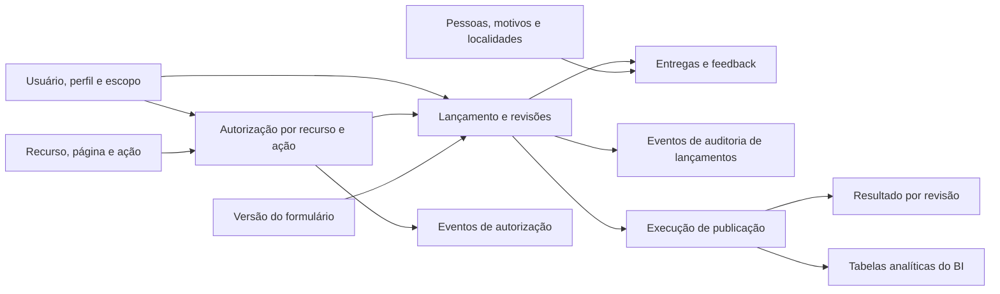

# Guia das tabelas do modelo operacional de Logística

**Status:** modelos ORM já mapeados no backend do portal; este guia e o DBML não confirmam que as tabelas já foram criadas ou migradas.

Este guia explica o papel de cada tabela `op_logistica_*` definida no [DBML operacional](./modelo_operacional_lancamento_logistica.dbml). O modelo dá suporte aos cadastros, às permissões, ao preenchimento de formulários, ao fluxo de revisão e à publicação dos dados aprovados.

As tabelas operacionais guardam o processo e seu histórico. As tabelas `dim_*` e `fato_*` do VilarejoBI são voltadas à análise. O prefixo `op_logistica_` identifica a camada operacional; não significa, por si só, que ela esteja em outro servidor, banco ou catálogo. Manter o DBML operacional separado documenta essa responsabilidade distinta; as tabelas ainda poderão ser criadas no mesmo banco de Logística do BI por uma migration coordenada.

## Visão geral do fluxo

1. O usuário entra com username e senha; o serviço verifica o hash e recebe os perfis e escopos de acesso concedidos à conta.
2. O usuário inicia um lançamento usando uma versão publicada do formulário.
3. O sistema grava uma ou mais revisões e os dados tipados do formulário.
4. Eventos registram as ações e mudanças de estado. Revisões aprovadas ficam preservadas; uma correção cria uma nova revisão.
5. Uma execução de publicação processa revisões aprovadas, registra o resultado de cada uma e envia os dados ao modelo analítico.

## Setores, localidades e autorização

| Tabela | O que guarda | Por que é importante |
|---|---|---|
| `op_logistica_setor` | Os setores ou módulos da operação, como Entregas. | Organiza os lançamentos por área e permite limitar o acesso a cada setor. |
| `op_logistica_localidade` | Cópia controlada das localidades usadas pelo portal, com código, nome e tipo. | Evita variações de texto livre. `codigo_localidade` permite associar a localidade ao BI por correspondência exata; o cadastro não deve ser editado livremente pela interface. |
| `op_logistica_perfil` | Os papéis do sistema, como operador, gestor ou administrador. | Agrupa as regras de acesso que serão concedidas aos usuários. |
| `op_logistica_recurso` | Áreas ou páginas funcionais do portal, como Entregas, Frota e Painel Gerencial. | Permite configurar quais perfis podem acessar cada área. Um recurso associado a um setor respeita o escopo daquele setor; páginas transversais continuam sujeitas aos escopos dos dados. |
| `op_logistica_permissao` | Uma ação dentro de um recurso, como `ENTREGAS_DIARIAS:ACESSAR`, `ENTREGAS_DIARIAS:VER` ou `ENTREGAS_DIARIAS:APROVAR`. | Separa acesso à página das ações feitas nela. A API verifica a ação específica em cada chamada; mostrar/ocultar menu não substitui autorização no servidor. |
| `op_logistica_perfil_permissao` | Associação que representa as permissões atualmente concedidas a cada perfil, com data e autor da concessão. | Combina ações diferentes em cada área sem codificar a regra em uma página. Na revogação, a associação atual pode ser removida, mas o evento correspondente preserva ator, data e motivo na trilha de auditoria. |
| `op_logistica_usuario` | Cadastro da conta local, com username, nome completo, estado ativo e datas. | O username normalizado identifica a conta. O nível de acesso não fica aqui: os perfis e escopos são atribuídos em `op_logistica_usuario_escopo`. |
| `op_logistica_usuario_credencial` | Hash de senha e datas relacionadas à credencial local, em relação um-para-um com a conta. | Isola o material de autenticação do cadastro usado pelo restante do portal. A senha é armazenada somente como hash Argon2id gerado por biblioteca confiável; o hash nunca é enviado pela API ou registrado em logs. |
| `op_logistica_usuario_identificacao` | Linha opcional com CPF da conta, separada do cadastro usado pelo portal no dia a dia. | Mantém o CPF fora das consultas comuns de usuários e permite restringir sua leitura. A ausência da linha significa que o CPF não foi coletado; só incluir quando houver necessidade aprovada. |
| `op_logistica_escopo` | O contexto em que um acesso vale: global, setor, localidade ou combinação de setor e localidade. | Limita os dados e as ações ao contexto autorizado, como um setor em determinadas unidades. |
| `op_logistica_usuario_escopo` | Perfil e escopo concedidos a uma conta, com período de vigência e autor da concessão. | Suporta vários papéis e escopos por pessoa. Uma revogação desativa ou encerra a concessão sem apagar a linha; a trilha registra quem fez isso, quando e o motivo. Uma nova concessão gera outra linha. A API valida a concessão e o escopo em cada leitura, gravação e exportação. |
| `op_logistica_autorizacao_evento` | Eventos de concessão e revogação de permissões de perfil e de escopos atribuídos a contas. | Preserva o histórico mesmo quando uma associação de permissão deixa de estar vigente. A aplicação grava o evento e a mudança da concessão na mesma transação; a tabela é append-only e serve para auditoria, não para decidir o acesso atual. |

Em conjunto, essas tabelas respondem: **qual é a conta, quais recursos seus perfis podem acessar, quais ações pode executar e em quais setores ou localidades**. Não há um número único de “nível de acesso”: perfis podem ter permissões diferentes por recurso e valer em escopos distintos. O CPF, se necessário, fica na tabela opcional de identificação e não participa do login nem da autorização.

### Como a autorização deve funcionar

Para cada solicitação protegida, o backend deve resolver a autorização no servidor nesta ordem:

1. Confirmar que a conta autenticada existe e está ativa.
2. Identificar o recurso e a ação exigidos pela operação, como `ENTREGAS_DIARIAS:VER` ou `ENTREGAS_DIARIAS:APROVAR`.
3. Encontrar uma concessão ativa e vigente em `op_logistica_usuario_escopo` e confirmar que o perfil concedido possui aquela permissão em `op_logistica_perfil_permissao`.
4. Comparar o setor e a localidade do registro solicitado com o escopo concedido. Para um recurso transversal, a consulta ainda precisa aplicar os escopos do usuário aos dados.
5. Negar por padrão se a conta estiver inativa, a concessão estiver vencida, faltar a ação ou o registro estiver fora do escopo.

O menu pode esconder recursos sem `ACESSAR`, mas isso é apenas navegação: a API deve repetir a verificação para toda operação e filtrar resultados no banco antes de paginar, exportar ou retornar registros. Também deve verificar se cada identificador recebido pertence ao escopo autorizado, evitando que a troca de um ID na URL permita consultar dados de outro setor.

| Exemplo | Concessão esperada | Resultado |
|---|---|---|
| Gestores X e Y do mesmo setor | Ambos recebem o perfil de gestor, permissões do recurso Entregas e escopo daquele setor. | Ambos consultam os registros autorizados do setor. |
| Diretor de Logística ou dono da Vilarejo | Recebe permissões explícitas de leitura nos recursos necessários e escopo `GLOBAL`. | Consulta os recursos concedidos em todos os setores; isso não concede automaticamente administração, aprovação ou acesso a dados pessoais restritos. |
| Gestor de outro setor | Não possui a permissão do recurso ou não possui escopo compatível com o registro. | A página/operação é negada, mesmo que o usuário tente chamar a API diretamente. |

A hierarquia de cargos não concede acesso automaticamente neste modelo. Se futuramente a empresa quiser que mudanças na estrutura organizacional propaguem acesso sem concessões explícitas, será necessário definir uma fonte confiável dessa hierarquia e uma regra de herança; não basta comparar o nome do cargo.

As concessões atuais e o histórico têm papéis distintos. `op_logistica_perfil_permissao` e `op_logistica_usuario_escopo` representam o estado que a API consulta para autorizar. `op_logistica_autorizacao_evento` registra cada concessão ou revogação em trilha append-only. A mudança do estado atual e a inclusão do evento devem ocorrer na mesma transação; exigir motivo para revogações e impedir que a credencial de runtime altere ou apague eventos. Para revogar uma associação de perfil/permissão, remover a associação atual e preservar o evento; para revogar usuário/escopo, desativar ou antecipar o fim da concessão e preservar sua linha. O vencimento natural em `vigente_ate` já impede o acesso e não é uma revogação manual que precise de novo evento.

## Formulários, lançamentos e auditoria

| Tabela | O que guarda | Por que é importante |
|---|---|---|
| `op_logistica_formulario_versao` | Versões de cada formulário, vinculadas a um setor, com status, período de vigência, hash do contrato de campos e responsáveis pela publicação. | Permite identificar qual versão e quais validações se aplicavam a um lançamento histórico. A API confere se o setor da versão corresponde ao setor do lançamento. A definição tipada dos campos fica no código validado, não em um JSON genérico. |
| `op_logistica_lancamento` | Cabeçalho estável do processo: setor, criador, UUID público e chave de idempotência. | Agrupa as revisões de um mesmo processo. Não guarda o estado atual; esse estado é derivado da revisão mais recente. |
| `op_logistica_lancamento_revisao` | Cada versão do conteúdo lançado, com número, estado, formulário usado, hash e responsáveis/datas de criação, envio, aprovação ou devolução. | Preserva o que foi enviado e aprovado. Após aprovação, a revisão é imutável; uma correção cria outra revisão. O UUID da revisão ajuda a rastrear a publicação no BI. |
| `op_logistica_lancamento_evento` | Ações e mudanças de estado, com ator, data, comentário e nomes dos campos alterados. | Mantém a trilha de auditoria. Deve ser append-only: a aplicação não deve alterar nem apagar eventos antigos. `campos_alterados` guarda metadados, não valores sensíveis do formulário. |

Os estados previstos para uma revisão são `RASCUNHO`, `ENVIADA`, `EM_REVISAO`, `DEVOLVIDA`, `APROVADA` e `CANCELADA`. A revisão registra o estado e as datas; a tabela de eventos explica as ações que levaram a essas mudanças.

## Cadastros usados nos formulários

| Tabela | O que guarda | Por que é importante |
|---|---|---|
| `op_logistica_pessoa` | Pessoas que podem participar dos registros, com nome, função e período de vigência. Pode incluir o código correspondente no sistema de origem. | Evita nomes digitados livremente e preserva qual versão de nome/função valia na data do registro. Contém dados identificáveis; o BI deve receber apenas os dados autorizados e necessários, com pseudonimização quando aplicável. |
| `op_logistica_motivo_nao_entrega` | Motivos controlados para uma entrega não realizada, com código, descrição e vigência. | Padroniza o preenchimento e preserva o significado histórico dos motivos. Um motivo usado não deve ser apagado nem reutilizado com outro significado. |
| `op_logistica_tipo_feedback` | Categorias controladas de feedback, como elogio ou reclamação. | Padroniza a classificação. O tipo deve ser escolhido no cadastro; não deve ser inferido automaticamente do texto livre. |

Pessoas e motivos são versionados por período. Quando uma descrição, função ou nome muda e a mudança precisa ser preservada, cria-se uma nova versão em vez de sobrescrever o registro histórico.

## Dados preenchidos

| Tabela | O que guarda | Por que é importante |
|---|---|---|
| `op_logistica_entrega_diaria` | Resumo de entregas realizadas e não realizadas por data, localidade e equipe, dentro de uma revisão. Pode conter uma observação operacional. | É a linha principal do formulário de Entregas. O grão é por equipe; por isso, podem existir vários registros para a mesma data e localidade. A observação fica fora do modelo analítico proposto. |
| `op_logistica_entrega_participante` | Associação de cada resumo de entrega às pessoas participantes e seus papéis, como motorista ou ajudante. | Permite atribuir a entrega à equipe sem repetir as quantidades para cada pessoa. O serviço deve validar as regras da equipe, incluindo limite de motorista e ajudantes. |
| `op_logistica_entrega_motivo` | Quantidade de entregas não realizadas para cada motivo associado a uma linha de entrega. | Explica a composição das não realizadas. Na mesma transação, o serviço deve validar que a soma das quantidades por motivo coincide com `quantidade_nao_realizada`. |
| `op_logistica_feedback` | Feedback com tipo, data, localidade, relato e, quando necessário, nome/identificador do cliente e vínculo com uma entrega. | Registra elogios e reclamações com contexto. Pode conter dados pessoais e texto livre; o acesso deve ser restrito, a retenção definida e o conteúdo não deve ser copiado para fatos ou logs técnicos. |
| `op_logistica_feedback_participante` | Associação entre um feedback e as pessoas relacionadas a ele, incluindo o papel de cada pessoa. | Permite relacionar o feedback aos participantes sem duplicar o relato. O acesso a essas associações também precisa respeitar as permissões do feedback. |

`op_logistica_entrega_participante`, `op_logistica_entrega_motivo` e `op_logistica_feedback_participante` são tabelas de ligação: cada uma representa relações que podem envolver várias pessoas ou motivos sem guardar listas dentro de uma única coluna.

## Publicação e linhagem para o BI

| Tabela | O que guarda | Por que é importante |
|---|---|---|
| `op_logistica_publicacao` | Cada execução técnica de publicação: destino, status, horários, usuário iniciador, contagens e erro resumido. | Permite acompanhar e auditar a carga, inclusive tentativas com falha. Não é a fonte dos indicadores; estes vêm das tabelas analíticas. Erros devem ser resumidos e não conter dados pessoais. |
| `op_logistica_publicacao_lancamento` | As revisões consideradas em cada execução, com hash, horário e resultado: publicado, ignorado, rejeitado ou substituído. | Registra exatamente o que aconteceu com cada revisão em cada execução. Ajuda a explicar reprocessamentos e evita perder a linhagem da carga. |

## Relação com o modelo analítico

O DBML operacional não declara FKs diretas para as dimensões e fatos do BI. A localidade é sincronizada por código estável; revisões aprovadas são publicadas e transformadas pelo processo de carga. O identificador da execução pode ser correlacionado com `etl_logistica_execucao` no modelo analítico, sem depender de uma FK entre as camadas.

Essa separação mantém rascunhos, workflow e dados pessoais na camada operacional, enquanto o BI recebe os dados necessários às análises, no grão adequado e após aprovação. As tabelas podem estar no mesmo banco físico sem misturar suas responsabilidades: as consultas analíticas continuam usando as dimensões e fatos; o portal usa as tabelas `op_logistica_*` para login, autorização, formulários e workflow.

## Próxima etapa: implementação física no banco de Logística do BI

**Ainda não realizada.** Este documento e o DBML descrevem a estrutura proposta; não significam que as tabelas operacionais já existam no banco do BI. Na próxima etapa, a criação deverá seguir o histórico de migrations já usado para as dimensões e fatos:

1. Confirmar o banco/alvo, o mecanismo e a versão, o schema/catálogo e o estado atual das migrations de Logística.
2. Usar a sequência de Alembic existente para esse banco, sem criar uma linha de migrations concorrente se ambas escreverem no mesmo catálogo.
3. Criar as tabelas `op_logistica_*` conforme o DBML, com chaves, índices, unicidade e constraints. Preservar as tabelas `dim_*` e `fato_*`; esta etapa adiciona a camada operacional e não as recria.
4. Implementar a trilha append-only de concessões/revogações definida em `op_logistica_autorizacao_evento` e aplicar as regras de escopo no servidor.
5. Aplicar primeiro em desenvolvimento/staging, comparar a estrutura criada com o DBML e validar backup/restauração antes de planejar produção.

As tabelas de autorização e cadastros de referência poderão receber dados iniciais controlados em uma etapa de seed. Não criar usuários reais nem senhas padrão dentro da migration de schema; provisionamento de contas e credenciais deve seguir um fluxo seguro separado.
