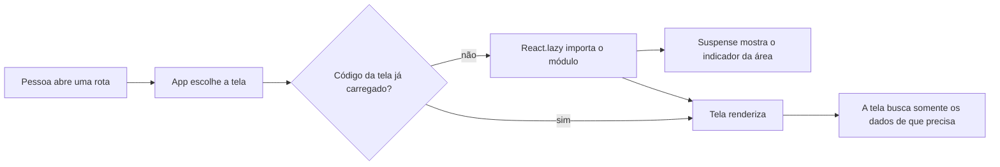
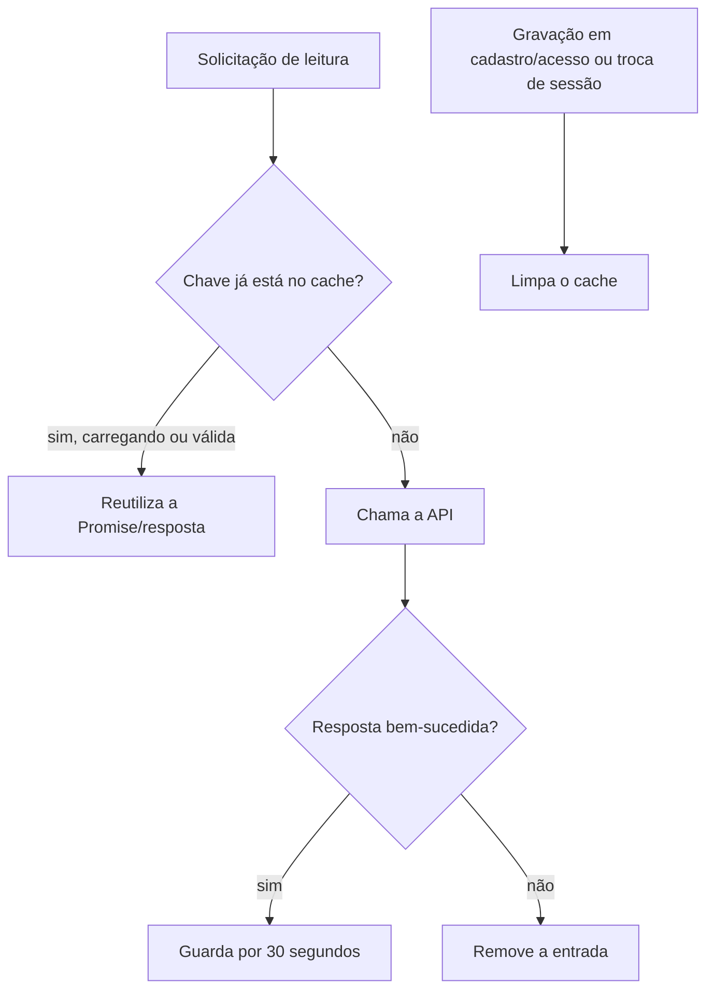

# Relatório técnico: alterações e otimizações do Portal de Logística

**Atualizado em:** 26/10/2026  
**Escopo:** mudanças presentes no workspace e fatos de staging confirmados nesta conversa. Este relatório não significa que as alterações locais já foram publicadas.

## 1. Situação confirmada

- A API de staging está na EC2, atrás do Nginx do BI. A rota `https://api-bi.vilarejosolucoes.com.br/logistica-staging/health` respondeu `200 OK` e encaminhou para o container de Logística na porta `8081`.
- O teste `scripts.check_staging_db` confirmou a conexão com `vilarejo_bi_logistica_staging` e informou que não alterou dados. O diagnóstico exibiu apenas o resultado sanitizado; nenhuma credencial deve ser registrada aqui.
- Depois de configurar a origem da Vercel em `CORS_ALLOWED_ORIGINS`, foi confirmado que o login funcionou e a sessão persistiu no navegador.
- Para compartilhar o frontend, a intenção é usar o domínio/alias estável do projeto Vercel, e não o endereço exclusivo de cada deploy com identificador variável. Assim, o valor de CORS e a URL usada pela equipe não precisam mudar a cada publicação.
- Ainda não existe banco de produção. A base compartilhada de staging permite testar o Portal, mas qualquer entrega enviada pelo formulário é uma gravação real no banco de staging.
- A conta de Vyctor e os cadastros oficiais ainda precisam ser confirmados/cadastrados em staging. “Desativar usuário” é uma exclusão lógica: preserva histórico e auditoria.
- As alterações deste relatório que aparecem como modificadas no Git ainda precisam ser revisadas, commitadas e publicadas. A Vercel só mostra as mudanças do frontend depois de um novo deploy; a API só muda depois do fluxo de deploy do backend.

O checklist de retomada foi atualizado para refletir os testes da rota HTTPS e do banco em [pendencias-para-retomada.md](./pendencias-para-retomada.md). Esse arquivo ainda contém etapas antigas de infraestrutura em seções posteriores; a decisão atual de staging é usar o Nginx e o domínio do BI com `/logistica-staging/`, sem criar um ALB ou DNS novos para essa rota.

## 2. O que foi implementado

### 2.1 Edição da identidade de usuários

A área administrativa permite editar o nome completo e o nome de usuário de uma conta. A API normaliza o usuário para minúsculas, remove espaços duplicados do nome, valida os caracteres permitidos e recusa um nome de usuário que já pertença a outra conta. O serviço também confere a hierarquia administrativa e registra os valores alterados na auditoria.

Não se apaga fisicamente uma conta. A ação “Desativar” impede novos acessos e preserva concessões e histórico. Isso mantém referências de auditoria e de lançamentos íntegros. A senha continua sendo tratada pelas ações separadas de redefinição.

### 2.2 Abertura mais rápida do formulário de entrega

Antes, a tela de novo lançamento esperava uma única `Promise.all` com localidades, motoristas, ajudantes, motivos e, na edição, os dados do rascunho. Uma resposta lenta mantinha a página inteira no estado de carregamento.

Agora, ao criar uma entrega, a página e o formulário aparecem imediatamente. As quatro consultas de catálogo começam em paralelo e cada lista é colocada no formulário quando sua própria resposta chega. `Promise.allSettled` é usado apenas para saber quando terminaram as tentativas e exibir eventual erro; ele não bloqueia a renderização inicial.

Na edição, o rascunho continua sendo carregado antes de exibir o formulário porque os campos precisam dos dados que serão editados. As listas de catálogo carregam ao mesmo tempo e não prolongam essa espera. Se alguma lista falhar, o formulário continua visível e mostra o erro para a pessoa poder tentar novamente.

### 2.3 Cadastros e usuários sob demanda

A página de administração já abre sua estrutura visual sem esperar todas as listas. Agora, ela também evita buscar dados de seções que ainda não foram abertas:

- Ao abrir **Cadastros operacionais**, busca somente a aba selecionada: lojas, equipe ou motivos.
- Ao mudar de aba, busca aquela lista. Se já foi carregada e a tela continua aberta, reutiliza os dados em memória.
- Ao abrir **Usuários e acessos**, busca a lista de usuários, sem aguardar perfis e opções de escopo que não são necessários para ler a tabela.
- Perfis e opções de setor/loja só são consultados ao abrir o cadastro de uma conta ou ao iniciar a concessão de um acesso.
- Os acessos concedidos de uma conta só são consultados ao abrir “Acessos” naquela linha.
- As permissões detalhadas de um perfil são consultadas depois que o perfil é selecionado.

Assim, a tabela de usuários não fica esperando chamadas que só são usadas em formulários. Os indicadores ainda não carregados mostram `—`, em vez de iniciar consultas adicionais somente para preencher números de resumo.

### 2.4 Menos chamadas repetidas de leitura

Foi criado um cache em memória no navegador para leituras específicas de catálogos e administração. Ele reduz chamadas duplicadas quando várias partes da tela pedem a mesma lista e quando a pessoa navega entre telas em pouco tempo.

O cache não substitui o banco nem grava dados no navegador. Ele mantém a `Promise` da solicitação enquanto ela está em andamento, então pedidos simultâneos com a mesma chave compartilham uma única chamada. Quando a resposta chega com sucesso, o resultado fica reutilizável por 30 segundos. Se a solicitação falha, a entrada é removida para que a próxima tentativa faça uma nova chamada.

As alterações em cadastros e controle de acesso limpam o cache após uma gravação bem-sucedida. Login, logout, atualização da identidade e respostas `401` também limpam o cache para que dados privados não atravessem sessões. O modo de demonstração pula esse cache e continua usando suas funções locais, preservando a atualização imediata dos dados falsos.

## 3. Como o fluxo ficou

### Navegação e carregamento de código



`App.tsx` usa importação dinâmica para as telas. O código do Painel, Auditoria, Feedback, Histórico, Cadastros e Entregas não precisa entrar todo no primeiro carregamento. O `Suspense` apresenta um estado curto enquanto o módulo da rota é baixado. Depois disso, cada tela administra os próprios dados.

### Cache dos dados



As chaves são explícitas. Por exemplo, as localidades da área operacional têm chave própria da API de catálogos, enquanto a lista administrativa usa a API e a forma de resposta do módulo de administração. Não se deve supor que qualquer resposta HTTP ou qualquer dado do portal está em cache.

## 4. O que foi medido e o que isso significa

Os tempos que vocês trouxeram antes destas alterações incluíam solicitações no navegador como `/api/v1/pessoas` entre aproximadamente 160 e 404 ms, `/api/v1/motivos` até cerca de 417 ms e `/api/v1/localidades` até cerca de 284 ms. A captura também mostrou várias chamadas repetidas para os mesmos catálogos.

Para o Painel, foi observado no navegador `/api/v1/analytics/dashboard` em 2.570 ms. Em uma execução de backend posterior, o endpoint terminou em 195,69 ms; o passo mais lento registrado nessa execução foi `teams`, em 66,45 ms. Esses registros não são o mesmo `request_id`, então a comparação não prova, sozinha, onde ocorreu a diferença. Ela sugere que a espera do navegador pode incluir rede, proxy, inicialização ou outro tempo fora da consulta do backend. Para separar essas partes com precisão, compare uma única chamada usando o mesmo `X-Request-ID` no navegador e nos logs.

Na medição do navegador, os arquivos estáticos observados foram mais curtos que a espera de algumas APIs. Isso aponta para as chamadas e a ordem de carregamento como alvos mais prováveis do que uma troca de biblioteca de interface. A otimização atual reduz chamadas desnecessárias e tira as respostas de catálogo do caminho que bloqueava a tela; ela ainda precisa ser medida de novo depois do deploy.

### Revisão das outras telas

- **Histórico:** precisa buscar a página atual de entregas e as localidades para os filtros. O detalhe e os eventos de uma entrega são buscados quando a pessoa abre aquela ação; não precisam ser carregados para todas as linhas logo de início.
- **Feedback:** a lista e as localidades alimentam a tela e seus filtros. Os itens de entrega usados no formulário são buscados depois que a pessoa abre o formulário e escolhe data/localidade.
- **Painel gerencial:** precisa buscar os indicadores do período e as localidades permitidas para filtrar. A API do Painel não é consultada ao abrir outras rotas.
- **Auditoria:** busca eventos quando a pessoa entra nessa área; não carrega a auditoria na abertura do portal.
- **Entregas:** as listas são necessárias para escolher loja, motorista, ajudante e motivo. A tela agora aparece antes de terminar essa busca, e as chamadas são compartilhadas com o cache quando outra tela as pediu recentemente.

Pelo código revisado, as outras páginas já são abertas sob demanda por rota e mostram a estrutura/filtros enquanto os dados da própria área chegam. Não havia uma chamada de Dashboard, Auditoria ou Feedback sendo feita por todas as páginas que justificasse removê-la.

## 5. Arquivo por arquivo

### Backend

- `backend/app/modules/access_control/models.py` — declara os modelos e restrições do controle de acesso. A lista de eventos válidos agora inclui `USUARIO_ATUALIZADO`; a restrição de banco/ORM precisa aceitar esse evento para a edição ser auditada.
- `backend/app/modules/access_control/repository.py` — concentra consultas ao banco do módulo. `username_is_taken` verifica duplicidade ignorando maiúsculas/minúsculas e excluindo a própria conta editada.
- `backend/app/modules/access_control/router.py` — expõe os endpoints do módulo. Adiciona `PATCH /access/users/{id_usuario}/identity`, protegido pela autenticação, CSRF e regra de administração existente.
- `backend/app/modules/access_control/schemas.py` — valida os formatos de entrada e saída. O novo schema aceita atualização de identidade, normaliza nome/usuário e rejeita campos extras, nulos inválidos ou caracteres fora da regra.
- `backend/app/modules/access_control/service.py` — executa a regra de negócio. Busca a conta para atualização, verifica hierarquia administrativa, trata colisões de usuário, grava a alteração e registra o evento de auditoria dentro da transação.
- `backend/app/modules/auth/router.py` — implementa o bootstrap de sessão em `/auth/session`, que devolve identidade, permissões, escopos e token CSRF em uma chamada. A resposta de login também passa a incluir a identidade completa, evitando uma chamada posterior a `/me`.
- `backend/app/modules/auth/schemas.py` — define os contratos dessas respostas. `SessionBootstrapResponse` reutiliza o formato de identidade e acrescenta o CSRF; `LoginResponse` herda esse formato.

### Frontend

- `frontend/src/app/App.tsx` — liga as rotas às páginas. As páginas são carregadas com `React.lazy` e exibem um fallback com `Suspense` enquanto o módulo específico chega.
- `frontend/src/app/providers.tsx` — mantém identidade, permissões e estado de autenticação. Usa o bootstrap novo para restaurar a sessão e limpa o cache privado em login, logout e atualização da identidade.
- `frontend/src/features/auth/api.ts` — faz as chamadas de autenticação. O login agora usa a identidade retornada pelo próprio endpoint; a restauração usa `/auth/session` em vez de buscar `/me` e CSRF separadamente.
- `frontend/src/features/auth/types.ts` — define tipos TypeScript de usuário, permissões, escopos e sessão. O tipo de resposta de login agora compartilha a forma de `MeResponse` e token CSRF.
- `frontend/src/features/administration/api.ts` — concentra chamadas de cadastros e usuários. As leituras escolhidas passam pelo cache; o modo de demonstração continua chamando diretamente a API local de demonstração. Também liga a edição do usuário ao novo endpoint.
- `frontend/src/features/administration/demoApi.ts` — simula as ações administrativas na prévia de demonstração. A edição de identidade normaliza os valores e detecta nomes de usuário duplicados sem usar a API real.
- `frontend/src/features/administration/pages/RegistriesPage.tsx` — compõe a tela de cadastros, usuários e acessos. Faz carregamento por aba, separa a tabela de usuários das opções necessárias apenas para formulários, exibe erros/repetição e apresenta a edição de nome e usuário.
- `frontend/src/features/catalogs/api.ts` — concentra leituras compartilhadas de setores, localidades, pessoas e motivos. Usa cache de 30 segundos no modo conectado e contorna o cache no modo de demonstração.
- `frontend/src/features/deliveries/pages/DeliveryLaunchPage.tsx` — carrega os catálogos e abre o formulário de nova entrega sem esperar as quatro listas. Na edição, aguarda o rascunho, mas carrega as opções em paralelo.
- `frontend/src/shared/api/apiClient.ts` — centraliza requisições HTTP, cookies, CSRF e tratamento de erros. Limpa o cache após alterações em cadastros/acessos e diante de `401`.
- `frontend/src/shared/api/requestCache.ts` — novo utilitário pequeno que compartilha chamadas em andamento e guarda respostas bem-sucedidas por 30 segundos em memória.

### Documentação do modelo e da operação

- `backend/migrations/README.md` — registra que a cadeia Alembic do catálogo compartilhado é administrada no repositório VilarejoBI. O texto cita a revisão `c9b61a2f4d80` para habilitar auditoria de alterações de identidade; esse arquivo de migration não pertence a este repositório do Portal e precisa estar confirmado na cadeia do VilarejoBI antes de aplicar em staging/produção.
- `docs/modelo_operacional_lancamento_logistica.dbml` — espelha o modelo e os eventos auditáveis, incluindo agora `USUARIO_ATUALIZADO`.
- `docs/pendencias-para-retomada.md` — registra as validações de staging informadas pelo usuário e a decisão de usar a rota existente do Nginx do BI.
- `docs/relatorio-tecnico-alteracoes-e-otimizacoes.md` — este relatório.

## 6. React ou HTML, CSS e JavaScript sem framework?

Trocar React por HTML, CSS e JavaScript puro provavelmente não resolveria a lentidão que foi medida. A maior espera observada estava em respostas de API no navegador e em listas buscadas antes de a tela aparecer. Um código JavaScript sem framework continuaria fazendo as mesmas chamadas, atravessando o mesmo proxy e consultando o mesmo banco. O que corrige esse caminho é reduzir chamadas redundantes, buscar dados no momento certo, mostrar a interface antes das respostas não essenciais e medir API/rede separadamente — que são as mudanças feitas aqui.

JavaScript puro pode reduzir o peso de runtime em algumas páginas pequenas, mas não é garantia de renderização mais rápida e obrigaria a reimplementar roteamento, formulários, estado, validação e atualizações de tela que React já organiza. No próprio portal, os módulos de rota já são carregados sob demanda. A medição citada não mostrou um bloqueio de renderização da interface que justificasse reescrever o produto.

O próximo passo técnico sensato é publicar estas alterações e comparar a mesma navegação no Network/Performance, correlacionando o `X-Request-ID` do navegador com os logs do backend. Se depois disso o painel de Performance mostrar tarefas longas de JavaScript ou commits React caros, use o Profiler e otimize esses componentes localmente. A documentação oficial descreve [carregamento sob demanda com `lazy`](https://react.dev/reference/react/lazy), [medição de renderizações com o Profiler](https://react.dev/reference/react/Profiler) e [hooks de otimização](https://react.dev/reference/react/hooks). O [Performance API do navegador](https://developer.mozilla.org/en-US/docs/Web/API/Performance_API/Performance_data) ajuda a separar tempo de recurso e rede.

## 7. Plano geral do projeto

O objetivo imediato é entregar um **staging confiável para o gestor testar**, com usuário e cadastros aprovados, sem misturar dados de produção. A produção vem depois, porque o banco de produção ainda não existe.

### Estado resumido

| Item | Estado conhecido |
|---|---|
| API de staging e rota `/logistica-staging/health` pelo Nginx do BI | Confirmado com HTTP 200 |
| Conexão do backend à base `vilarejo_bi_logistica_staging` | Confirmada por `scripts.check_staging_db`; a checagem não gravou dados |
| CORS, login e persistência de sessão na prévia | Login e sessão confirmados depois do ajuste de CORS |
| Código local descrito neste relatório | Ainda precisa de revisão, CI/build e publicação |
| Revisão `c9b61a2f4d80` para auditar mudanças de identidade | Migration já commitada e enviada no VilarejoBI; confirmar/aplicar no banco de staging antes de testar edição |
| Conta de Vyctor e listas oficiais | Confirmar perfil/escopo e cadastrar em staging |
| Banco e infraestrutura de produção | Ainda não provisionados |

### Sequência recomendada para concluir o staging

1. **Revisar o workspace e separar as mudanças em commits claros.** Há alterações de backend, frontend, autenticação, edição de usuário e otimização. Conferir o diff completo e separar os commits por assunto para facilitar revisão e reversão.
2. **Validar a migration no repositório VilarejoBI.** A migration que habilita `USUARIO_ATUALIZADO` precisa estar presente na cadeia compartilhada e aplicada ao catálogo de staging antes de a API gravar esse novo evento. Confirmar a revisão atual antes de qualquer `upgrade`; não rodar migration no startup do container.
3. **Rodar as verificações do projeto antes de publicar.** Executar a CI e os testes de backend existentes, fazer o build do frontend e corrigir falhas. O teste de conectividade de RDS já foi confirmado separadamente; ele não substitui os testes do código.
4. **Publicar backend e frontend de staging.** Enviar os commits para a branch `staging`; executar o workflow da API para gerar/publicar a imagem se houver mudanças de backend, e aguardar a Vercel gerar a prévia do frontend. Conferir que ambos estão usando o ambiente de staging.
5. **Confirmar acesso externo à prévia.** Usar o domínio/alias estável do projeto Vercel. Conferir que a proteção de deploy da Vercel permite a entrada das pessoas convidadas sem exigir conta da equipe Vercel, se esse for o modo de acesso desejado. Confirmar que `VITE_API_BASE_URL` aponta para a rota HTTPS do proxy e que `CORS_ALLOWED_ORIGINS` contém a origem exata do alias.
6. **Preparar a conta do gestor.** Confirmar com Vyctor o perfil e os escopos necessários antes de criar a conta. Entregar a senha inicial por canal privado; não usar a conta DEV como conta operacional do gestor.
7. **Inserir os dados aprovados.** Cadastrar as lojas/filiais, motoristas, ajudantes e motivos que o gestor vai testar. Conferir códigos, nomes e localidades com a fonte oficial. Se ainda não houver lista aprovada, usar apenas dados sintéticos e identificá-los claramente como teste.
8. **Fazer o aceite funcional no navegador, com dados de teste.** Conferir login, atualização/reabertura de sessão, logout, formulário vazio, criação/edição de rascunho, validações e confirmação de entrega, histórico, feedback, painel, auditoria e permissões por perfil/escopo. Enviar uma entrega de teste grava dados no banco de staging; registrar quais foram criadas e usar o fluxo de cancelamento/correção previsto pelo sistema para tratá-las.
9. **Repetir a medição de desempenho.** Depois do deploy, medir a mesma sequência no Network/Performance: entrar no portal, abrir Lançar Entrega, abrir Cadastros/Usuários e acessar o Painel. Comparar com os números anteriores e correlacionar cada chamada lenta pelo mesmo `X-Request-ID` nos logs da API. Só então decidir se falta otimizar frontend, proxy, consultas ou banco.
10. **Registrar o aceite do gestor e as pendências restantes.** Ajustes de processo ou de dados encontrados por Vyctor devem virar itens separados, com prioridade e responsável, antes de liberar dados reais.

### Preparação de produção — etapa separada

1. Provisionar um banco/catálogo de produção independente de staging e do BI, com credencial de runtime própria e privilégio mínimo.
2. Definir domínio estável e HTTPS para o frontend e para a API de produção, regras de rede, CORS, cookies, secrets e acesso de deploy.
3. Aplicar migrations de forma revisada no banco novo, conferir backup e restauração, logs/alertas e processo de rollback.
4. Configurar as variáveis **Production** da Vercel sem reaproveitar valores de Preview; revisar controles de acesso públicos antes da liberação.
5. Integrar a versão aprovada de staging em `main`, publicar backend e frontend de produção e repetir os fluxos de aceite com um conjunto pequeno e aprovado de usuários.
6. Liberar dados reais somente depois de confirmar retenção de dados de clientes, política de acesso, suporte operacional e responsáveis por monitoramento.

**Critério de conclusão do staging:** versão atual publicada, migration necessária confirmada, Vyctor com perfil correto, cadastros de teste/aprovados disponíveis, fluxos principais aceitos e medições pós-deploy registradas. **Critério de produção:** todos os itens de produção acima concluídos com banco e infraestrutura próprios.

## 8. Push recomendado para hoje

### Repositório do Portal

O workspace `LancamentoLogistica` está na branch `staging`, sincronizada com `origin/staging`, com **20 arquivos modificados e 2 novos arquivos não rastreados**. Eles cobrem a edição de identidade de usuários, o bootstrap de sessão, o carregamento sob demanda, o cache de leituras e a documentação. Depois de revisar `git diff`, a publicação recomendada é um commit na branch `staging`:

```bash
git add -- \
  backend/app/modules/access_control/models.py \
  backend/app/modules/access_control/repository.py \
  backend/app/modules/access_control/router.py \
  backend/app/modules/access_control/schemas.py \
  backend/app/modules/access_control/service.py \
  backend/app/modules/auth/router.py \
  backend/app/modules/auth/schemas.py \
  backend/migrations/README.md \
  docs/modelo_operacional_lancamento_logistica.dbml \
  docs/pendencias-para-retomada.md \
  docs/relatorio-tecnico-alteracoes-e-otimizacoes.md \
  frontend/src/app/App.tsx \
  frontend/src/app/providers.tsx \
  frontend/src/features/administration/api.ts \
  frontend/src/features/administration/demoApi.ts \
  frontend/src/features/administration/pages/RegistriesPage.tsx \
  frontend/src/features/auth/api.ts \
  frontend/src/features/auth/types.ts \
  frontend/src/features/catalogs/api.ts \
  frontend/src/features/deliveries/pages/DeliveryLaunchPage.tsx \
  frontend/src/shared/api/apiClient.ts \
  frontend/src/shared/api/requestCache.ts
git commit -m "feat: editar usuários e otimizar carregamento"
git push origin staging
```

O push aciona a CI do Portal; se ela passar, a Vercel gera a prévia da branch. O push **não** publica sozinho a imagem da API na EC2: o workflow `Deploy Portal API to Staging` é manual (`workflow_dispatch`) e deve ser executado depois da CI. Como o backend novo grava `USUARIO_ATUALIZADO`, confirmar/aplicar a migration `c9b61a2f4d80` no banco de staging antes de testar essa ação.

### Repositório VilarejoBI

A migration `c9b61a2f4d80_allow_user_identity_update_audit.py` já está commitada em `72ced8a` e `origin/logistica` está no mesmo commit. **Não há push adicional necessário nesse repositório hoje para essa migration.** O workspace do VilarejoBI contém muitas outras alterações locais sem relação com este deploy; não as adicionar nem enviar junto. A migration ainda precisa ser conferida no banco de staging, tomando cuidado para selecionar a configuração/catálogo corretos.

Não enviar mudanças para `main` nem fazer deploy de produção. A base de produção ainda não foi provisionada.

**Verificação desta rodada:** não foram executados build, testes ou deploy. As alterações foram revisadas por inspeção do código e do diff; a confirmação de comportamento depende das verificações e publicação descritas acima.
